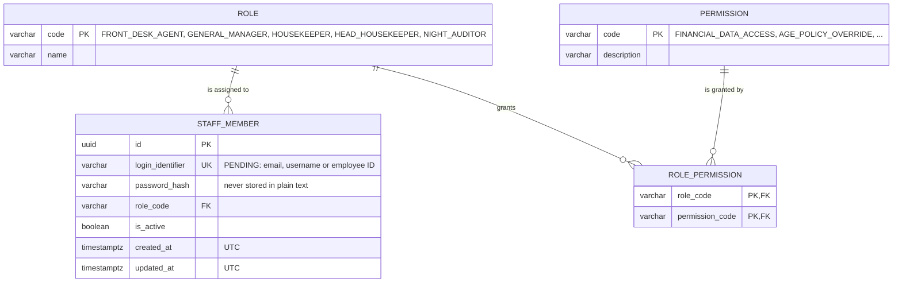
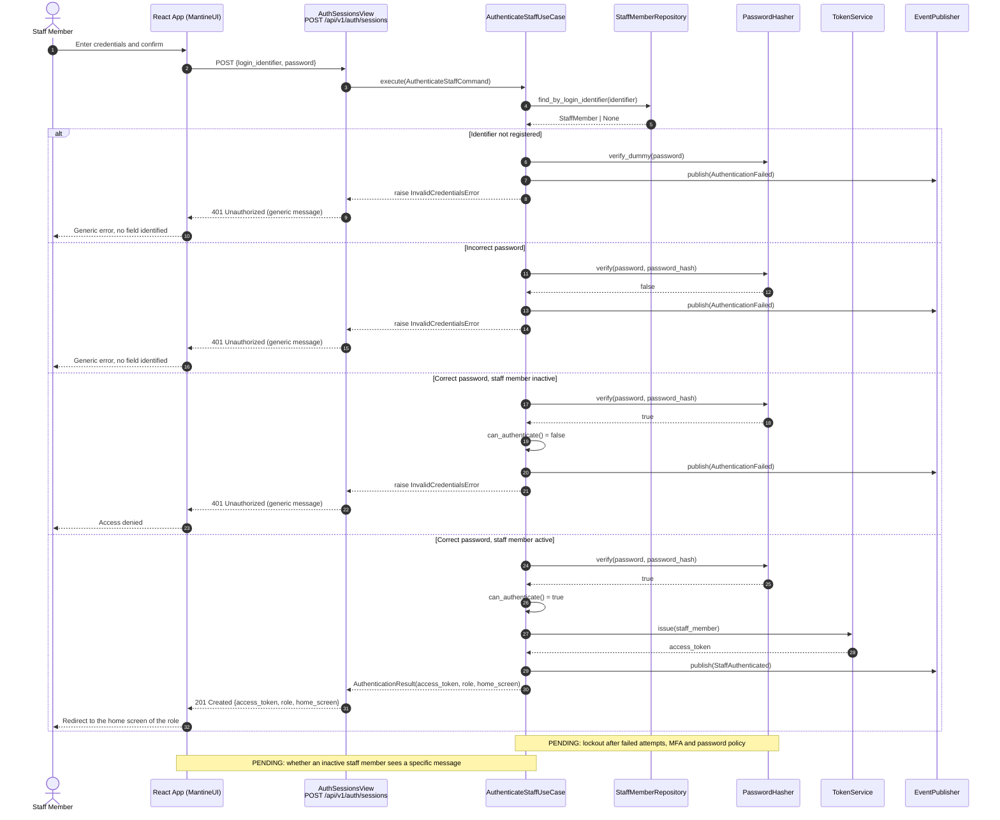
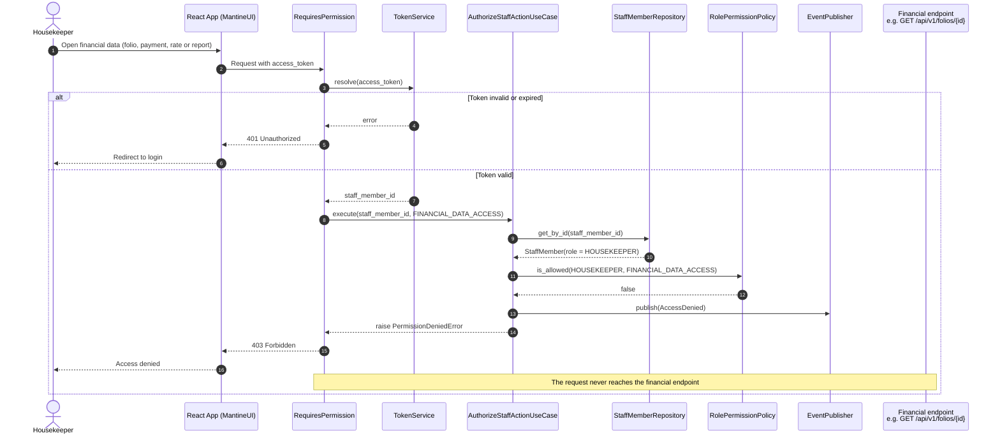

# US-01 — Staff Authentication and Role-Based Access: Diagrams

> Sources: `US-01-staff-authentication-and-role-based-access.md`, `docs/Business Modeling/Business Modeling.md`, `CLAUDE.md`.
> Elements tagged **PENDING** depend on business rules not defined yet. They are placeholders in the design, not decisions.

---

## 1. Class Diagram (Clean Architecture)

Dependencies point inward: Interface → Application → Domain. Infrastructure implements the Application ports.

```mermaid
classDiagram
    direction LR

    namespace Domain {
        class StaffMember {
            <<Entity / Aggregate Root>>
            -StaffMemberId id
            -LoginIdentifier login_identifier
            -PasswordHash password_hash
            -Role role
            -bool is_active
            +can_authenticate() bool
            +has_permission(permission: Permission) bool
        }
        class StaffMemberId {
            <<Value Object>>
            +UUID value
        }
        class LoginIdentifier {
            <<Value Object>>
            +str value
            %% PENDING: email, username or employee ID
        }
        class PasswordHash {
            <<Value Object>>
            +str value
        }
        class Role {
            <<Enumeration>>
            FRONT_DESK_AGENT
            GENERAL_MANAGER
            HOUSEKEEPER
            HEAD_HOUSEKEEPER
            NIGHT_AUDITOR
        }
        class Permission {
            <<Enumeration>>
            FINANCIAL_DATA_ACCESS
            AGE_POLICY_OVERRIDE
            %% PENDING: complete permission matrix
        }
        class RolePermissionPolicy {
            <<Domain Service>>
            +permissions_for(role: Role) set~Permission~
            +is_allowed(role: Role, permission: Permission) bool
        }
        class StaffAuthenticated {
            <<Domain Event>>
            +StaffMemberId staff_member_id
            +Role role
            +datetime occurred_at_utc
        }
        class AuthenticationFailed {
            <<Domain Event>>
            +str attempted_identifier
            +datetime occurred_at_utc
        }
        class AccessDenied {
            <<Domain Event>>
            +StaffMemberId staff_member_id
            +Permission permission
            +datetime occurred_at_utc
        }
        class InvalidCredentialsError {
            <<Domain Exception>>
        }
        class PermissionDeniedError {
            <<Domain Exception>>
        }
    }

    namespace Application {
        class AuthenticateStaffUseCase {
            <<Use Case>>
            +execute(command: AuthenticateStaffCommand) AuthenticationResult
        }
        class AuthorizeStaffActionUseCase {
            <<Use Case>>
            +execute(staff_member_id: StaffMemberId, permission: Permission) None
        }
        class AuthenticateStaffCommand {
            <<DTO>>
            +str login_identifier
            +str password
        }
        class AuthenticationResult {
            <<DTO>>
            +str access_token
            +Role role
            +str home_screen
        }
        class StaffMemberRepository {
            <<Port>>
            +find_by_login_identifier(identifier: LoginIdentifier) StaffMember | None
            +get_by_id(staff_member_id: StaffMemberId) StaffMember
        }
        class PasswordHasher {
            <<Port>>
            +verify(raw_password: str, password_hash: PasswordHash) bool
            +verify_dummy(raw_password: str) None
        }
        class TokenService {
            <<Port>>
            +issue(staff_member: StaffMember) str
            +resolve(token: str) StaffMemberId
        }
        class EventPublisher {
            <<Port>>
            +publish(event: DomainEvent) None
        }
        class Clock {
            <<Port>>
            +now_utc() datetime
        }
    }

    namespace Infrastructure {
        class DjangoStaffMemberRepository {
            <<Adapter>>
        }
        class DjangoPasswordHasher {
            <<Adapter>>
        }
        class TokenServiceAdapter {
            <<Adapter>>
            %% PENDING: session timeout
        }
        class InProcessEventPublisher {
            <<Adapter>>
        }
        class SystemClock {
            <<Adapter>>
        }
    }

    namespace Interface {
        class AuthSessionsView {
            <<REST Controller>>
            +post(request) Response
        }
        class RequiresPermission {
            <<Authorization Guard>>
            +check(request, permission: Permission) None
        }
    }

    StaffMember *-- StaffMemberId
    StaffMember *-- LoginIdentifier
    StaffMember *-- PasswordHash
    StaffMember --> Role
    RolePermissionPolicy ..> Role
    RolePermissionPolicy ..> Permission
    StaffMember ..> RolePermissionPolicy : delegates permission check

    AuthenticateStaffUseCase ..> AuthenticateStaffCommand
    AuthenticateStaffUseCase ..> AuthenticationResult
    AuthenticateStaffUseCase --> StaffMemberRepository
    AuthenticateStaffUseCase --> PasswordHasher
    AuthenticateStaffUseCase --> TokenService
    AuthenticateStaffUseCase --> EventPublisher
    AuthenticateStaffUseCase --> Clock
    AuthenticateStaffUseCase ..> StaffAuthenticated : emits
    AuthenticateStaffUseCase ..> AuthenticationFailed : emits
    AuthenticateStaffUseCase ..> InvalidCredentialsError : raises

    AuthorizeStaffActionUseCase --> StaffMemberRepository
    AuthorizeStaffActionUseCase --> EventPublisher
    AuthorizeStaffActionUseCase ..> AccessDenied : emits
    AuthorizeStaffActionUseCase ..> PermissionDeniedError : raises

    DjangoStaffMemberRepository ..|> StaffMemberRepository
    DjangoPasswordHasher ..|> PasswordHasher
    TokenServiceAdapter ..|> TokenService
    InProcessEventPublisher ..|> EventPublisher
    SystemClock ..|> Clock

    AuthSessionsView --> AuthenticateStaffUseCase
    RequiresPermission --> TokenService
    RequiresPermission --> AuthorizeStaffActionUseCase
```

### Design notes
- **One role per staff member**, following the personas of the business document. PENDING: whether Head Housekeeper is a separate role or a permission granted to a Housekeeper, which may turn this into a one-to-many relationship.
- **Known permissions only:** `FINANCIAL_DATA_ACCESS` (folios, payments, rates, reports — denied to Housekeeper and Head Housekeeper) and `AGE_POLICY_OVERRIDE` (management only, US-17). The rest of the matrix is PENDING.
- **`verify_dummy`** runs a hash check when the identifier does not exist, so response time does not reveal whether an identifier is registered (Scenario 2: no field is identified as incorrect).
- **`InProcessEventPublisher`** keeps the domain independent of the broker. RabbitMQ can replace the adapter later without touching the domain or use cases.
- **`Clock`** is a port so that timestamps are always UTC and tests are deterministic.

---

## 2. ER Diagram (PostgreSQL persistence)

### Design notes
- `ROLE_PERMISSION` holds the permission matrix as data, so completing it (PENDING) needs no schema change.
- All timestamps are `timestamptz` and stored in UTC (Business Modeling, Section 4).
- **Not modelled until defined:**
  - staff ↔ property access (US-03): would add a `STAFF_PROPERTY_ACCESS` table;
  - lockout after failed attempts: would add attempt counters or an attempt table;
  - MFA: would add a factor table;
  - audit trail of authentication events: would add an `AUTHENTICATION_EVENT` table.

---

## 3. Event Flow

### 3.1 Login — Scenarios 1 and 2

### 3.2 Authorization — Scenario 3 (Housekeeper and financial data)

### 3.3 Domain events

| Event | Emitted by | When | Payload |
|---|---|---|---|
| `StaffAuthenticated` | `AuthenticateStaffUseCase` | Active staff member authenticated | `staff_member_id`, `role`, `occurred_at_utc` |
| `AuthenticationFailed` | `AuthenticateStaffUseCase` | Unknown identifier, wrong password or inactive staff member | `attempted_identifier`, `occurred_at_utc` |
| `AccessDenied` | `AuthorizeStaffActionUseCase` | Role lacks the required permission | `staff_member_id`, `permission`, `occurred_at_utc` |

Consumers (e.g., lockout counter, audit log) are PENDING until the related rules are defined.
