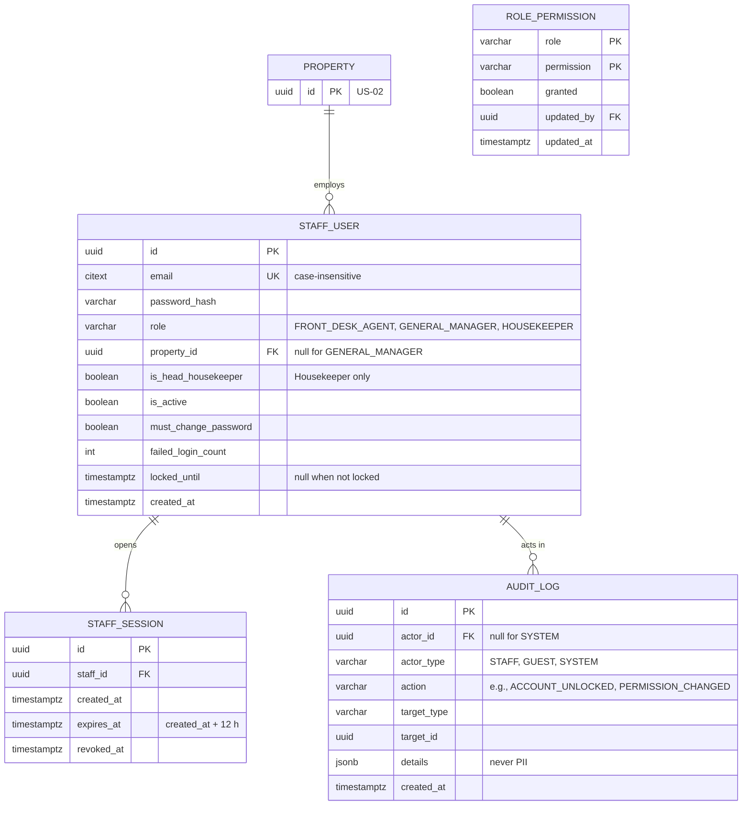
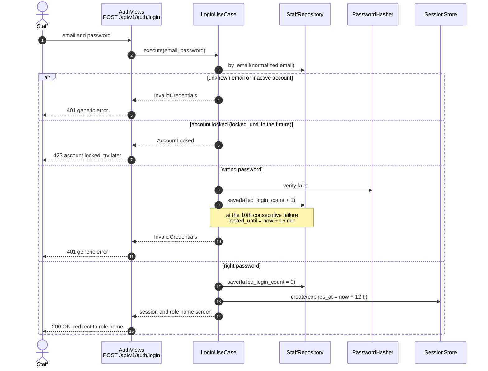
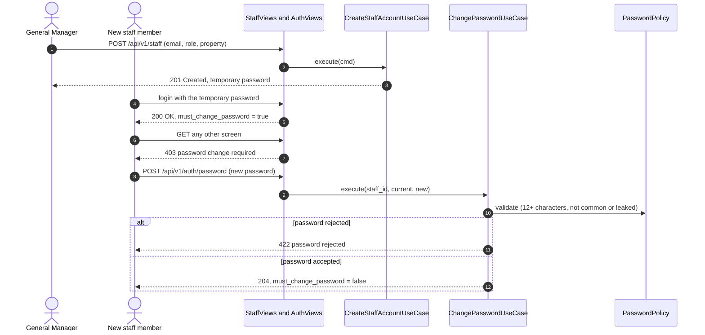
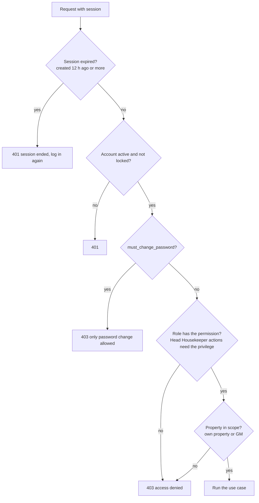

# US-01 — Staff Authentication and Role-Based Access: Diagrams

> Source: `US-01-staff-authentication-and-role-based-access.md`. Every element below traces to a rule of that story.

## Business rules reflected

| Rule (US-01) | Where it appears |
|---|---|
| Roles: Front Desk Agent, General Manager/Owner, Housekeeper | `Role` enum, `STAFF_USER.role` |
| Head Housekeeper is a privilege granted by the GM, not a role | `StaffUser.is_head_housekeeper`, `GrantHeadHousekeeperUseCase` |
| Night Audit is a system process, not a role | No role or account for it |
| Login with a unique, case-insensitive email | `EmailAddress` value object, `STAFF_USER.email` (`citext`, unique) |
| Password ≥ 12 characters, common and leaked passwords rejected | `PasswordPolicy`, `BreachedPasswordChecker` port |
| 10 consecutive failures → 15-minute lockout; GM can unlock; success resets the counter | `LoginAttemptPolicy`, `UnlockAccountUseCase`, sequence 3.1 |
| Session expires 12 hours after login, regardless of activity | `StaffSession.expires_at`, sequence 3.3 |
| GM creates, edits, deactivates accounts; temporary password changed at first login | `CreateStaffAccountUseCase`, `must_change_password`, sequence 3.2 |
| Inactive staff cannot log in | `StaffUser.can_log_in()` |
| One property per staff member; GM has access to all | `STAFF_USER.property_id` (null for GM), `PropertyScope` |
| Permission matrix per role, editable by the GM (default matrix in US-01) | `ROLE_PERMISSION`, `UpdatePermissionMatrixUseCase` |
| Housekeepers can never receive financial access | `PermissionMatrix.FINANCIAL` guard |
| GM cannot remove their own settings and permissions access | `PermissionMatrix.LOCKED_FOR_GM` guard |
| Only the GM performs the age-policy override | `Permission.AGE_OVERRIDE` locked to GM |

---

## 1. Class Diagram (Clean Architecture)

```mermaid
classDiagram
    direction LR

    namespace Domain {
        class Role {
            <<Enumeration>>
            FRONT_DESK_AGENT
            GENERAL_MANAGER
            HOUSEKEEPER
        }
        class Permission {
            <<Enumeration>>
            FRONT_DESK_WORK
            HOUSEKEEPING_BOARD
            HEAD_HOUSEKEEPER_ACTIONS
            GUEST_PROFILES
            NIGHT_AUDIT_REPORT
            FINANCIAL_REPORTS
            AGE_OVERRIDE
            SETTINGS
        }
        class EmailAddress {
            <<Value Object>>
            +str normalized
            +from_raw(raw) EmailAddress
        }
        class StaffUser {
            <<Aggregate Root>>
            +StaffId id
            +EmailAddress email
            +Role role
            +PropertyId property_id
            +bool is_head_housekeeper
            +bool is_active
            +bool must_change_password
            +int failed_login_count
            +datetime locked_until
            +can_log_in(now) bool
            +register_failed_login(now, policy) None
            +register_successful_login() None
            +unlock() None
            +change_password(hash) None
        }
        class StaffSession {
            <<Entity>>
            +SessionId id
            +StaffId staff_id
            +datetime created_at
            +datetime expires_at
            +is_expired(now) bool
        }
        class PermissionMatrix {
            <<Aggregate Root>>
            +dict grants
            +FINANCIAL set~Permission~
            +LOCKED_FOR_GM set~Permission~
            +allows(user, permission) bool
            +set_grant(role, permission, granted) None
        }
        class PasswordPolicy {
            <<Domain Service>>
            +MIN_LENGTH = 12
            +validate(plain, checker) None
        }
        class LoginAttemptPolicy {
            <<Value Object>>
            +MAX_FAILURES = 10
            +LOCK_MINUTES = 15
        }
        class SessionPolicy {
            <<Value Object>>
            +DURATION_HOURS = 12
        }
        class StaffRepository {
            <<Port>>
            +by_email(email) StaffUser
            +get(id) StaffUser
            +save(user) None
        }
        class PermissionMatrixRepository {
            <<Port>>
            +load() PermissionMatrix
            +save(matrix) None
        }
    }

    namespace Application {
        class LoginUseCase {
            +execute(email, password) LoginResult
        }
        class ChangePasswordUseCase {
            +execute(staff_id, current, new) None
        }
        class CreateStaffAccountUseCase {
            +execute(cmd) TemporaryCredentials
        }
        class UpdateStaffAccountUseCase {
            +execute(cmd) None
        }
        class DeactivateStaffAccountUseCase {
            +execute(staff_id) None
        }
        class UnlockAccountUseCase {
            +execute(staff_id) None
        }
        class GrantHeadHousekeeperUseCase {
            +execute(staff_id, granted) None
        }
        class UpdatePermissionMatrixUseCase {
            +execute(actor, role, permission, granted) None
        }
        class AuthorizeRequest {
            <<Application Service>>
            +check(session_id, permission, property_id) StaffUser
        }
        class PasswordHasher {
            <<Port>>
        }
        class BreachedPasswordChecker {
            <<Port>>
            +is_common_or_leaked(plain) bool
        }
        class SessionStore {
            <<Port>>
        }
        class Clock {
            <<Port>>
            +now() datetime
        }
        class AuditLog {
            <<Port>>
            +record(actor, action, target, details) None
        }
    }

    namespace Infrastructure {
        class DjangoStaffRepository
        class DjangoPermissionMatrixRepository
        class Argon2PasswordHasher
        class CommonPasswordListChecker
        class DbSessionStore
        class PostgresAuditLog
    }

    namespace Interface {
        class AuthViews {
            <<REST>>
            POST /api/v1/auth/login
            POST /api/v1/auth/logout
            POST /api/v1/auth/password
        }
        class StaffViews {
            <<REST · GM>>
            /api/v1/staff
            POST /api/v1/staff/id/unlock
        }
        class PermissionViews {
            <<REST · GM>>
            /api/v1/permissions
        }
        class RequiresPermission {
            <<Authorization Guard>>
        }
    }

    StaffUser --> Role
    StaffUser --> EmailAddress
    PermissionMatrix --> Permission
    LoginUseCase --> StaffRepository
    LoginUseCase --> PasswordHasher
    LoginUseCase --> SessionStore
    LoginUseCase --> LoginAttemptPolicy
    LoginUseCase --> SessionPolicy
    LoginUseCase --> Clock
    ChangePasswordUseCase --> PasswordPolicy
    PasswordPolicy ..> BreachedPasswordChecker
    CreateStaffAccountUseCase --> StaffRepository
    UnlockAccountUseCase --> AuditLog
    UpdatePermissionMatrixUseCase --> PermissionMatrixRepository
    AuthorizeRequest --> SessionStore
    AuthorizeRequest --> PermissionMatrixRepository
    DjangoStaffRepository ..|> StaffRepository
    DjangoPermissionMatrixRepository ..|> PermissionMatrixRepository
    Argon2PasswordHasher ..|> PasswordHasher
    CommonPasswordListChecker ..|> BreachedPasswordChecker
    DbSessionStore ..|> SessionStore
    PostgresAuditLog ..|> AuditLog
    AuthViews --> LoginUseCase
    AuthViews --> ChangePasswordUseCase
    StaffViews --> CreateStaffAccountUseCase
    StaffViews --> UnlockAccountUseCase
    PermissionViews --> UpdatePermissionMatrixUseCase
    RequiresPermission --> AuthorizeRequest
```

### Design notes
- **`AuthorizeRequest` checks three things on every request:** the session is not expired (12 hours from login), the role has the permission in the matrix, and the property is in the user's scope (own property, or any property for the GM).
- **Housekeeper financial access:** `PermissionMatrix.set_grant()` rejects granting any permission in `FINANCIAL` to `HOUSEKEEPER`. `FINANCIAL` holds the permissions that expose folios, payments, rates or reports (Scenario 3): `FRONT_DESK_WORK`, `NIGHT_AUDIT_REPORT`, `FINANCIAL_REPORTS` and `SETTINGS`.
- **GM self-protection:** `set_grant()` rejects removing `SETTINGS` from `GENERAL_MANAGER`. `AGE_OVERRIDE` can only be granted to `GENERAL_MANAGER`.
- **Head Housekeeper:** `HEAD_HOUSEKEEPER_ACTIONS` is allowed to a Housekeeper only when `is_head_housekeeper` is true.
- **Generic error:** `LoginUseCase` returns the same error for an unknown email and a wrong password (Scenario 2). A locked account is rejected even with the right password.
- **Temporary password:** while `must_change_password` is true, `AuthorizeRequest` only allows the change-password endpoint (Scenario 5).

---

## 2. ER Diagram

### Design notes
- `ROLE_PERMISSION` is seeded with the default matrix of US-01 and edited by the GM.
- `CHECK (role <> 'GENERAL_MANAGER' OR property_id IS NULL)` and `CHECK (role = 'GENERAL_MANAGER' OR property_id IS NOT NULL)`.
- `CHECK (is_head_housekeeper = false OR role = 'HOUSEKEEPER')`.
- `AUDIT_LOG` is the shared audit table used by the other stories.

---

## 3. Event Flow

### 3.1 Login, failed attempts and lockout — Scenarios 1, 2 and 4

### 3.2 Account creation and first login — Scenario 5

### 3.3 Authorization on every request — Scenarios 3 and 6

### 3.4 Domain events

| Event | Raised when | Consumers |
|---|---|---|
| `StaffLoggedIn` | Successful login | Audit log |
| `StaffAccountLocked` | 10th consecutive failure | Audit log |
| `StaffAccountUnlocked` | GM unlocks the account | Audit log |
| `StaffAccountCreated` / `StaffAccountDeactivated` | GM manages accounts | Audit log, session revocation on deactivation |
| `PermissionMatrixChanged` | GM edits the matrix | Audit log |
| `HeadHousekeeperPrivilegeChanged` | GM grants or removes the privilege | Audit log |
