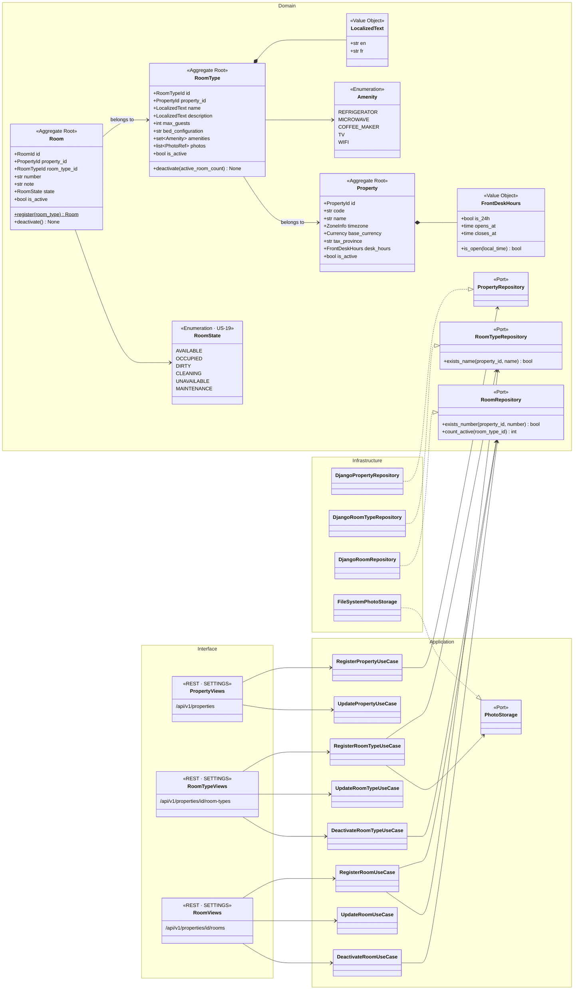
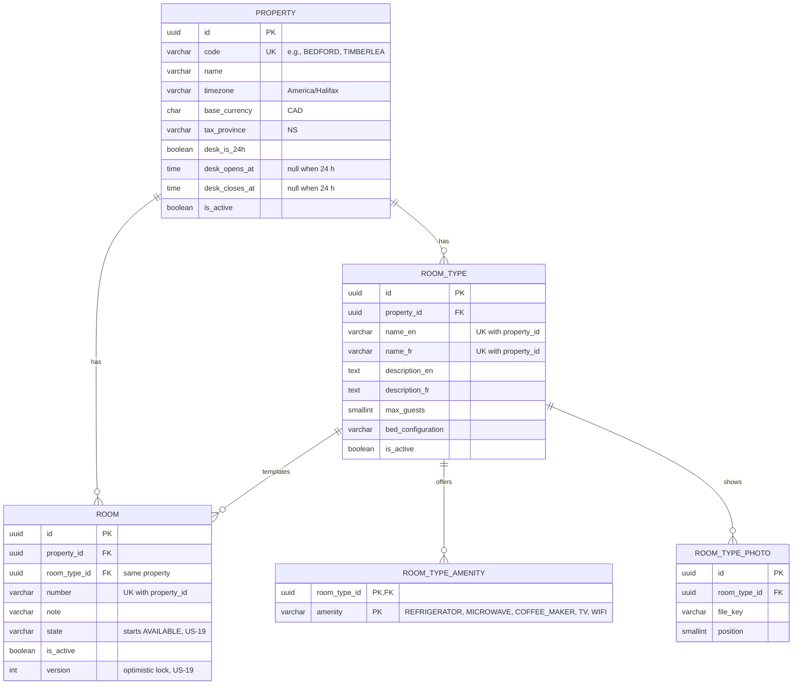
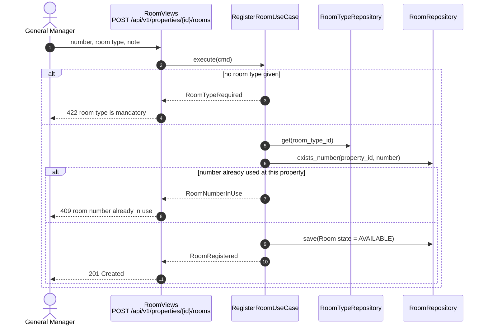
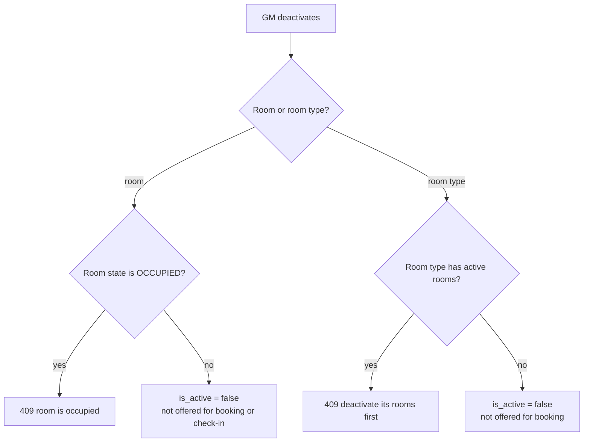

# US-02 — Property, Room Type and Room Registry: Diagrams

> Source: `US-02-room-type-and-room-registry.md`. Related: US-01 (GM-only settings), US-03 (rates and availability), US-19 (room states).

## Business rules reflected

| Rule (US-02) | Where it appears |
|---|---|
| Two properties: Bedford (24 h desk) and Timberlea (8:00 AM–12:00 AM), NS, America/Halifax, CAD | Seed data, `Property`, `FrontDeskHours` |
| GM registers and edits properties: name, timezone, base currency, tax province, desk hours | `RegisterPropertyUseCase`, `PROPERTY` |
| A room type belongs to one property; a room belongs to one room type, in the same property | `RoomType.property_id`, `Room.room_type_id`, composite FK |
| No fixed number of rooms or room types | No limits in the model |
| Room type: name EN/FR, description EN/FR, max guests, bed configuration, amenities from a fixed list, optional photos | `RoomType`, `Amenity`, `ROOM_TYPE_PHOTO` |
| Room: number, room type, optional note | `Room`, `ROOM` |
| A new room starts Available | `Room.register()` sets `AVAILABLE` |
| Room type names and room numbers unique per property | `UNIQUE (property_id, name_en)`, `UNIQUE (property_id, name_fr)`, `UNIQUE (property_id, number)` |
| Edit and deactivate, never delete | No delete endpoint; `is_active` |
| An occupied room cannot be deactivated; a room type with active rooms cannot be deactivated | `Room.deactivate()`, `DeactivateRoomTypeUseCase` |
| Deactivated rooms and room types are not offered for booking or check-in | `is_active` filter used by US-03 and US-13 |

---

## 1. Class Diagram (Clean Architecture)

### Design notes
- **All endpoints need the `SETTINGS` permission** (GM only, US-01). There is no `DELETE` endpoint: deactivation is `PATCH ... {"is_active": false}`.
- **`Room.deactivate()`** raises `RoomOccupied` when the state is `OCCUPIED` (Scenario 6). **`RoomType.deactivate()`** raises `RoomTypeHasActiveRooms` when `count_active(room_type_id) > 0`.
- **`RegisterRoomUseCase`** checks the room type exists, is active and belongs to the same property (Scenario 4), and that the number is free in that property (Scenario 5).
- **Rates** (base and weekend) belong to the room type but are specified in US-03; property policy settings (deposit, fees, grace period) are specified in US-11 and US-13.
- **Timberlea hours:** `closes_at = 00:00` means midnight; `is_open()` handles a closing time earlier than the opening time.

---

## 2. ER Diagram

### Design notes
- **Same-property rule:** `ROOM_TYPE` has `UNIQUE (id, property_id)` and `ROOM` has `FOREIGN KEY (room_type_id, property_id) REFERENCES ROOM_TYPE (id, property_id)`.
- Bedford and Timberlea are seeded by a data migration; the GM can edit them.

---

## 3. Event Flow

### 3.1 Room registration — Scenarios 3, 4 and 5

### 3.2 Deactivation rules — Scenario 6

### 3.3 Domain events

| Event | Raised when | Consumers |
|---|---|---|
| `PropertyRegistered` / `PropertyUpdated` | GM saves a property | Booking widget property list (US-03) |
| `RoomTypeRegistered` / `RoomTypeUpdated` / `RoomTypeDeactivated` | GM manages room types | Availability (US-03), OTA mapping (US-08) |
| `RoomRegistered` / `RoomDeactivated` | GM manages rooms | Availability (US-03), housekeeping board (US-18) |
