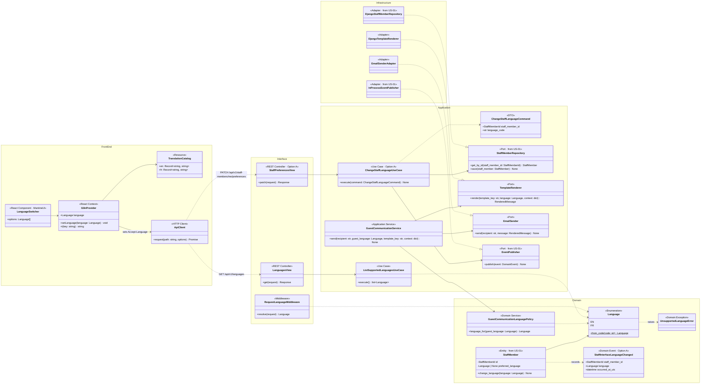
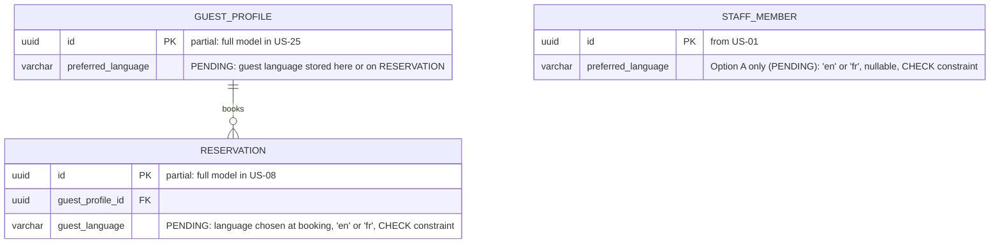
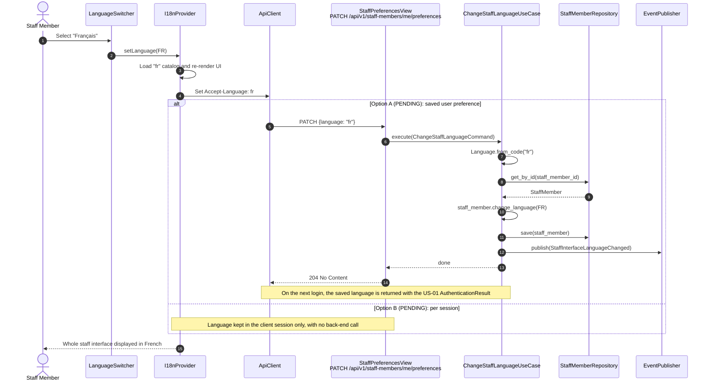
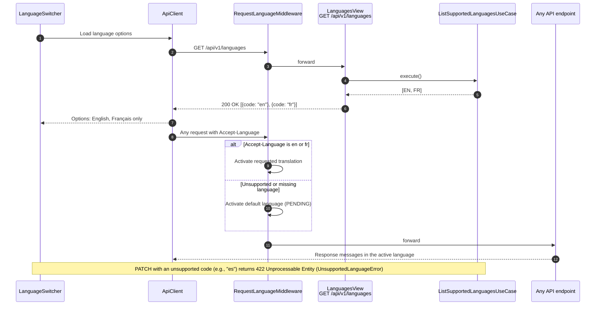
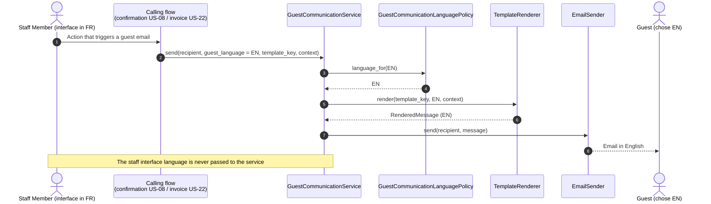

# US-02 — Staff Interface Language (EN/FR): Diagrams

> Sources: `US-02-staff-interface-language-en-fr.md`, `docs/Business Modeling/Business Modeling.md` (Section 7), `CLAUDE.md`.
> Elements tagged **PENDING** depend on business rules not defined yet. They are placeholders in the design, not decisions.
>
> **Main open decision:** whether the language is a **saved user preference** (Option A) or **chosen per session** (Option B), and which language is the default. Both options are drawn so the design does not presume the answer; the shared parts work for either one.

---

## 1. Class Diagram (Clean Architecture + Front-end)

### Design notes
- **`Language` is a closed enumeration (EN, FR).** The business rule allows only these two, so adding a third is a deliberate code change, not configuration. `from_code` rejects anything else with `UnsupportedLanguageError`.
- **Scenario 2:** `GET /api/v1/languages` returns only the values of `Language`, and the `LanguageSwitcher` builds its options from that response. The front end does not keep a separate hard-coded list.
- **Scenario 1 (front-end and back-end):**
  - **Front end:** the `I18nProvider` translates the UI using `TranslationCatalog` (`en`/`fr`).
  - **Back end:** `ApiClient` sends `Accept-Language` on every request, and `RequestLanguageMiddleware` turns on Django translation for API messages (e.g., the US-01 generic login error). It accepts only `en`/`fr`; anything else falls back to the default language, which is still PENDING.
- **Scenario 3:** `GuestCommunicationLanguagePolicy.language_for` takes only the guest's language. The staff language is not a parameter at all, so the staff member's choice cannot leak into guest emails. `GuestCommunicationService` is shared by the confirmation (US-08) and invoice (US-22) flows.
- **Option A only:**
  - `StaffMember.preferred_language`, `ChangeStaffLanguageUseCase`, `StaffPreferencesView` and `StaffInterfaceLanguageChanged`.
- **Option B only:**
  - the language lives in the client and is sent per request through `Accept-Language`;
  - none of the Option A elements is needed.

---

## 2. ER Diagram (PostgreSQL persistence)

### Design notes
- **No language lookup table:** language columns are `varchar(2)` with `CHECK (language IN ('en', 'fr'))`. The set is closed by business rule, so a table would add joins without adding flexibility.
- **`STAFF_MEMBER.preferred_language`** is only created if Option A is chosen; under Option B the schema does not change.
- **Where the guest's language is stored is PENDING:**
  - on `GUEST_PROFILE`: one language per guest;
  - on `RESERVATION`: the language chosen for each booking, which matches "the confirmation email is sent in the language chosen";
  - only the column that is chosen will be created.
- **Partial tables:** only the columns relevant to this story are shown.

---

## 3. Event Flow

### 3.1 Changing the interface language — Scenario 1

### 3.2 Language options and back-end messages — Scenarios 1 and 2

### 3.3 Guest communication language — Scenario 3

### 3.4 Domain events

| Event | Emitted by | When | Payload |
|---|---|---|---|
| `StaffInterfaceLanguageChanged` | `ChangeStaffLanguageUseCase` | Staff member saves a new language (Option A only) | `staff_member_id`, `language`, `occurred_at_utc` |

Under Option B the language change is a client-side state change and emits no domain event.
