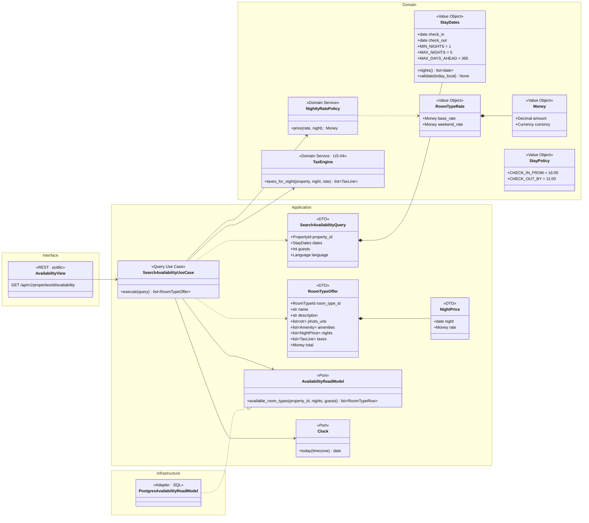
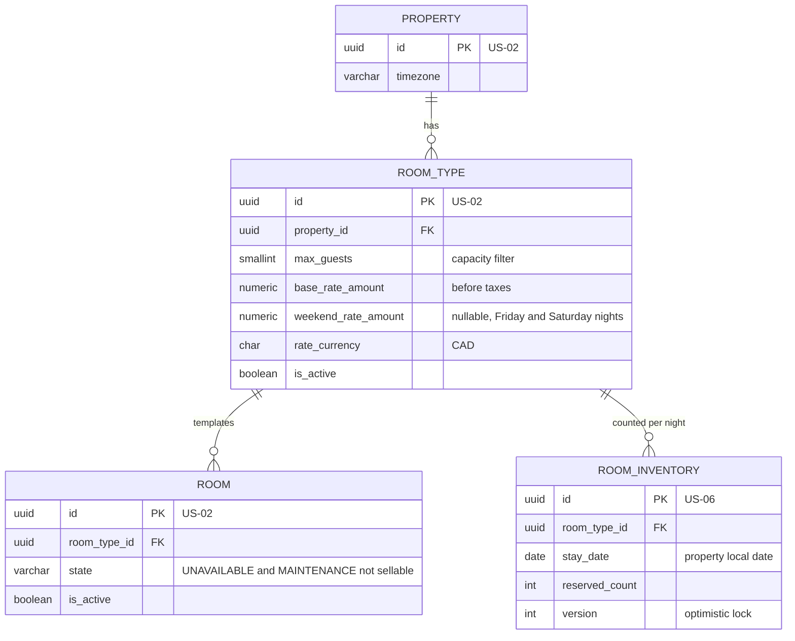
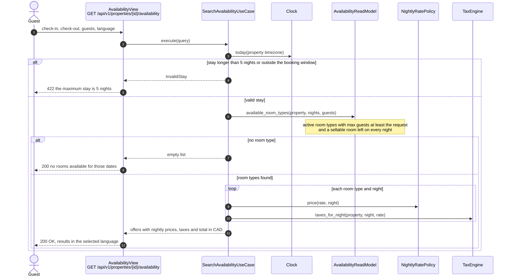

# US-03 — Availability Search: Diagrams

> Source: `US-03-availability-search.md`. Related: US-02 (room types and rooms), US-04 (taxes), US-06 (inventory and concurrency), US-19 (out-of-service rooms).

## Business rules reflected

| Rule (US-03) | Where it appears |
|---|---|
| Property first, then dates and number of guests; only that property's room types | `SearchAvailabilityQuery.property_id`, route per property |
| Bilingual widget (EN/FR) | `language` parameter; `LocalizedText` in the result |
| Availability checked against room type inventory with concurrency control (US-06) | `AvailabilityReadModel`, `ROOM_INVENTORY` |
| Only room types with max guests ≥ requested guests | Capacity filter in `SearchAvailabilityUseCase` |
| Nightly base rate and optional weekend rate (Friday and Saturday nights), set by the GM | `RoomTypeRate`, `NightlyRatePolicy` |
| Rates exclude taxes; taxes calculated separately (US-04) | `TaxEngine` port |
| Amounts in CAD | `Money` with currency |
| Check-in from 4:00 PM, check-out by 11:00 AM | `StayPolicy` constants shown in the result |
| Stays of 1 to 5 nights | `StayDates` validation (Scenario 4) |
| Same day up to 365 days ahead, in the property's local days | `StayDates` validation with the property's `Clock` |
| Result: name, description, photos, amenities, price of each night, taxes, total | `RoomTypeOffer` DTO |
| Deactivated, Unavailable and Maintenance rooms are not offered | `sellable_rooms` count |

---

## 1. Class Diagram (Clean Architecture)

### Design notes
- **`NightlyRatePolicy.price()`** returns `weekend_rate` for Friday and Saturday nights when it is set, otherwise `base_rate` (Scenario 5: base $100, weekend $130, Thursday to Sunday → $100 + $130 + $130 before taxes).
- **`StayDates.validate()`** rejects 0 nights, more than 5 nights (Scenario 4), a check-in before today or more than 365 days ahead. "Today" is the property's local date.
- **Availability per night** = `sellable_rooms` − `ROOM_INVENTORY.reserved_count`, where `sellable_rooms` counts the room type's active rooms that are not `UNAVAILABLE` or `MAINTENANCE`. A room type is listed only if every night has at least one room left.
- **The search is read-only.** It never takes a lock; the concurrency check happens when the reservation is created (US-06).
- **Rates** are stored on the room type (`base_rate_amount`, `weekend_rate_amount`) and edited by the GM in the settings (US-02 screens, `SETTINGS` permission).

---

## 2. ER Diagram

---

## 3. Event Flow

### 3.1 Searching — Scenarios 1, 2, 4, 5 and 6

### 3.2 Domain events

None. The search is read-only.
