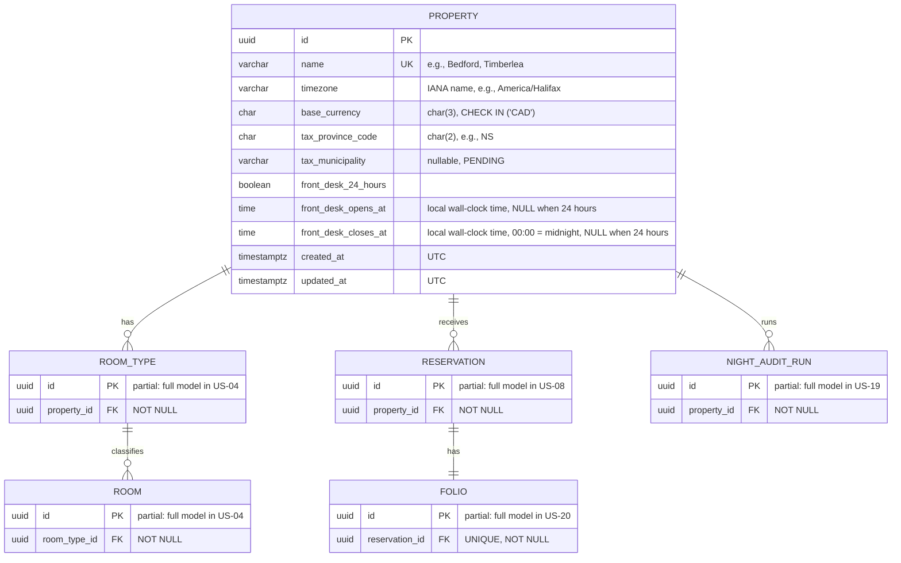
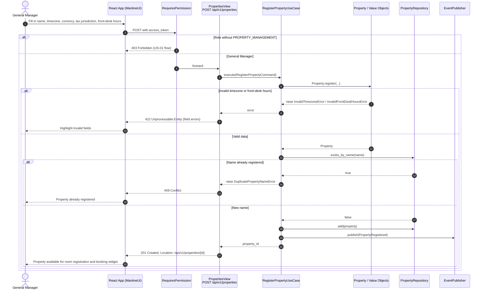
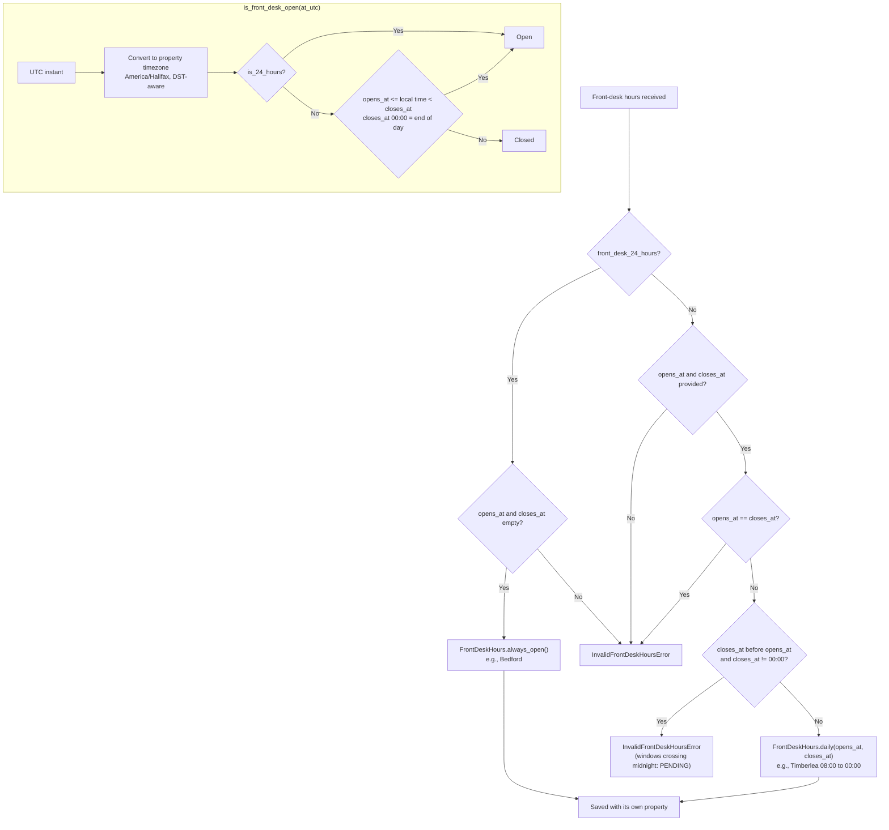
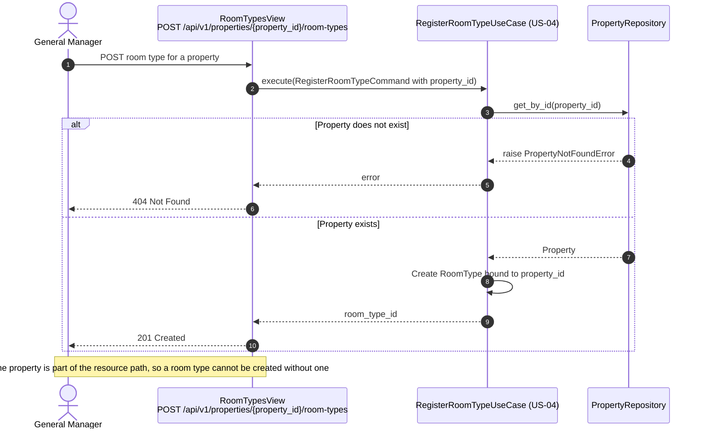
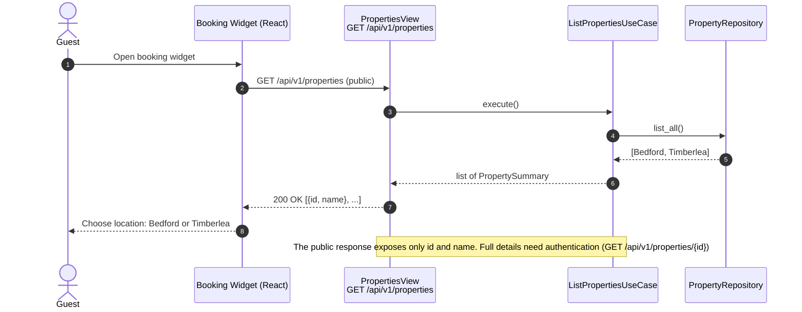

# US-03 — Property (Location) Registry: Diagrams

> Sources: `US-03-property-location-registry.md`, `docs/Business Modeling/Business Modeling.md` (Sections 2 and 5), `CLAUDE.md`.
> Elements tagged **PENDING** depend on business rules not defined yet. They are placeholders in the design, not decisions.

---

## 1. Class Diagram (Clean Architecture)

```mermaid
classDiagram
    direction LR

    namespace Domain {
        class Property {
            <<Entity / Aggregate Root>>
            -PropertyId id
            -PropertyName name
            -Timezone timezone
            -Currency base_currency
            -TaxJurisdiction tax_jurisdiction
            -FrontDeskHours front_desk_hours
            +register(...)$ Property
            +is_front_desk_open(at_utc: datetime) bool
        }
        class PropertyId {
            <<Value Object>>
            +UUID value
        }
        class PropertyName {
            <<Value Object>>
            +str value
        }
        class Timezone {
            <<Value Object>>
            +str iana_name
            +to_local(at_utc: datetime) datetime
        }
        class Currency {
            <<Enumeration>>
            CAD
        }
        class TaxJurisdiction {
            <<Value Object>>
            +str province_code
            +str | None municipality
        }
        class FrontDeskHours {
            <<Value Object>>
            +bool is_24_hours
            +time | None opens_at
            +time | None closes_at
            +always_open()$ FrontDeskHours
            +daily(opens_at: time, closes_at: time)$ FrontDeskHours
            +is_open_at(local_time: time) bool
        }
        class PropertyRegistered {
            <<Domain Event>>
            +PropertyId property_id
            +str name
            +datetime occurred_at_utc
        }
        class InvalidTimezoneError {
            <<Domain Exception>>
        }
        class InvalidFrontDeskHoursError {
            <<Domain Exception>>
        }
        class DuplicatePropertyNameError {
            <<Domain Exception>>
        }
        class PropertyNotFoundError {
            <<Domain Exception>>
        }
        class RoomType {
            <<Entity · from US-04>>
            -RoomTypeId id
            -PropertyId property_id
        }
    }

    namespace Application {
        class RegisterPropertyUseCase {
            <<Use Case>>
            +execute(command: RegisterPropertyCommand) PropertyId
        }
        class ListPropertiesUseCase {
            <<Use Case>>
            +execute() list~PropertySummary~
        }
        class GetPropertyUseCase {
            <<Use Case>>
            +execute(property_id: PropertyId) PropertyDetails
        }
        class RegisterRoomTypeUseCase {
            <<Use Case · from US-04>>
            +execute(command: RegisterRoomTypeCommand) RoomTypeId
        }
        class RegisterPropertyCommand {
            <<DTO>>
            +str name
            +str timezone
            +str base_currency
            +str tax_province_code
            +str | None tax_municipality
            +bool front_desk_24_hours
            +str | None front_desk_opens_at
            +str | None front_desk_closes_at
        }
        class PropertySummary {
            <<DTO>>
            +UUID id
            +str name
        }
        class PropertyDetails {
            <<DTO>>
            +UUID id
            +str name
            +str timezone
            +str base_currency
            +str tax_province_code
            +str | None tax_municipality
            +dict front_desk_hours
        }
        class PropertyRepository {
            <<Port>>
            +add(property: Property) None
            +get_by_id(property_id: PropertyId) Property
            +exists_by_name(name: PropertyName) bool
            +list_all() list~Property~
        }
        class EventPublisher {
            <<Port · from US-01>>
            +publish(event: DomainEvent) None
        }
        class Clock {
            <<Port · from US-01>>
            +now_utc() datetime
        }
    }

    namespace Infrastructure {
        class DjangoPropertyRepository {
            <<Adapter>>
        }
        class InProcessEventPublisher {
            <<Adapter · from US-01>>
        }
        class SystemClock {
            <<Adapter · from US-01>>
        }
    }

    namespace Interface {
        class PropertiesView {
            <<REST Controller>>
            +post(request) Response
            +get(request) Response
        }
        class PropertyDetailView {
            <<REST Controller>>
            +get(request, property_id) Response
        }
        class RequiresPermission {
            <<Authorization Guard · from US-01>>
            +check(request, permission: Permission) None
        }
    }

    Property *-- PropertyId
    Property *-- PropertyName
    Property *-- Timezone
    Property --> Currency
    Property *-- TaxJurisdiction
    Property *-- FrontDeskHours
    Property ..> PropertyRegistered : records
    Timezone ..> InvalidTimezoneError : raises
    FrontDeskHours ..> InvalidFrontDeskHoursError : raises
    RoomType --> PropertyId : belongs to

    RegisterPropertyUseCase ..> RegisterPropertyCommand
    RegisterPropertyUseCase --> PropertyRepository
    RegisterPropertyUseCase --> EventPublisher
    RegisterPropertyUseCase --> Clock
    RegisterPropertyUseCase ..> DuplicatePropertyNameError : raises
    ListPropertiesUseCase --> PropertyRepository
    ListPropertiesUseCase ..> PropertySummary
    GetPropertyUseCase --> PropertyRepository
    GetPropertyUseCase ..> PropertyDetails
    GetPropertyUseCase ..> PropertyNotFoundError : raises
    RegisterRoomTypeUseCase --> PropertyRepository : validates property

    DjangoPropertyRepository ..|> PropertyRepository
    InProcessEventPublisher ..|> EventPublisher
    SystemClock ..|> Clock

    PropertiesView --> RegisterPropertyUseCase
    PropertiesView --> ListPropertiesUseCase
    PropertyDetailView --> GetPropertyUseCase
    PropertiesView --> RequiresPermission : POST requires PROPERTY_MANAGEMENT
```

### Design notes
- **`Property` is the aggregate root that scopes everything else.** RoomTypes, Rooms, inventory, Reservations, Folios and Night Audit runs reference a `PropertyId`; they never embed property data.
- **`Timezone` validates IANA names** (e.g., `America/Halifax`) using the standard library `zoneinfo`. The domain stays framework-free, and daylight saving time (AST/ADT) is handled by the timezone database instead of a fixed UTC offset.
- **`FrontDeskHours` has two valid shapes:** `always_open()` (Bedford) or `daily(opens_at, closes_at)` (Timberlea, 08:00 to 00:00). A `closes_at` of `00:00` means midnight at the end of the day. Any other combination raises `InvalidFrontDeskHoursError`, including windows that close after midnight (e.g., 22:00 to 06:00): no property needs them today, so supporting them is PENDING.
- **`is_front_desk_open(at_utc)`** converts the UTC instant to the property's local time before checking the hours. How it is used, such as for Timberlea arrivals while the desk is closed, is PENDING.
- **`Currency`** contains only `CAD`, the only base currency defined.
- **Permission:** registering a property needs a new `PROPERTY_MANAGEMENT` permission, granted to `GENERAL_MANAGER` (Scenario 1). It is added to the US-01 `ROLE_PERMISSION` matrix as data.
- **Not modelled until defined:**
  - editing or deactivating a property (e.g., changing its timezone affects the Night Audit);
  - per-property policies (check-in/out times, Age 21+, deposit, fines);
  - property attributes beyond those listed in the story.

---

## 2. ER Diagram (PostgreSQL persistence)

### Design notes
- **Front-desk hours check constraint:** `CHECK ((front_desk_24_hours AND front_desk_opens_at IS NULL AND front_desk_closes_at IS NULL) OR (NOT front_desk_24_hours AND front_desk_opens_at IS NOT NULL AND front_desk_closes_at IS NOT NULL))`.
- **`time` columns are deliberate.** Front-desk hours are local wall-clock times that repeat daily, not instants, so they do not conflict with the "store timestamps in UTC" rule. Instants (`created_at`, `updated_at`) remain `timestamptz` in UTC.
- **`name` is unique** so the same location cannot be registered twice.
- **How each table reaches its property:**
  - `ROOM` through `ROOM_TYPE`, which guarantees a Room belongs to the same Property as its RoomType;
  - `FOLIO` through `RESERVATION`;
  - `ROOM_TYPE`, `RESERVATION` and `NIGHT_AUDIT_RUN` hold `property_id` directly.
- **Partial tables:** only the property link is shown; each table is detailed in its own story.

**Initial data (Scenario 2):**

| name | timezone | base_currency | tax_province_code | front_desk_24_hours | opens_at | closes_at |
|---|---|---|---|---|---|---|
| Bedford | America/Halifax | CAD | NS | true | NULL | NULL |
| Timberlea | America/Halifax | CAD | NS | false | 08:00 | 00:00 |

---

## 3. Event Flow

### 3.1 Registering a property — Scenario 1

### 3.2 Front-desk hours rules — Scenario 2

### 3.3 Room type requires its property — Scenario 3

### 3.4 Locations in the booking widget — Scenario 1

### 3.5 Domain events

| Event | Emitted by | When | Payload |
|---|---|---|---|
| `PropertyRegistered` | `RegisterPropertyUseCase` | A new property is saved | `property_id`, `name`, `occurred_at_utc` |

Consumers are PENDING. Possible future consumers include scheduling the property's Night Audit (US-19) and creating its channel listing (US-12/13).
