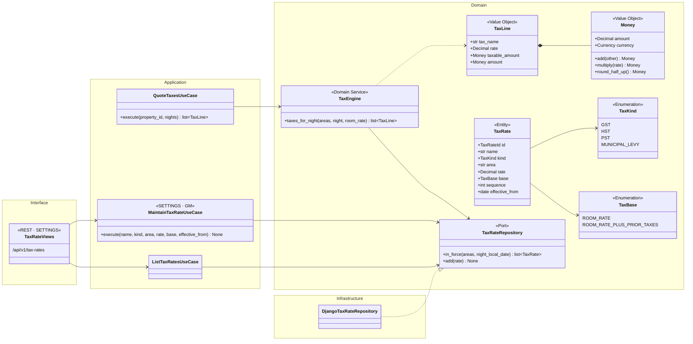
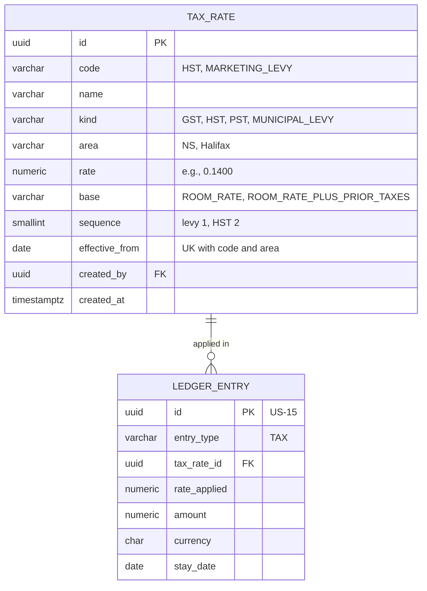
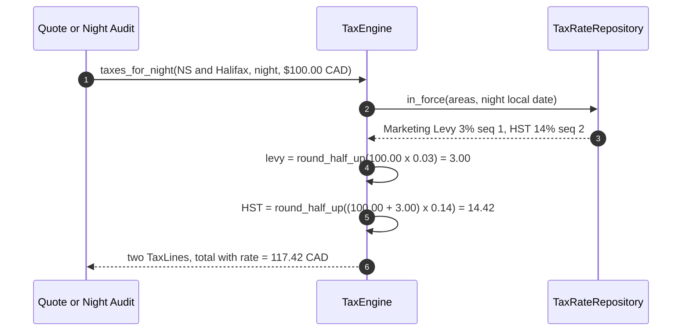
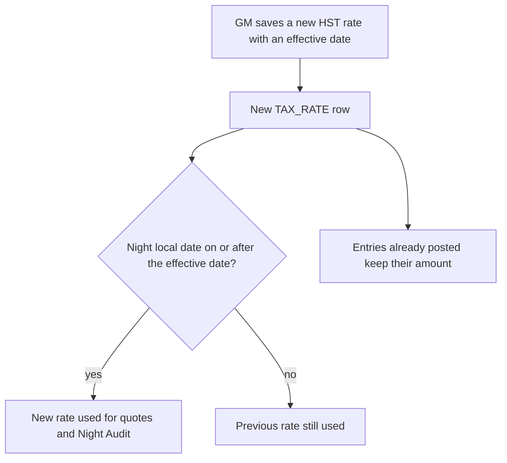

# US-04 — Localized Tax Calculation: Diagrams

> Source: `US-04-localized-tax-calculation.md`. Used by US-03 (quotes), US-14 (nightly posting), US-15 (folio), US-17 (invoice) and US-22 (Tax Summary).

## Business rules reflected

| Rule (US-04) | Where it appears |
|---|---|
| Supports GST, HST, PST and municipal levies; modular | `TaxKind`, `TaxRate` rows, `TaxEngine` |
| Defaults (GM can edit): HST 14% NS from 2025-04-01; Halifax Marketing Levy 3% at Bedford and Timberlea | Seed rows in `TAX_RATE` |
| Levy on the nightly rate; HST on the rate plus the rounded levy | `TaxRate.base` (`ROOM_RATE` or `ROOM_RATE_PLUS_PRIOR_TAXES`), `sequence` |
| Only room nights are taxed; fines and fees are not | `TaxEngine` is called only for room nights |
| Per-line rounding to the cent, halves up | `Money.round_half_up()` |
| GM maintains name, area, rate, effective date; changes apply to nights on or after the date; posted amounts never change | `MaintainTaxRateUseCase`, append-only rows, posted entries store the amount |
| The rate used is the one in force on the night's local date | `TaxRateRepository.in_force(area, night)` |
| Each tax on its own line | `TaxLine` list |
| No floats; every amount with value and currency | `Money` (`Decimal` + `Currency`), `numeric(12,2)` + `char(3)` columns |

---

## 1. Class Diagram (Clean Architecture)

### Design notes
- **Algorithm (per night):** sort the rates in force by `sequence`; for each rate, the taxable amount is the room rate (`ROOM_RATE`) or the room rate plus the already rounded previous taxes (`ROOM_RATE_PLUS_PRIOR_TAXES`); `amount = (taxable × rate).quantize(0.01, ROUND_HALF_UP)`.
- **Verified examples (Scenarios 1 and 2):**
  - $100.00 → levy $3.00; HST 14% × $103.00 = $14.42; total **$117.42**.
  - $89.99 → levy 2.6997 → **$2.70**; HST 14% × $92.69 = 12.9766 → **$12.98**; total **$105.67**.
- **Areas of a property:** its province (`NS`) and its municipality (`Halifax`). Both properties are in the Halifax Regional Municipality, so both get the levy.
- **Rate changes (Scenario 3):** a change is a new row with a later `effective_from`; existing rows are never updated. Posted folio entries store their own amount and rate, so they never change.
- **Not taxed (Scenario 4):** fines (US-16) and cancellation and no-show fees (US-11) never call the engine.

---

## 2. ER Diagram

---

## 3. Event Flow

### 3.1 Taxes for one night — Scenarios 1 to 3

### 3.2 GM changes a rate — Scenario 3

### 3.3 Domain events

| Event | Raised when | Consumers |
|---|---|---|
| `TaxRateScheduled` | GM adds a rate with an effective date | Audit log |
