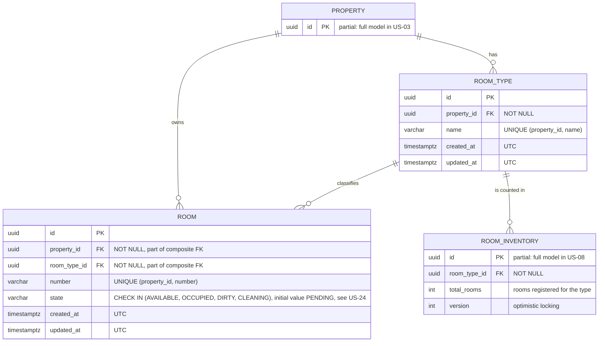
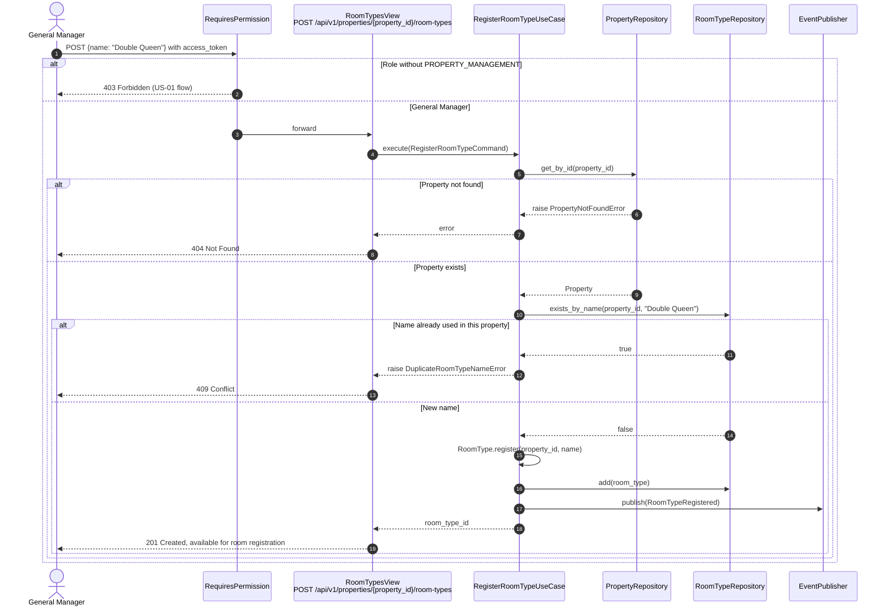
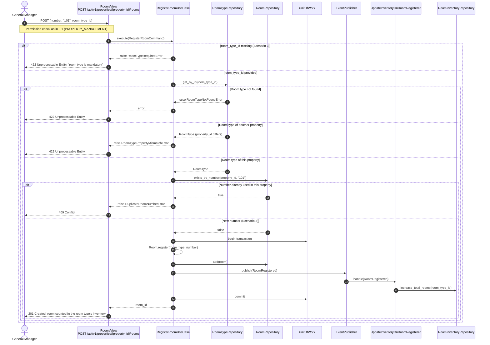

# US-04 — Room Type and Room Registry: Diagrams

> Sources: `US-04-room-type-and-room-registry.md`, `docs/Business Modeling/Business Modeling.md` (Sections 2, 4 and 5), `CLAUDE.md`.
> Elements tagged **PENDING** depend on business rules not defined yet. They are placeholders in the design, not decisions.

---

## 1. Class Diagram (Clean Architecture)

```mermaid
classDiagram
    direction LR

    namespace Domain {
        class RoomType {
            <<Entity / Aggregate Root>>
            -RoomTypeId id
            -PropertyId property_id
            -RoomTypeName name
            +register(property_id: PropertyId, name: RoomTypeName)$ RoomType
        }
        class Room {
            <<Entity / Aggregate Root>>
            -RoomId id
            -PropertyId property_id
            -RoomTypeId room_type_id
            -RoomNumber number
            -RoomState state
            +register(room_type: RoomType, number: RoomNumber)$ Room
        }
        class RoomTypeId {
            <<Value Object>>
            +UUID value
        }
        class RoomId {
            <<Value Object>>
            +UUID value
        }
        class RoomTypeName {
            <<Value Object>>
            +str value
        }
        class RoomNumber {
            <<Value Object>>
            +str value
        }
        class RoomState {
            <<Enumeration · detailed in US-24>>
            AVAILABLE
            OCCUPIED
            DIRTY
            CLEANING
        }
        class PropertyId {
            <<Value Object · from US-03>>
            +UUID value
        }
        class RoomTypeRegistered {
            <<Domain Event>>
            +RoomTypeId room_type_id
            +PropertyId property_id
            +str name
            +datetime occurred_at_utc
        }
        class RoomRegistered {
            <<Domain Event>>
            +RoomId room_id
            +RoomTypeId room_type_id
            +PropertyId property_id
            +str number
            +datetime occurred_at_utc
        }
        class RoomTypeRequiredError {
            <<Domain Exception>>
        }
        class RoomTypeNotFoundError {
            <<Domain Exception>>
        }
        class RoomTypePropertyMismatchError {
            <<Domain Exception>>
        }
        class DuplicateRoomTypeNameError {
            <<Domain Exception>>
        }
        class DuplicateRoomNumberError {
            <<Domain Exception>>
        }
    }

    namespace Application {
        class RegisterRoomTypeUseCase {
            <<Use Case>>
            +execute(command: RegisterRoomTypeCommand) RoomTypeId
        }
        class RegisterRoomUseCase {
            <<Use Case>>
            +execute(command: RegisterRoomCommand) RoomId
        }
        class ListRoomTypesUseCase {
            <<Use Case>>
            +execute(property_id: PropertyId) list~RoomTypeSummary~
        }
        class ListRoomsUseCase {
            <<Use Case>>
            +execute(property_id: PropertyId, room_type_id: RoomTypeId | None) list~RoomSummary~
        }
        class UpdateInventoryOnRoomRegistered {
            <<Event Handler>>
            +handle(event: RoomRegistered) None
        }
        class RegisterRoomTypeCommand {
            <<DTO>>
            +UUID property_id
            +str name
        }
        class RegisterRoomCommand {
            <<DTO>>
            +UUID property_id
            +UUID | None room_type_id
            +str number
        }
        class RoomTypeSummary {
            <<DTO>>
            +UUID id
            +str name
            +int room_count
        }
        class RoomSummary {
            <<DTO>>
            +UUID id
            +str number
            +UUID room_type_id
            +str state
        }
        class PropertyRepository {
            <<Port · from US-03>>
            +get_by_id(property_id: PropertyId) Property
        }
        class RoomTypeRepository {
            <<Port>>
            +add(room_type: RoomType) None
            +get_by_id(room_type_id: RoomTypeId) RoomType
            +exists_by_name(property_id: PropertyId, name: RoomTypeName) bool
            +list_by_property(property_id: PropertyId) list~RoomType~
        }
        class RoomRepository {
            <<Port>>
            +add(room: Room) None
            +exists_by_number(property_id: PropertyId, number: RoomNumber) bool
            +list_by_property(property_id: PropertyId, room_type_id: RoomTypeId | None) list~Room~
            +count_by_room_type(room_type_id: RoomTypeId) int
        }
        class RoomInventoryRepository {
            <<Port · detailed in US-08>>
            +increase_total_rooms(room_type_id: RoomTypeId) None
        }
        class UnitOfWork {
            <<Port>>
            +__enter__() UnitOfWork
            +commit() None
            +rollback() None
        }
        class EventPublisher {
            <<Port · from US-01>>
            +publish(event: DomainEvent) None
        }
    }

    namespace Infrastructure {
        class DjangoRoomTypeRepository {
            <<Adapter>>
        }
        class DjangoRoomRepository {
            <<Adapter>>
        }
        class DjangoRoomInventoryRepository {
            <<Adapter>>
        }
        class DjangoUnitOfWork {
            <<Adapter · transaction.atomic>>
        }
        class InProcessEventPublisher {
            <<Adapter · from US-01>>
        }
    }

    namespace Interface {
        class RoomTypesView {
            <<REST Controller>>
            +post(request, property_id) Response
            +get(request, property_id) Response
        }
        class RoomsView {
            <<REST Controller>>
            +post(request, property_id) Response
            +get(request, property_id) Response
        }
        class RequiresPermission {
            <<Authorization Guard · from US-01>>
            +check(request, permission: Permission) None
        }
    }

    RoomType *-- RoomTypeId
    RoomType *-- RoomTypeName
    RoomType --> PropertyId : belongs to
    Room *-- RoomId
    Room *-- RoomNumber
    Room --> RoomTypeId : classified by
    Room --> PropertyId : same as its RoomType
    Room --> RoomState
    RoomType ..> RoomTypeRegistered : records
    Room ..> RoomRegistered : records

    RegisterRoomTypeUseCase ..> RegisterRoomTypeCommand
    RegisterRoomTypeUseCase --> PropertyRepository
    RegisterRoomTypeUseCase --> RoomTypeRepository
    RegisterRoomTypeUseCase --> UnitOfWork
    RegisterRoomTypeUseCase --> EventPublisher
    RegisterRoomTypeUseCase ..> DuplicateRoomTypeNameError : raises

    RegisterRoomUseCase ..> RegisterRoomCommand
    RegisterRoomUseCase --> RoomTypeRepository
    RegisterRoomUseCase --> RoomRepository
    RegisterRoomUseCase --> UnitOfWork
    RegisterRoomUseCase --> EventPublisher
    RegisterRoomUseCase ..> RoomTypeRequiredError : raises
    RegisterRoomUseCase ..> RoomTypeNotFoundError : raises
    RegisterRoomUseCase ..> RoomTypePropertyMismatchError : raises
    RegisterRoomUseCase ..> DuplicateRoomNumberError : raises

    ListRoomTypesUseCase --> RoomTypeRepository
    ListRoomTypesUseCase --> RoomRepository
    ListRoomTypesUseCase ..> RoomTypeSummary
    ListRoomsUseCase --> RoomRepository
    ListRoomsUseCase ..> RoomSummary
    UpdateInventoryOnRoomRegistered ..> RoomRegistered : handles
    UpdateInventoryOnRoomRegistered --> RoomInventoryRepository

    DjangoRoomTypeRepository ..|> RoomTypeRepository
    DjangoRoomRepository ..|> RoomRepository
    DjangoRoomInventoryRepository ..|> RoomInventoryRepository
    DjangoUnitOfWork ..|> UnitOfWork
    InProcessEventPublisher ..|> EventPublisher
    InProcessEventPublisher ..> UpdateInventoryOnRoomRegistered : dispatches

    RoomTypesView --> RegisterRoomTypeUseCase
    RoomTypesView --> ListRoomTypesUseCase
    RoomsView --> RegisterRoomUseCase
    RoomsView --> ListRoomsUseCase
    RoomTypesView --> RequiresPermission : POST requires PROPERTY_MANAGEMENT
    RoomsView --> RequiresPermission : POST requires PROPERTY_MANAGEMENT
```

### Design notes
- **`RoomType` and `Room` are separate aggregates.** A Room changes state many times a day (check-in, check-out, housekeeping, US-24). Keeping it outside `RoomType` avoids locking the whole room type on every state change; the Room references its type by `RoomTypeId`.
- **`Room.register(room_type, number)`** copies `property_id` from the given `RoomType`, so a Room cannot be assigned a different property (business rule: "a Room belongs to the same Property as its RoomType").
- **Scenario 3:** `RegisterRoomCommand.room_type_id` is optional at the DTO level only so the use case can raise an explicit `RoomTypeRequiredError` ("the room type is mandatory") instead of a generic parse error.
- **Scenario 2, inventory:**
  - `RoomRegistered` is handled by `UpdateInventoryOnRoomRegistered`, which increases the room type's total in `RoomInventory`, the table the business document names for optimistic locking against overbooking (US-08).
  - The handler runs inside the same `UnitOfWork` as the insert, so the room and its inventory count are committed together.
- **Uniqueness (design choice, to confirm):**
  - room type names are unique **per property** ("Double Queen" can exist in both Bedford and Timberlea);
  - room numbers are unique **per property** ("101" can exist in both).
- **Permission:** writes reuse `PROPERTY_MANAGEMENT` (US-03), granted to `GENERAL_MANAGER`.
- **Not modelled until defined:**
  - room type attributes (occupancy, beds, amenities, base rate);
  - the number of rooms and room types per property;
  - the initial state of a newly registered room;
  - editing or removing room types and rooms.

---

## 2. ER Diagram (PostgreSQL persistence)

### Design notes
- **Same-property guarantee at database level:**
  - `ROOM_TYPE` gets `UNIQUE (id, property_id)`;
  - `ROOM` uses the composite foreign key `(room_type_id, property_id) REFERENCES room_type (id, property_id)`;
  - so the database itself rejects a Room whose property differs from its RoomType's. This refines the US-03 ER, which reached `ROOM`'s property only through `ROOM_TYPE`.
- **Scenario 3:** `ROOM.room_type_id NOT NULL` is the last line of defence; the use case already rejects a missing room type before the insert.
- **`ROOM_INVENTORY` is partial here.** Its granularity (e.g., per room type per stay date), its booking columns and how far ahead rows exist are defined with the booking stories (US-05/US-08). This story only keeps `total_rooms` in sync.
- **`ROOM.state`** is shown because the room state machine (US-24) lives on this table. Its initial value on registration is PENDING.
- **Room type attribute columns** will be added once the attributes are defined.

---

## 3. Event Flow

### 3.1 Registering a room type — Scenario 1

### 3.2 Registering a room — Scenarios 2 and 3

### 3.3 Domain events

| Event | Emitted by | When | Payload | Consumers |
|---|---|---|---|---|
| `RoomTypeRegistered` | `RegisterRoomTypeUseCase` | A room type is saved for a property | `room_type_id`, `property_id`, `name`, `occurred_at_utc` | PENDING (e.g., OTA channel mapping, US-13) |
| `RoomRegistered` | `RegisterRoomUseCase` | A room is saved under a room type | `room_id`, `room_type_id`, `property_id`, `number`, `occurred_at_utc` | `UpdateInventoryOnRoomRegistered` (same transaction) |
