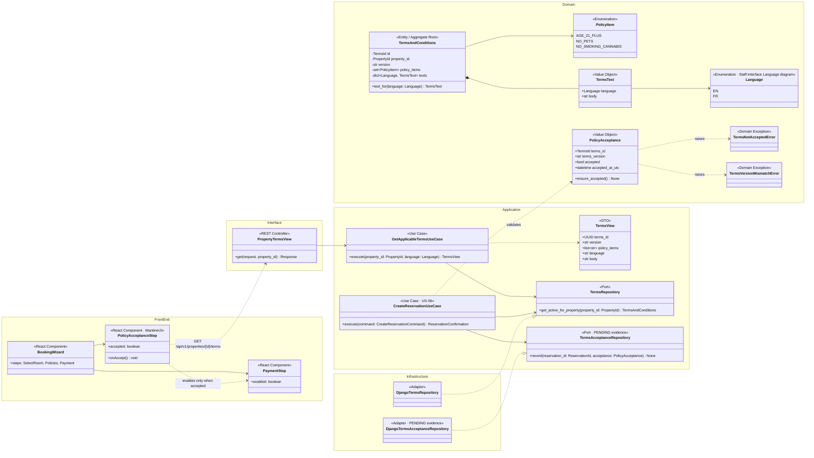
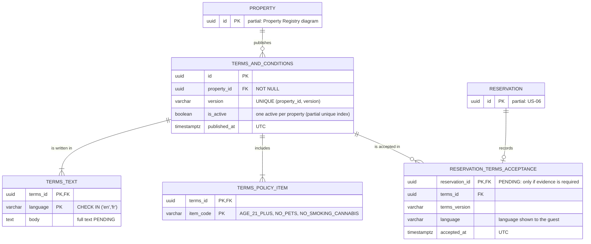
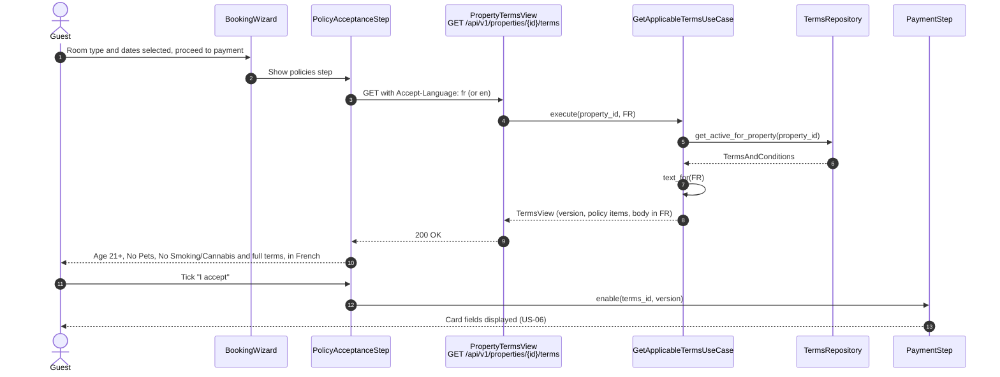
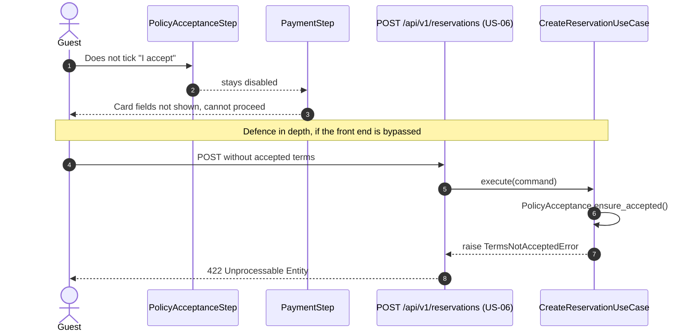

# US-05 — Policy Acceptance Before Payment: Diagrams

> Sources: `US-05-policy-acceptance-before-payment.md`, `docs/Business Modeling/Business Modeling.md` (Phase 1, Sections 5 and 7), `CLAUDE.md`.
> Elements tagged **PENDING** depend on business rules not defined yet. They are placeholders in the design, not decisions.
> Data is scoped per **Property** (Business Modeling, Section 5) even where the story text does not mention it.

---

## 1. Class Diagram (Clean Architecture + Front-end)

### Design notes
- **The three known policies are an enumeration** (`AGE_21_PLUS`, `NO_PETS`, `NO_SMOKING_CANNABIS`). The full Terms & Conditions text, including the cancellation policy, is PENDING and lives in `TermsText.body`, one per language (EN/FR).
- **Acceptance is enforced on both sides:**
  - **Front end:** `PaymentStep` stays disabled until `PolicyAcceptanceStep` is accepted, so no card field is shown before acceptance.
  - **Back end:** `CreateReservationUseCase` (US-06) rejects a request without a valid `PolicyAcceptance` (`TermsNotAcceptedError`), so the rule holds even if the front end is bypassed.
- **`TermsVersionMismatchError`** prevents accepting an outdated text if the terms changed while the guest was booking.
- **Evidence (PENDING):**
  - `TermsAcceptanceRepository` and its adapter exist only if acceptance must be stored as evidence (timestamp and version);
  - otherwise acceptance is validated and not persisted.
- **Per property:** terms are looked up per property. Whether both properties share identical policies is PENDING (Business Modeling, Section 5); one active terms record per property supports both answers.

---

## 2. ER Diagram (PostgreSQL persistence)

### Design notes
- **Both languages required:** `TERMS_TEXT` has a composite key `(terms_id, language)`, and publishing requires both `en` and `fr` rows, since only these two languages are supported.
- **One active version per property:** a partial unique index (`UNIQUE (property_id) WHERE is_active`) guarantees it.
- **`RESERVATION_TERMS_ACCEPTANCE` is PENDING.** It is created only if acceptance evidence is required.

---

## 3. Event Flow

### 3.1 Displaying and accepting the policies — Scenarios 1 and 3

### 3.2 Policies not accepted — Scenario 2

### 3.3 Domain events

No domain event is emitted by this story. Acceptance travels inside the reservation request (US-06). If acceptance evidence is required (PENDING), it is stored in the same transaction as the reservation.
