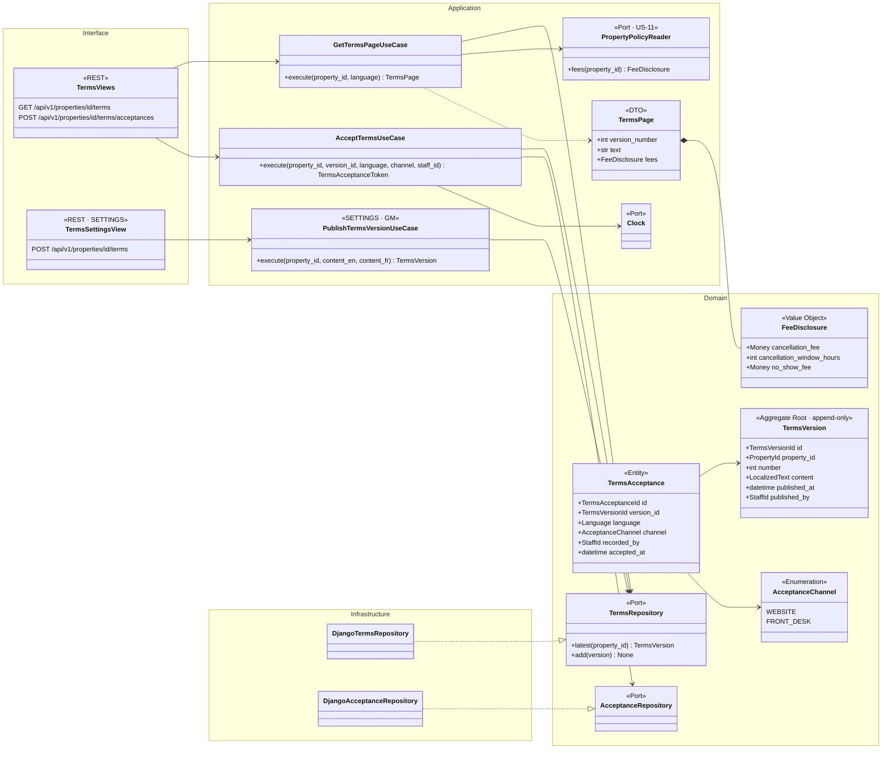
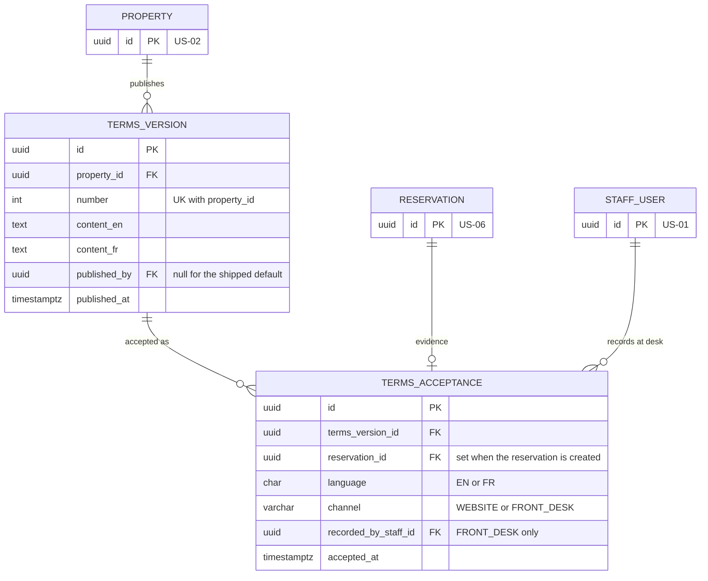
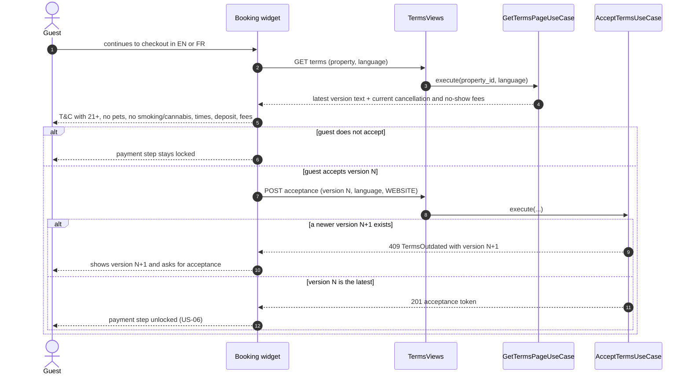

# US-05 — Policy Acceptance Before Payment: Diagrams

> Source: `US-05-policy-acceptance-before-payment.md`. Related: US-06 (direct booking), US-09 (walk-in), US-07 (OTA, no acceptance), US-11 (fees shown on the page).

## Business rules reflected

| Rule (US-05) | Where it appears |
|---|---|
| T&C per property, EN and FR | `TermsVersion.property_id`, `LocalizedText` content |
| A default T&C per property ships with the system; the GM edits it | Seed data, `PublishTermsVersionUseCase` |
| Must include at least: 21+, no pets, no smoking/cannabis, check-in/out times, deposit | Content of the seeded default (GM text) |
| The page shows the property's current cancellation and no-show fees, or "no fee" (US-11) | `TermsPage.fees` built from `PropertyPolicy` |
| Every edit creates a new version; the guest must accept the latest version | Append-only `TERMS_VERSION`, `AcceptTermsUseCase` version check |
| Acceptance before payment information is taken | `TermsAcceptanceToken` required by US-06 and US-09 |
| Displayed in EN or FR, as the guest chooses | `language` on display and on the evidence |
| Evidence: timestamp, version, language, channel (website or front desk); no IP address | `TERMS_ACCEPTANCE` columns |
| Walk-ins: the agent records acceptance for the guest; the agent is stored | `recorded_by_staff_id` |
| OTA bookings record no acceptance | US-07 flow skips this story |

---

## 1. Class Diagram (Clean Architecture)

### Design notes
- **Version check (Scenario 4):** `AcceptTermsUseCase` compares the `version_id` the guest saw with `latest(property_id)`. If the GM published a newer version in the meantime, it returns `TermsOutdated` with the new version, and the guest must accept it.
- **Acceptance token:** the use case returns a short-lived token that the booking (US-06) or walk-in (US-09) use case requires; without it the payment step is refused (Scenario 2). The acceptance row is linked to the reservation when the reservation is created.
- **Front desk:** when `channel = FRONT_DESK`, `recorded_by` is the logged-in agent. When `channel = WEBSITE`, it is null.
- **Fees:** the fee block is not part of the GM's text. It is rendered from the property settings at display time, so it always shows the current fees or "no fee".

---

## 2. ER Diagram

### Design notes
- No IP address column, by rule.
- `CHECK (channel = 'WEBSITE' AND recorded_by_staff_id IS NULL OR channel = 'FRONT_DESK' AND recorded_by_staff_id IS NOT NULL)`.

---

## 3. Event Flow

### 3.1 Acceptance before payment — Scenarios 1 to 5

### 3.2 Domain events

| Event | Raised when | Consumers |
|---|---|---|
| `TermsVersionPublished` | GM saves an edit | Audit log |
| `TermsAccepted` | Guest or agent records an acceptance | Linked to the reservation at creation (US-06, US-09) |
