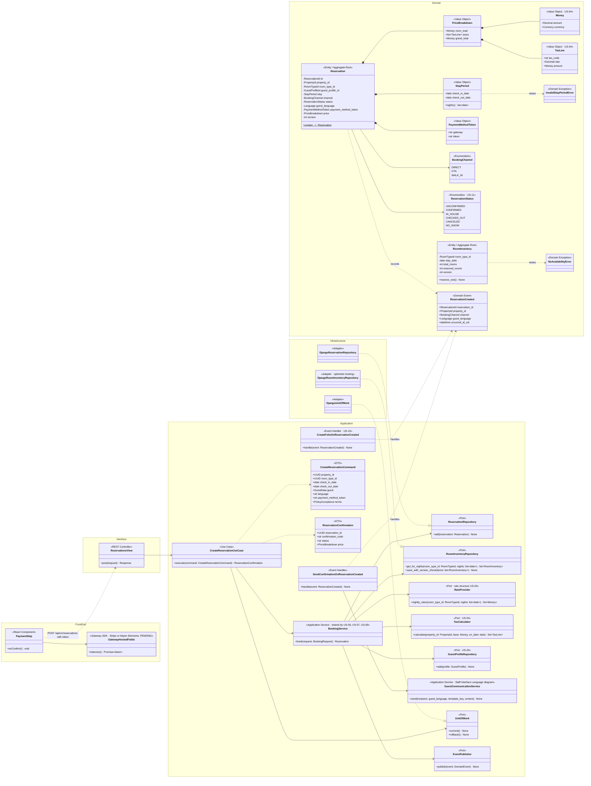
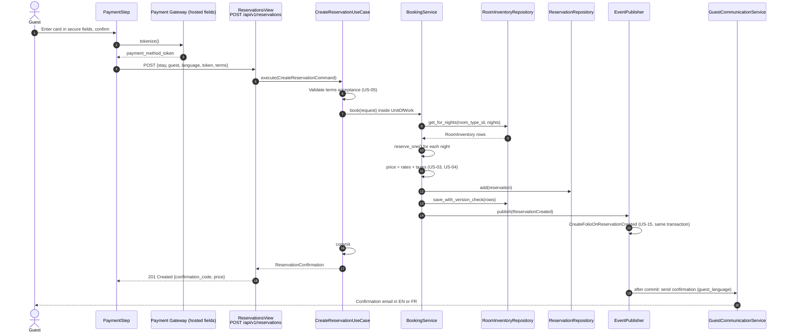
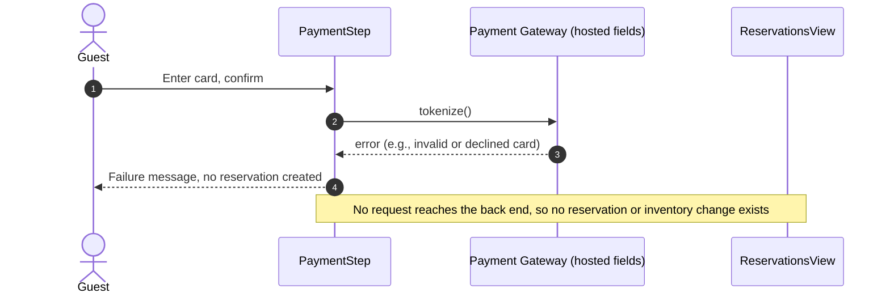
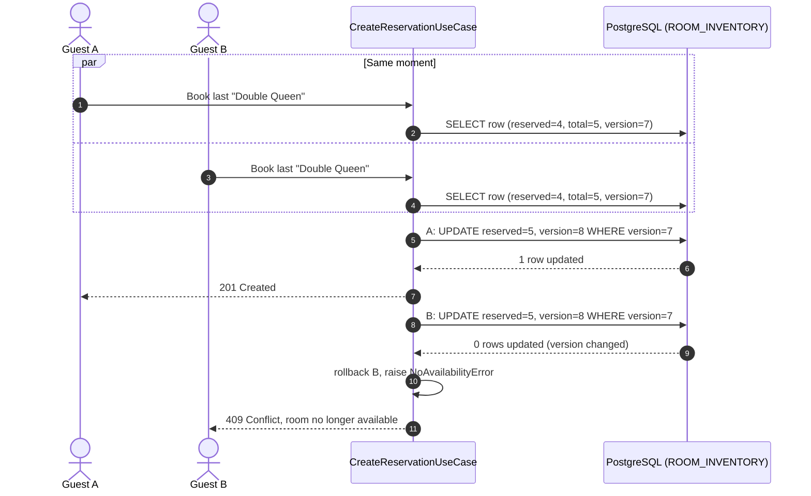

# US-06 — Reservation Creation with Secure Card Tokenization: Diagrams

> Sources: `US-06-reservation-creation-with-secure-card-tokenization.md`, `US-03-availability-search.md`, `US-04-localized-tax-calculation.md`, `docs/Business Modeling/Business Modeling.md` (Phase 1, Section 4), `CLAUDE.md`.
> Elements tagged **PENDING** depend on business rules not defined yet. They are placeholders in the design, not decisions.
> Data is scoped per **Property** (Business Modeling, Section 5) even where the story text does not mention it.

---

## 1. Class Diagram (Clean Architecture + Front-end)

### Design notes
- **Card data never reaches the back end (PCI-DSS):**
  - `GatewayHostedFields` (Stripe or Adyen Elements, gateway PENDING) is rendered by the gateway inside the page and returns a token;
  - the back end only ever receives and stores `PaymentMethodToken`.
- **`BookingService` is the single booking core.** Availability, price, taxes, inventory reservation and reservation creation happen in one place, reused by direct bookings (US-06), OTA bookings (US-07) and walk-ins (US-09). This is how "the same availability, concurrency and tax rules" are guaranteed.
- **`StayPeriod`** enforces the US-03 rules: a minimum of 1 night and a maximum of 5 nights. Check-in is from 4:00 PM and check-out by 11:00 AM in the property's local time. The booking window is PENDING.
- **Scenario 3 (concurrency):**
  - `RoomInventory` is one row per room type per night;
  - `reserve_one()` increments `reserved_rooms` only while it is below `total_rooms`;
  - the repository saves with `WHERE version = :expected`, so if another transaction updated the row first, zero rows are affected and the whole transaction rolls back (`NoAvailabilityError`).
- **Money:** every amount is `Money` (`Decimal` plus currency), following US-04.
- **After commit:**
  - `ReservationCreated` triggers the folio creation (US-15), inside the same transaction;
  - it also triggers the confirmation email in the guest's language, which is sent only after commit so no email goes out for a rolled-back booking.
- **PENDING:**
  - initial status (`UNCONFIRMED` or `CONFIRMED`) and what confirms it;
  - whether any amount is charged at booking;
  - the booking window (how far ahead inventory rows exist).

---

## 2. ER Diagram (PostgreSQL persistence)

```mermaid
erDiagram
    PROPERTY ||--o{ RESERVATION : "receives"
    ROOM_TYPE ||--o{ RESERVATION : "is booked as"
    GUEST_PROFILE ||--o{ RESERVATION : "makes"
    RESERVATION ||--|{ RESERVATION_NIGHT : "occupies"
    RESERVATION ||--o{ RESERVATION_TAX_LINE : "is taxed by"
    ROOM_TYPE ||--o{ ROOM_INVENTORY : "is counted in"
    ROOM_INVENTORY ||--o{ RESERVATION_NIGHT : "is consumed by"

    RESERVATION {
        uuid id PK
        uuid property_id FK "NOT NULL"
        uuid room_type_id FK "NOT NULL"
        uuid guest_profile_id FK "NOT NULL"
        uuid room_id FK "nullable, assignment PENDING (US-13)"
        varchar confirmation_code UK
        varchar channel "DIRECT, OTA, WALK_IN"
        varchar status "US-11, initial value PENDING"
        date check_in_date
        date check_out_date "CHECK 1 to 5 nights"
        varchar guest_language "CHECK IN ('en','fr')"
        varchar payment_gateway "PENDING: stripe or adyen"
        varchar payment_method_token "gateway token, never card data"
        numeric room_total_amount "numeric(12,2)"
        numeric grand_total_amount "numeric(12,2)"
        char currency "CAD"
        int version "optimistic locking"
        timestamptz created_at "UTC"
        timestamptz updated_at "UTC"
    }
    RESERVATION_NIGHT {
        uuid reservation_id PK, FK
        date stay_date PK
        uuid room_inventory_id FK
        numeric nightly_rate_amount
        char currency
    }
    RESERVATION_TAX_LINE {
        uuid id PK
        uuid reservation_id FK
        varchar tax_code "GST, HST, PST, US-04"
        numeric rate "numeric(6,4)"
        numeric amount "numeric(12,2)"
        char currency
    }
    ROOM_INVENTORY {
        uuid id PK
        uuid property_id FK
        uuid room_type_id FK "UNIQUE (room_type_id, stay_date)"
        date stay_date
        int total_rooms
        int reserved_rooms "CHECK reserved_rooms <= total_rooms"
        int version "optimistic locking"
    }
    ROOM_TYPE {
        uuid id PK "partial: US-02"
    }
    GUEST_PROFILE {
        uuid id PK "partial: US-20"
    }
    PROPERTY {
        uuid id PK "partial"
    }
```

### Design notes
- **`ROOM_INVENTORY`** completes the partial table of the room registry: one row per room type and night. The check `reserved_rooms <= total_rooms` is the last line of defence against overbooking, and `version` supports the optimistic locking required by the business document.
- **`RESERVATION_NIGHT`** records which inventory nights a reservation consumes, so a cancellation (US-11) can release exactly those nights.
- **Money columns:** every amount is stored as `numeric(12,2)` next to a currency column (US-04 rule: value and currency together). No floating-point types are used.
- **`payment_method_token`** is only the gateway's reference. Card numbers, expiry dates and CVCs are never stored.

---

## 3. Event Flow

### 3.1 Successful reservation — Scenario 1

### 3.2 Card tokenization fails — Scenario 2

### 3.3 Concurrent booking of the last room — Scenario 3

### 3.4 Domain events

| Event | Emitted by | When | Payload | Consumers |
|---|---|---|---|---|
| `ReservationCreated` | `BookingService` | A reservation is saved (any channel) | `reservation_id`, `property_id`, `channel`, `guest_language`, `occurred_at_utc` | `CreateFolioOnReservationCreated` (US-15, same transaction); `SendConfirmationOnReservationCreated` (after commit) |
