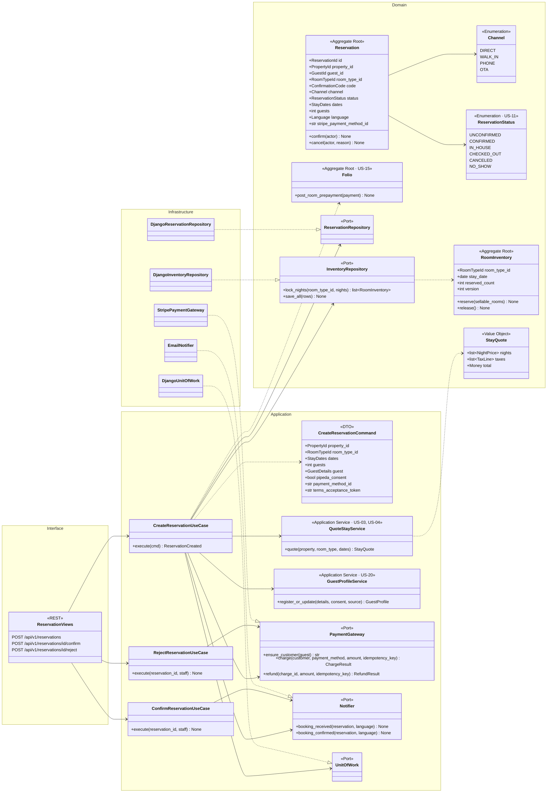
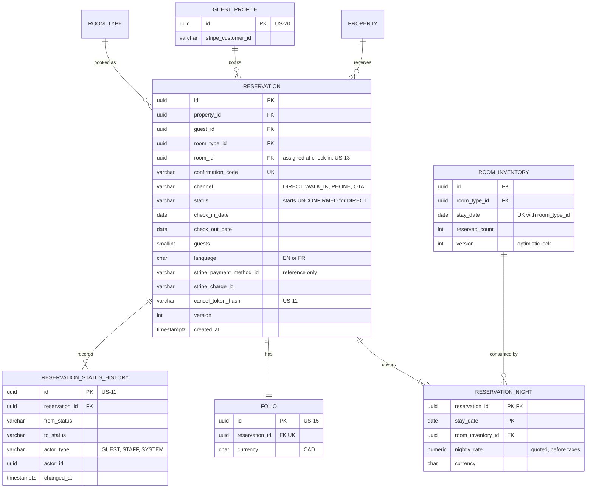
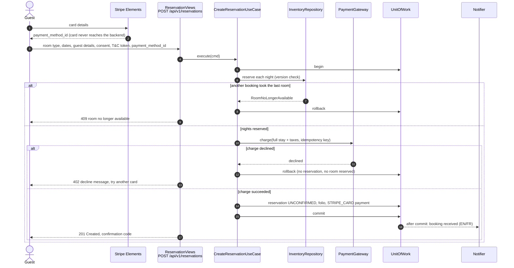
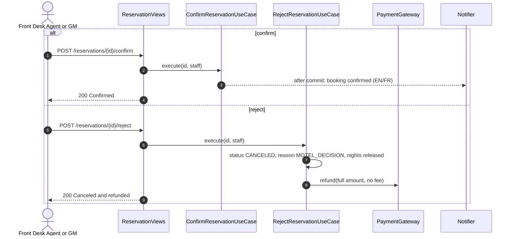

# US-06 — Reservation Creation with Secure Card Tokenization: Diagrams

> Source: `US-06-reservation-creation-with-secure-card-tokenization.md`. Related: US-03 (quote), US-04 (taxes), US-05 (T&C), US-11 (lifecycle and fees), US-13 (deposit hold on the kept card), US-15 (folio), US-20 (guest profile).

## Business rules reflected

| Rule (US-06) | Where it appears |
|---|---|
| Card data never reaches the backend; Stripe hosted elements | Stripe Elements in the widget; backend receives a PaymentMethod id |
| Gateway is Stripe | `PaymentGateway` port, `StripePaymentGateway` adapter |
| Guest provides full name, email, phone and PIPEDA consent; no consent, no booking | `CreateReservationCommand`, `GuestProfileService` (US-20) |
| Full stay (nights + taxes) charged at booking, recorded as a payment in the folio | `PaymentGateway.charge()`, `Folio.post_payment(STRIPE_CARD)` |
| Declined charge: no reservation, no room reserved; guest can try another card | Charge happens before commit; transaction rolled back (Scenario 3) |
| Stripe keeps the card; only its reference is stored; used for the deposit at check-in | `RESERVATION.stripe_payment_method_id`, `GUEST_PROFILE.stripe_customer_id` |
| Direct booking starts Unconfirmed; staff confirm | `Reservation.status = UNCONFIRMED`, `ConfirmReservationUseCase` |
| Unconfirmed bookings reserve the room, show on the dashboard, never expire | `ROOM_INVENTORY.reserved_count`, no expiry job |
| Staff rejection: canceled, full automatic refund, no fee | `RejectReservationUseCase` |
| Guest cancellation: refund minus the cancellation fee | US-11 (`CancelReservationUseCase`) |
| Two emails in EN/FR: "booking received", "booking confirmed" | `Notifier` after commit |
| Optimistic locking on RoomInventory | `RoomInventory.version`, Scenario 4 |

---

## 1. Class Diagram (Clean Architecture)

### Design notes
- **Order inside `CreateReservationUseCase`** (one database transaction):
  1. check the T&C acceptance token (US-05) and the PIPEDA consent;
  2. quote the stay again on the server (never trust the client total);
  3. reserve every night in `ROOM_INVENTORY` with optimistic locking (`UPDATE ... SET reserved_count = reserved_count + 1, version = version + 1 WHERE id = ? AND version = ?`); a lost update raises `RoomNoLongerAvailable` (Scenario 4);
  4. register or update the guest profile (US-20) and its Stripe customer;
  5. charge the full total through Stripe with an idempotency key; a decline raises `PaymentDeclined` and the transaction rolls back, so no reservation and no reserved night exist (Scenario 3);
  6. create the reservation as `UNCONFIRMED` and its folio, and post the payment as a `STRIPE_CARD` credit; room charges are **not** posted yet, because the Night Audit posts each night (US-14);
  7. after commit, send "booking received".
- **If the commit fails after a successful charge**, an after-rollback handler refunds the charge with the same idempotency key, so the guest is never charged without a reservation.
- **Card kept by Stripe:** the charge uses `setup_future_usage = off_session`, so the same PaymentMethod can be used for the deposit hold at check-in (US-13), extra charges at check-out (US-17) and late fines (US-16).
- **Confirm / reject** need the `FRONT_DESK_WORK` permission (Front Desk Agent or GM). Reject = cancel with reason `MOTEL_DECISION`, full refund, no fee, nights released.
- **Tokenization failure (Scenario 2)** happens in Stripe Elements before any call to the backend.

---

## 2. ER Diagram

---

## 3. Event Flow

### 3.1 Successful booking, decline and concurrency — Scenarios 1, 3 and 4

### 3.2 Staff confirms or rejects — Scenarios 5 and 6

### 3.3 Domain events

| Event | Raised when | Consumers |
|---|---|---|
| `ReservationCreated` | Booking committed | "Booking received" email, front desk dashboard (US-10) |
| `PaymentReceived` | Stripe charge posted to the folio | Folio (US-15) |
| `ReservationConfirmed` | Staff confirms | "Booking confirmed" email, dashboard |
| `ReservationCanceled` | Staff rejects (no fee) | Refund (US-11), inventory release, dashboard |
