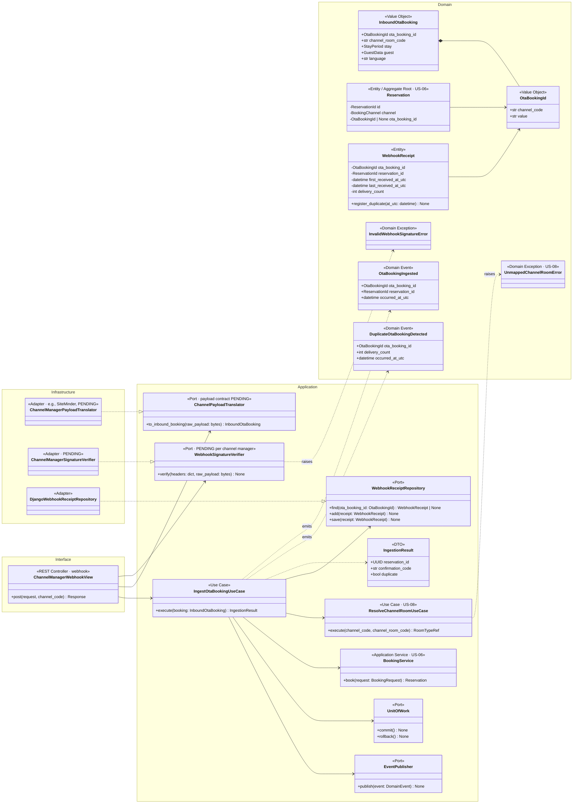
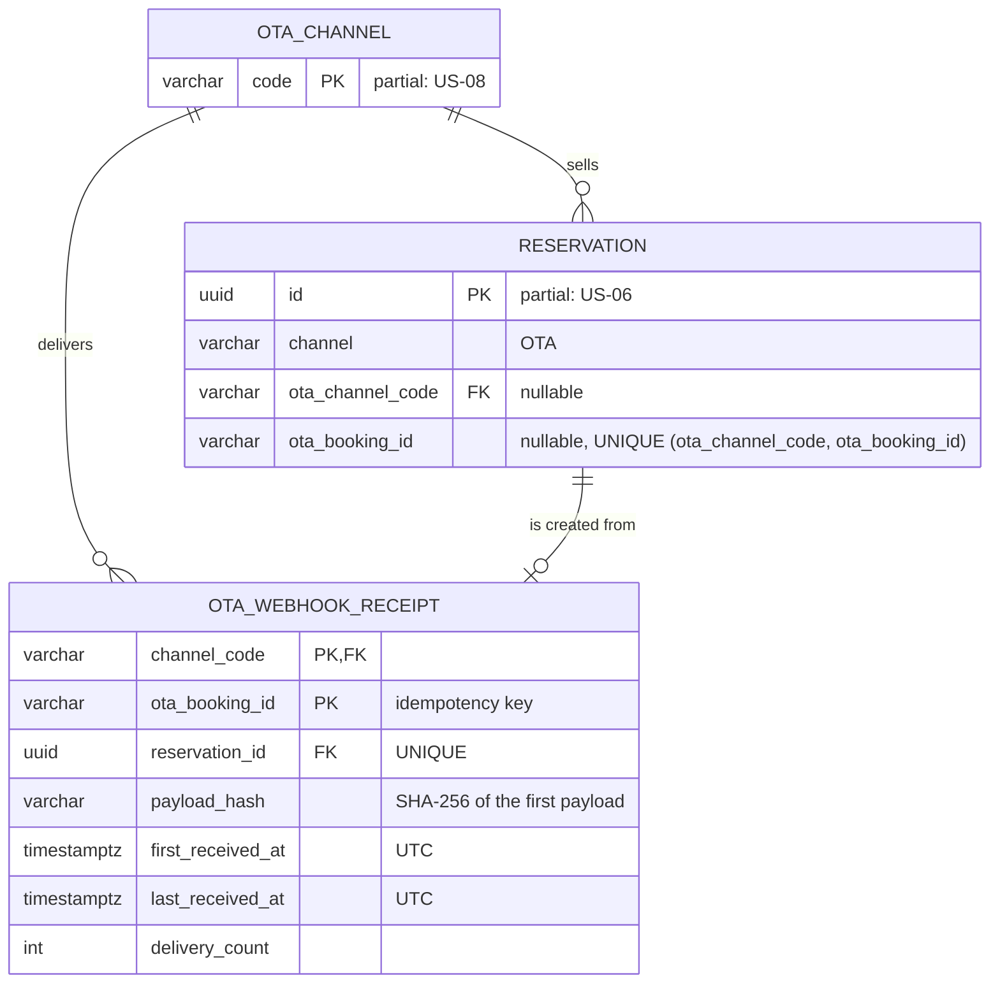
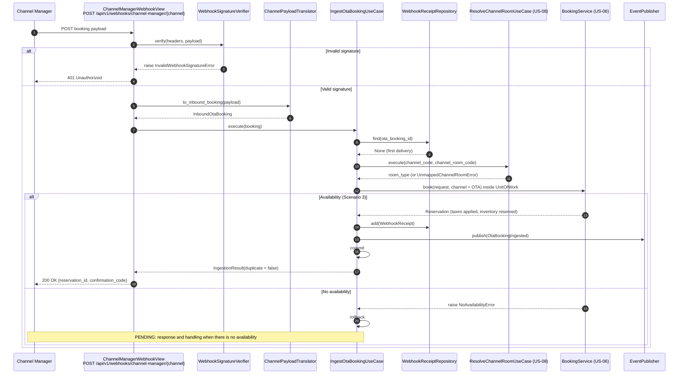
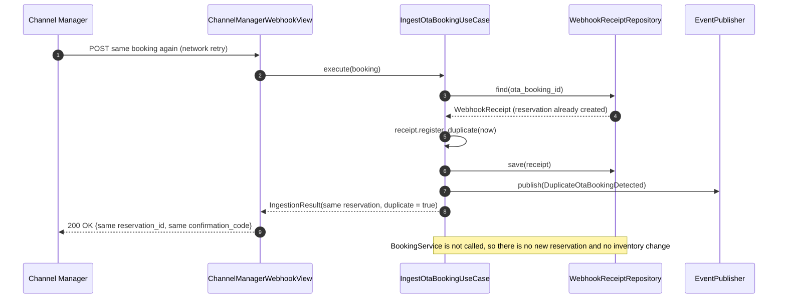
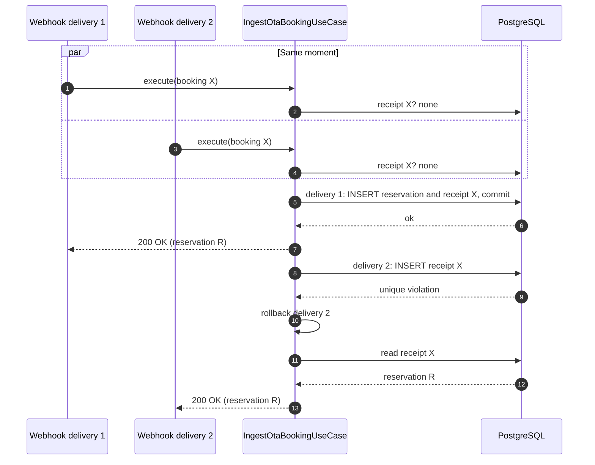

# US-07 — OTA Booking Ingestion via Channel Manager Webhook: Diagrams

> Sources: `US-07-ota-booking-ingestion-via-channel-manager-webhook.md`, `US-08-ota-channel-mapping.md`, `docs/Business Modeling/Business Modeling.md` (Phase 1, Section 4 "Idempotent API Operations"), `CLAUDE.md`.
> Elements tagged **PENDING** depend on business rules not defined yet. They are placeholders in the design, not decisions.
> Data is scoped per **Property** (Business Modeling, Section 5) even where the story text does not mention it.

---

## 1. Class Diagram (Clean Architecture)

### Design notes
- **Idempotency key:** `OtaBookingId` (channel code plus the OTA Booking ID) is the idempotency key required by the business document.
- **`WebhookReceipt` stores the first outcome of each OTA Booking ID.** A repeated webhook finds the receipt and returns the **same** response (same reservation and confirmation code) without calling `BookingService` again (Scenario 2).
- **Concurrent duplicates:** the receipt key is `UNIQUE` in the database. If two identical webhooks arrive at the same time, one insert fails, its transaction rolls back, and the request is answered from the receipt the other one committed.
- **Scenario 3:** OTA bookings go through the same `BookingService` (US-06), so availability, optimistic locking and localized taxes are identical to direct bookings.
- **Anti-corruption layer:** the channel manager payload is translated at the edge by `ChannelPayloadTranslator`, so the domain never depends on the channel manager's format. The channel manager and its contract are PENDING (the document cites SiteMinder as an example).
- **Authenticity:** `WebhookSignatureVerifier` rejects requests that are not signed by the channel manager. The mechanism depends on the provider (PENDING).
- **Processing mode:** processing is synchronous within the webhook request. RabbitMQ could later queue webhooks behind the same use case without changing it, if the stack phase allows.
- **PENDING:**
  - modifications and cancellations sent by webhook;
  - what to do when there is no availability;
  - the HTTP status the channel manager expects in each case.

---

## 2. ER Diagram (PostgreSQL persistence)

### Design notes
- **Two layers of idempotency:**
  - `OTA_WEBHOOK_RECEIPT` (composite primary key) answers repeated deliveries;
  - `UNIQUE (ota_channel_code, ota_booking_id)` on `RESERVATION` guarantees no second reservation can exist even if a receipt is lost.
- **`payload_hash`** detects a redelivery whose content differs from the first one. Treating a different payload as a modification is PENDING.
- **Raw payloads are not stored, because they contain guest PII (PIPEDA).** Only the hash is kept.

---

## 3. Event Flow

### 3.1 New OTA booking — Scenarios 1 and 3

### 3.2 Duplicate webhook — Scenario 2

### 3.3 Two identical webhooks at the same moment

### 3.4 Domain events

| Event | Emitted by | When | Payload | Consumers |
|---|---|---|---|---|
| `ReservationCreated` | `BookingService` (US-06) | OTA reservation saved | see US-06 | Folio creation, confirmation email (sending to OTA guests is PENDING) |
| `OtaBookingIngested` | `IngestOtaBookingUseCase` | First delivery processed | `ota_booking_id`, `reservation_id`, `occurred_at_utc` | PENDING |
| `DuplicateOtaBookingDetected` | `IngestOtaBookingUseCase` | Repeated delivery received | `ota_booking_id`, `delivery_count`, `occurred_at_utc` | PENDING (e.g., monitoring) |
