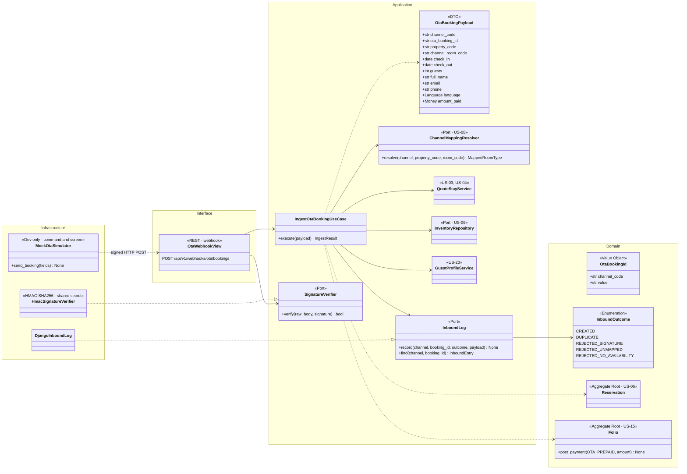
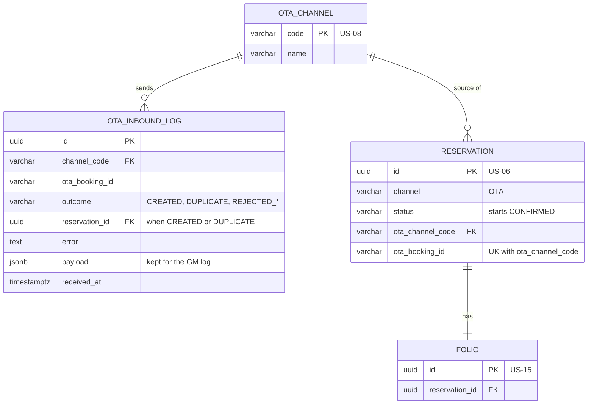
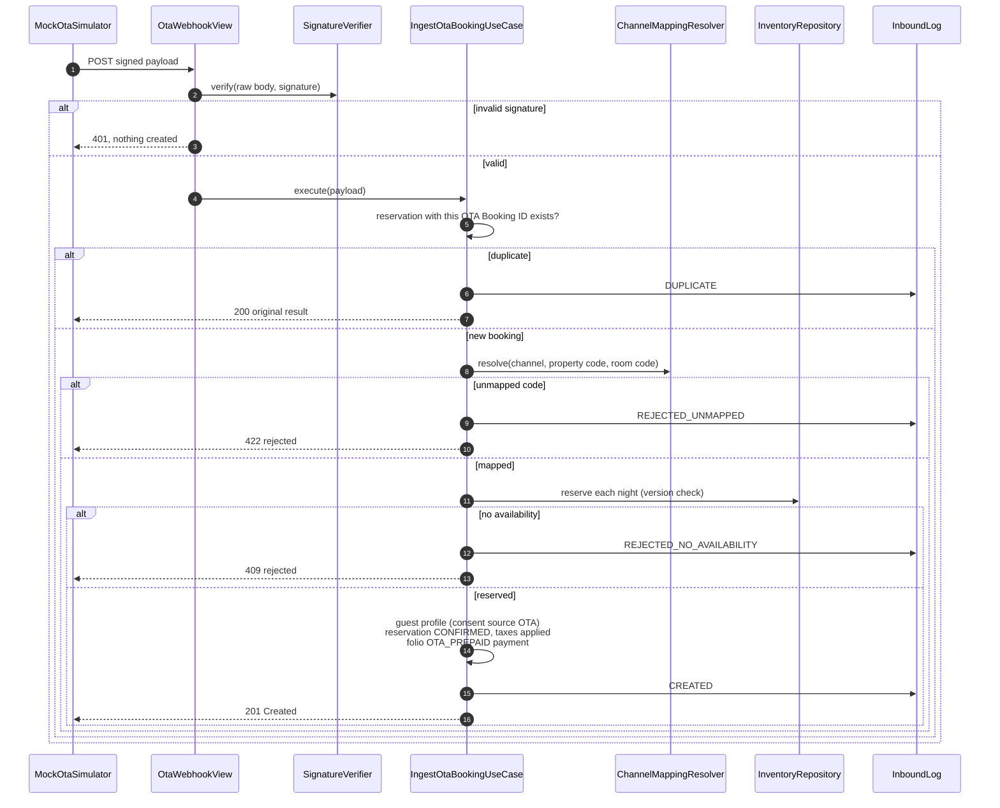

# US-07 — OTA Booking Ingestion via Channel Manager Webhook (mocked): Diagrams

> Source: `US-07-ota-booking-ingestion-via-channel-manager-webhook.md`. Related: US-06 (availability and concurrency), US-08 (channel mapping), US-15 (folio), US-20 (guest profile).

## Business rules reflected

| Rule (US-07) | Where it appears |
|---|---|
| OTA Booking ID is the idempotency key | `UNIQUE (channel_code, ota_booking_id)`, Scenario 2 |
| Same booking phase as direct bookings (availability, taxes) | Reuses `QuoteStayService` and `InventoryRepository` (US-06) |
| All OTA requests are mocked | `MockOtaSimulator` (command + dev screen) |
| The simulator posts to the real webhook endpoint | `OtaWebhookView` is the production endpoint |
| Payload fields (channel, OTA Booking ID, property code, channel room code, dates, guests, name, email, phone, language, amount paid) | `OtaBookingPayload` DTO |
| Mock data assumed valid; amount paid equals the system total | No amount reconciliation step |
| HMAC signature required, including in the mock | `HmacSignatureVerifier`, Scenario 5 |
| No Stripe charge; amount recorded as "OTA prepaid" | `Folio` payment type `OTA_PREPAID` |
| OTA bookings start Confirmed | `Reservation.status = CONFIRMED`, channel `OTA` |
| No availability: nothing created, error returned, logged for the GM | `OTA_INBOUND_LOG.outcome = REJECTED_NO_AVAILABILITY`, Scenario 4 |
| New bookings only; modifications and cancellations out of scope | Single event type accepted |
| PIPEDA consent recorded with source "OTA" | `GuestProfileService.register_or_update(..., source=OTA)` |
| No email to OTA guests | No `Notifier` call |

---

## 1. Class Diagram (Clean Architecture)

### Design notes
- **The signature is checked on the raw body** before parsing. An invalid signature returns `401` and creates nothing (Scenario 5).
- **Idempotency (Scenario 2):** the use case first looks for an existing reservation with the same `(channel_code, ota_booking_id)`. If found, it returns the original result (`200` with the same reservation code) and logs `DUPLICATE`. The unique constraint also protects against two concurrent deliveries.
- **Same booking phase:** the room type comes from the mapping (US-08), then the stay is quoted with taxes and the nights are reserved with the same optimistic locking as US-06 (Scenario 3).
- **Folio:** the reservation is created `CONFIRMED` with channel `OTA`, and the amount paid is posted as an `OTA_PREPAID` payment (debit OTA receivable, US-15). No Stripe call and no email.
- **Rejections** (no availability, unmapped code) return `409` / `422` to the simulator and are written to `OTA_INBOUND_LOG`, which the GM can see.
- **Simulator:** `manage.py ota_simulate` and a dev-only screen build a payload, sign it with the shared secret from an environment variable and post it to the real endpoint. It is not deployed to production.

---

## 2. ER Diagram

---

## 3. Event Flow

### 3.1 Ingestion — Scenarios 1 to 5

### 3.2 Domain events

| Event | Raised when | Consumers |
|---|---|---|
| `OtaReservationCreated` | Booking created | Front desk dashboard (US-10) |
| `OtaBookingRejected` | Unmapped code or no availability | GM log |
