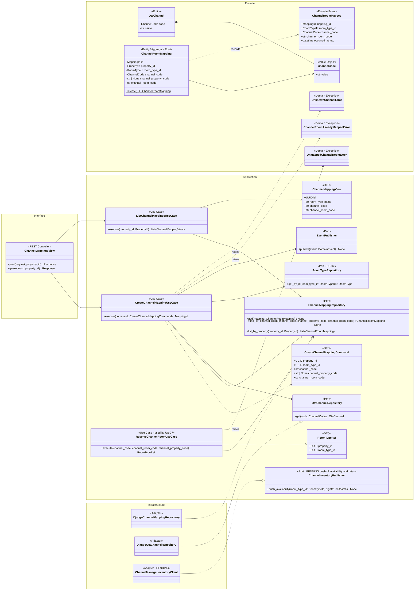
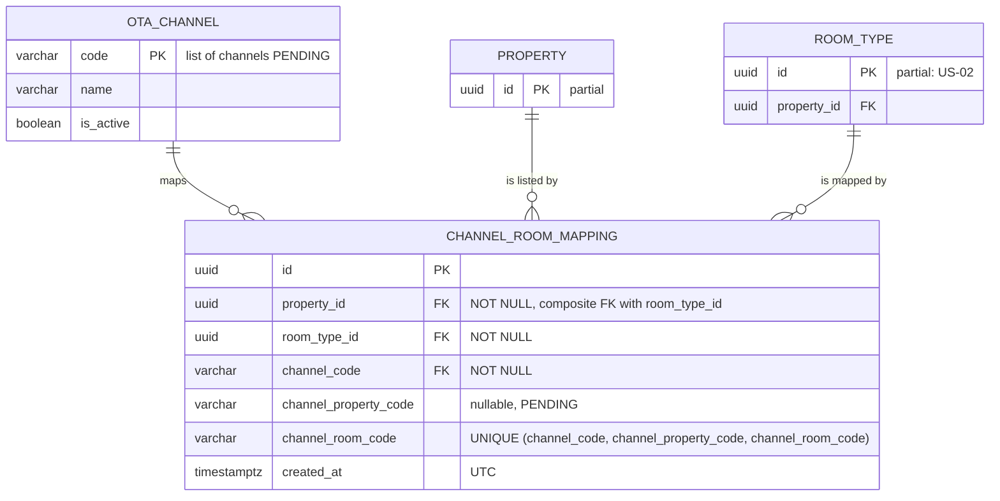
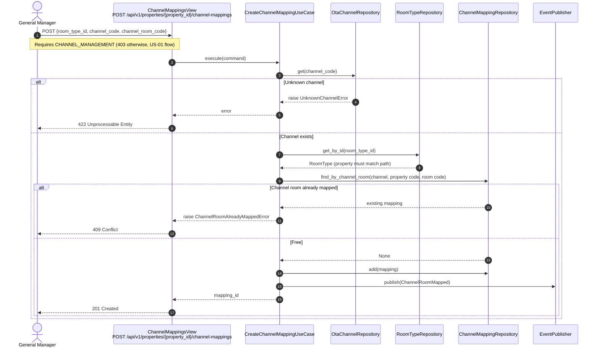
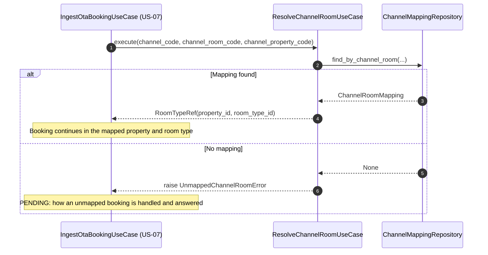

# US-08 — OTA Channel Mapping: Diagrams

> Sources: `US-08-ota-channel-mapping.md`, `US-07-ota-booking-ingestion-via-channel-manager-webhook.md`, `docs/Business Modeling/Business Modeling.md` (Personas, Section 5), `CLAUDE.md`.
> Elements tagged **PENDING** depend on business rules not defined yet. They are placeholders in the design, not decisions.
> Data is scoped per **Property** (Business Modeling, Section 5) even where the story text does not mention it.

---

## 1. Class Diagram (Clean Architecture)

### Design notes
- **What a mapping links:** a `ChannelRoomMapping` connects a channel's room code to a room type of one property. The room type's property is copied into the mapping, so an inbound booking (US-07) always resolves to a property **and** a room type.
- **Uniqueness:** a channel room code can point to only one room type (`ChannelRoomAlreadyMappedError`). Otherwise an inbound booking would be ambiguous.
- **`channel_property_code` is PENDING.** It is filled only if each property is a separate listing in the channel manager (Business Modeling, Section 5).
- **`ChannelInventoryPublisher` is drawn but PENDING.** The story only states "real-time inventory distribution"; whether availability and rates are pushed to channels, and the mapping granularity (room type or rate plan), are undefined.
- **Supported channels (PENDING):** they are reference data in `OTA_CHANNEL`, so adding one is data, not code.
- **Permission:** writes are restricted to the General Manager (OTA channel mapping is in the General Manager persona). A dedicated `CHANNEL_MANAGEMENT` permission is added to the role-permission matrix (US-01).

---

## 2. ER Diagram (PostgreSQL persistence)

### Design notes
- **Same property guaranteed:** the composite foreign key `(room_type_id, property_id) REFERENCES room_type (id, property_id)` makes the mapping's property always match the room type's property.
- **Unique key with a nullable column:** the unique key includes `channel_property_code`. PostgreSQL 15+ `UNIQUE NULLS NOT DISTINCT` keeps it strict while that column is null.
- **Rate plans:** if the granularity is per rate plan (PENDING), a `rate_plan_code` column joins the unique key.

---

## 3. Event Flow

### 3.1 Creating a mapping — Scenario 1

### 3.2 Resolving an inbound booking — Scenario 2

### 3.3 Domain events

| Event | Emitted by | When | Payload | Consumers |
|---|---|---|---|---|
| `ChannelRoomMapped` | `CreateChannelMappingUseCase` | A mapping is saved | `mapping_id`, `room_type_id`, `channel_code`, `channel_room_code`, `occurred_at_utc` | PENDING (e.g., initial availability push, if pushing is confirmed) |
