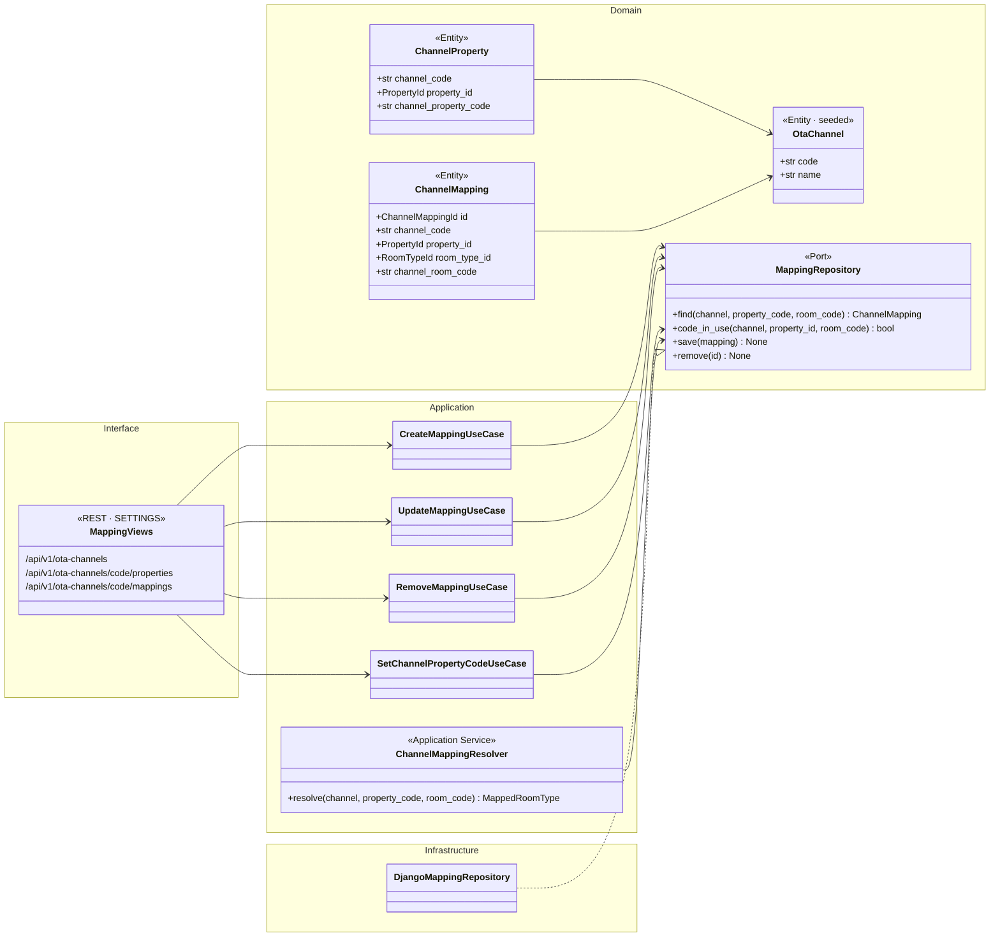
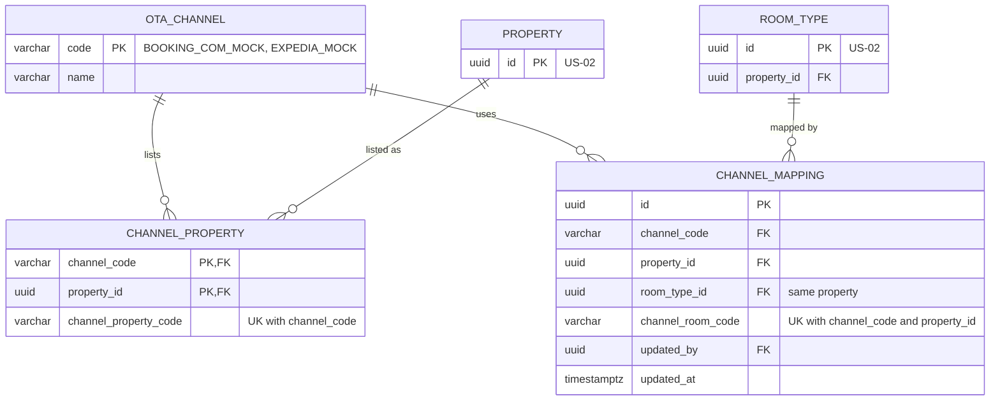
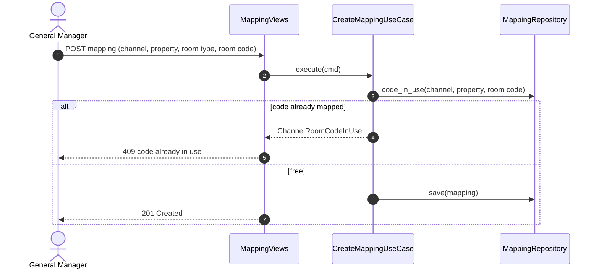
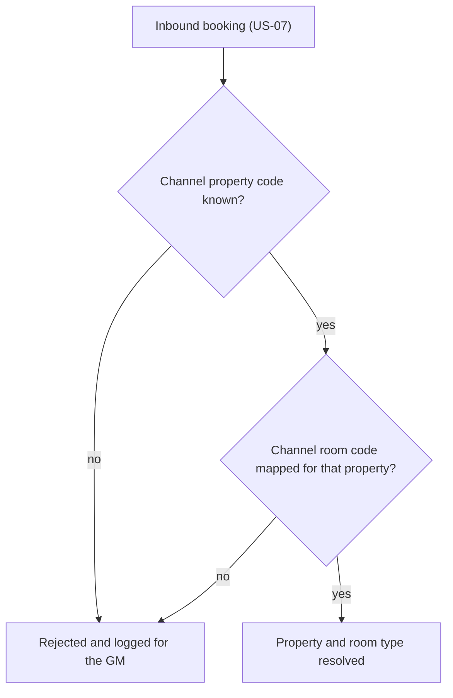

# US-08 — OTA Channel Mapping: Diagrams

> Source: `US-08-ota-channel-mapping.md`. Related: US-02 (properties and room types), US-07 (inbound bookings).

## Business rules reflected

| Rule (US-08) | Where it appears |
|---|---|
| No real-time inventory distribution; mappings only resolve inbound bookings | Only `ChannelMappingResolver` reads mappings; no outbound adapter |
| Two pre-loaded mock channels; the GM cannot add more | Seeded `OTA_CHANNEL` rows; no create endpoint |
| A mapping links a property's room type to a channel room code; no rate plans | `CHANNEL_MAPPING` columns |
| Each property is a separate listing with its own channel property code | `CHANNEL_PROPERTY` |
| A code maps to exactly one room type; a room type can map to several channels | `UNIQUE (channel_code, property_id, channel_room_code)` |
| Unmapped code: booking rejected and logged | `UnmappedChannelRoom` → US-07 log |
| GM only: add, edit, remove; removal does not affect existing reservations | `SETTINGS` permission; reservations store `room_type_id`, not the mapping |

---

## 1. Class Diagram (Clean Architecture)

### Design notes
- **Seed:** `BOOKING_COM_MOCK` ("Booking.com (mock)") and `EXPEDIA_MOCK` ("Expedia (mock)"). `/api/v1/ota-channels` is read-only.
- **Resolution:** the inbound `property_code` is matched against `CHANNEL_PROPERTY.channel_property_code` for that channel, then the room code against `CHANNEL_MAPPING` for that property.
- **Removal** deletes the mapping row only. Reservations keep their own `room_type_id`, so they are not affected; later bookings for that code are rejected as unmapped.
- **The room type must belong to the property** of the mapping and be active.

---

## 2. ER Diagram

---

## 3. Event Flow

### 3.1 Creating a mapping — Scenarios 1 and 3

### 3.2 Resolving an inbound booking — Scenarios 2 and 4

### 3.3 Domain events

| Event | Raised when | Consumers |
|---|---|---|
| `ChannelMappingChanged` | GM adds, edits or removes a mapping | Audit log |
