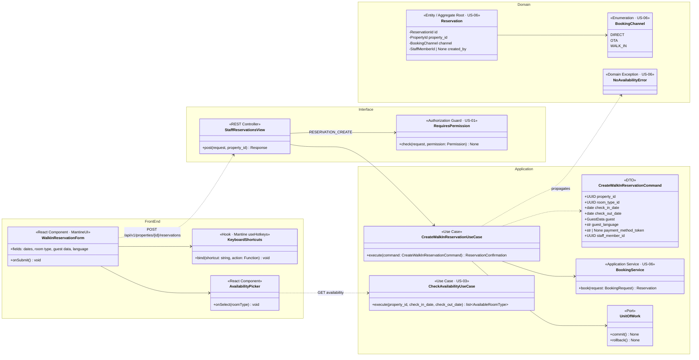
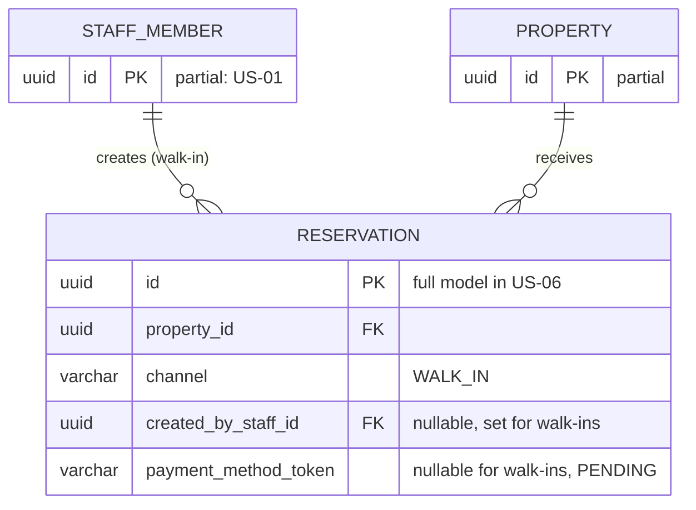
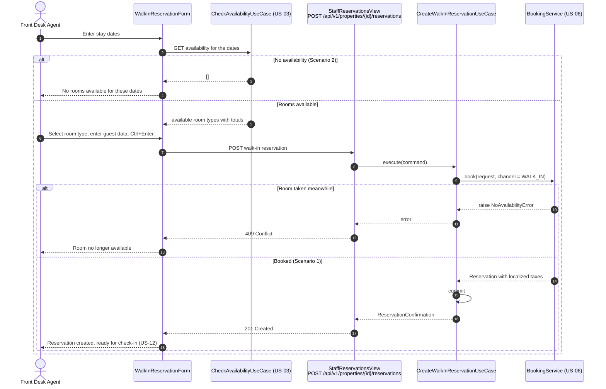
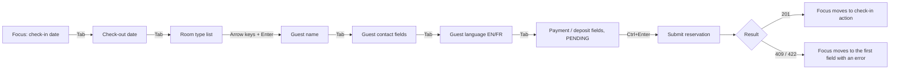

# US-09 — Walk-in Reservation: Diagrams

> Sources: `US-09-walk-in-reservation.md`, `US-06-reservation-creation-with-secure-card-tokenization.md`, `docs/Business Modeling/Business Modeling.md` (Personas, Section 5), `CLAUDE.md`.
> Elements tagged **PENDING** depend on business rules not defined yet. They are placeholders in the design, not decisions.
> Data is scoped per **Property** (Business Modeling, Section 5) even where the story text does not mention it.

---

## 1. Class Diagram (Clean Architecture + Front-end)

### Design notes
- **Same rules as other bookings:** a walk-in is a reservation with `channel = WALK_IN` created through the same `BookingService` (US-06). Availability, optimistic locking, stay limits (1 to 5 nights) and localized taxes therefore match direct and OTA bookings.
- **`created_by`** records the Front Desk Agent who created the reservation. Creating reservations at the desk requires a `RESERVATION_CREATE` permission (role-permission matrix, US-01).
- **Property:** the reservation is created for the property where the agent is working (path parameter). How staff are assigned to properties is PENDING.
- **Keyboard-only operation (Scenario 3):**
  - the form follows a linear tab order, and every field is a native or MantineUI input reachable with `Tab`/`Shift+Tab`;
  - the room type is chosen with the arrow keys plus `Enter`;
  - `Ctrl+Enter` submits;
  - `KeyboardShortcuts` uses MantineUI's `useHotkeys` hook, so no extra library is needed;
  - the exact shortcut set is a UI proposal to confirm.
- **`payment_method_token` is optional** because whether walk-ins go through card tokenization and T&C acceptance, and how cash guests are handled (including the deposit), are PENDING.

---

## 2. ER Diagram (PostgreSQL persistence)

### Design notes
- **No new table.** A walk-in reuses `RESERVATION`, `RESERVATION_NIGHT`, `RESERVATION_TAX_LINE` and `ROOM_INVENTORY` from US-06.
- **New column:** `created_by_staff_id` is added to `RESERVATION`, for traceability of desk sales.
- **`CHECK` constraint:** `payment_method_token` may be null only when `channel = 'WALK_IN'`. Direct bookings always carry a token (US-06).

---

## 3. Event Flow

### 3.1 Walk-in reservation — Scenarios 1 and 2

### 3.2 Keyboard-only operation — Scenario 3

### 3.3 Domain events

| Event | Emitted by | When | Payload | Consumers |
|---|---|---|---|---|
| `ReservationCreated` | `BookingService` (US-06) | Walk-in reservation saved (`channel = WALK_IN`) | see US-06 | Folio creation (US-15); confirmation email to walk-ins is PENDING |
