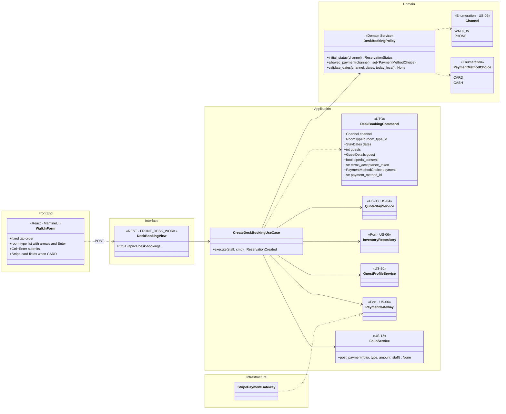
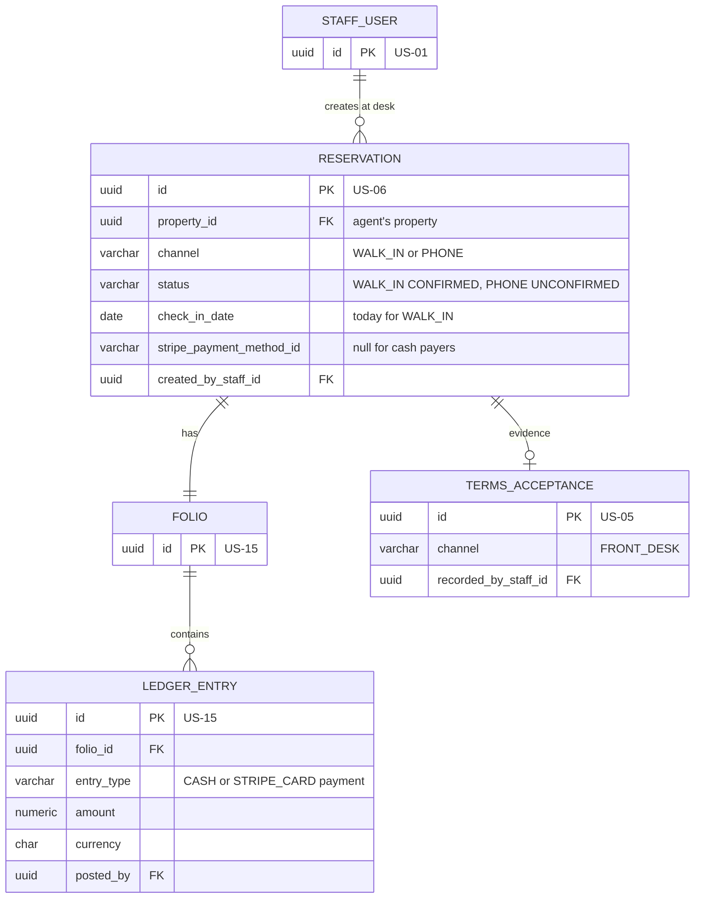
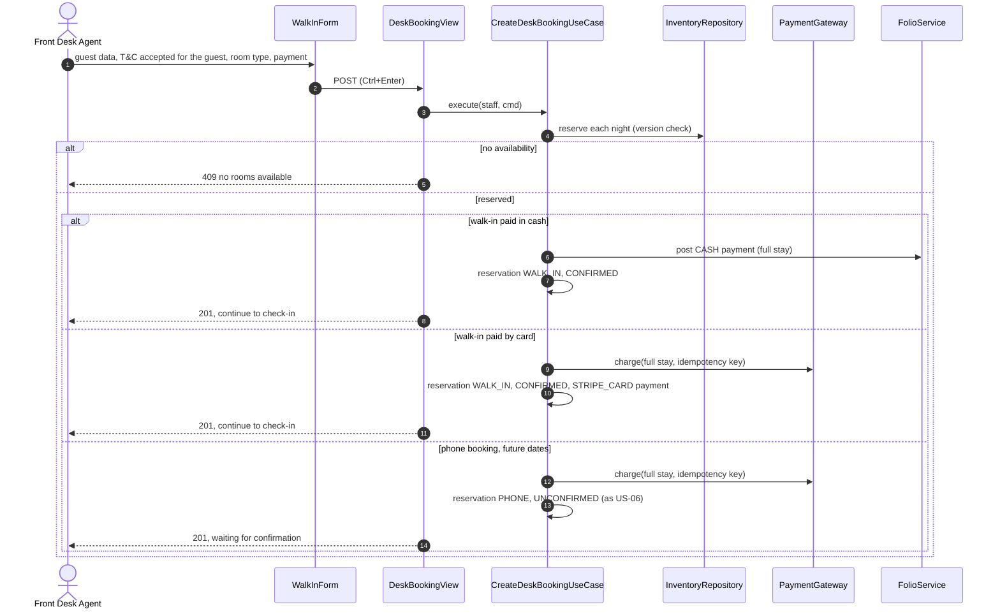

# US-09 — Walk-in Reservation: Diagrams

> Source: `US-09-walk-in-reservation.md`. Related: US-05 (T&C at the desk), US-06 (booking rules), US-12 and US-13 (check-in), US-15 (cash payment), US-20 (guest profile).

## Business rules reflected

| Rule (US-09) | Where it appears |
|---|---|
| Same availability, concurrency and tax rules | Reuses `QuoteStayService` and `InventoryRepository` (US-06) |
| Created for the agent's property | `property_id` taken from the session (US-01), not from the request |
| Walk-in starts today (property local date) and continues to check-in | `StayDates.check_in == today`, response links to check-in |
| Same T&C acceptance, recorded by the agent | `AcceptTermsUseCase` with `FRONT_DESK` (US-05) |
| Name, email (required), phone, PIPEDA consent | `DeskBookingCommand` validation |
| Full stay paid at creation: card via Stripe fields on the desk screen, or cash recorded in the folio | `PaymentMethodChoice` = `CARD` or `CASH` |
| Card tokenization only for card payers | No Stripe customer created for cash payers |
| Walk-ins start Confirmed | `channel = WALK_IN`, `status = CONFIRMED` |
| Phone bookings for future dates: same form, card only, start Unconfirmed | `channel = PHONE`, `status = UNCONFIRMED`, cash refused |
| Arrival before 4:00 PM needs early check-in approval (US-12) | Flag on the reservation, handled at check-in |
| Keyboard: Tab/Shift+Tab fixed order, arrows + Enter for room type, Ctrl+Enter submits | `WalkInForm` front-end component |

---

## 1. Class Diagram (Clean Architecture)

### Design notes
- **`DeskBookingPolicy`:**
  - `WALK_IN`: check-in must be today (property local date); status `CONFIRMED`; payment `CARD` or `CASH`.
  - `PHONE`: check-in after today, within the US-03 booking window; status `UNCONFIRMED`; payment `CARD` only.
- **Card payment:** the Stripe card fields run on the desk screen, so card data never reaches the backend; the charge, the kept card and the rollback rules are the same as US-06.
- **Cash payment:** no Stripe call; the agent's cash payment is posted to the folio as a `CASH` payment (debit cash, credit guest receivable, US-15) in the same transaction as the reservation.
- **Next step:** for a walk-in, the response returns the reservation id and the front end opens the check-in screen (US-12, US-13). If the local time is before 4:00 PM, the dashboard flag "early check-in approval needed" applies (US-10, US-12).
- **Permission:** `FRONT_DESK_WORK` (Front Desk Agent or GM).

---

## 2. ER Diagram

---

## 3. Event Flow

### 3.1 Walk-in by card or cash, and phone booking — Scenarios 1 to 4

### 3.2 Domain events

| Event | Raised when | Consumers |
|---|---|---|
| `ReservationCreated` (channel `WALK_IN` or `PHONE`) | Desk booking committed | Front desk dashboard (US-10); "booking received" email for phone bookings (US-06) |
| `PaymentReceived` | Card charge or cash posted | Folio (US-15) |
