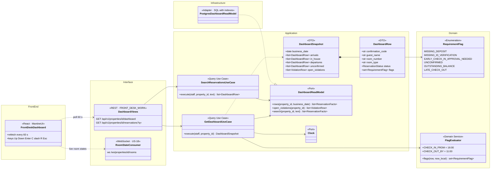
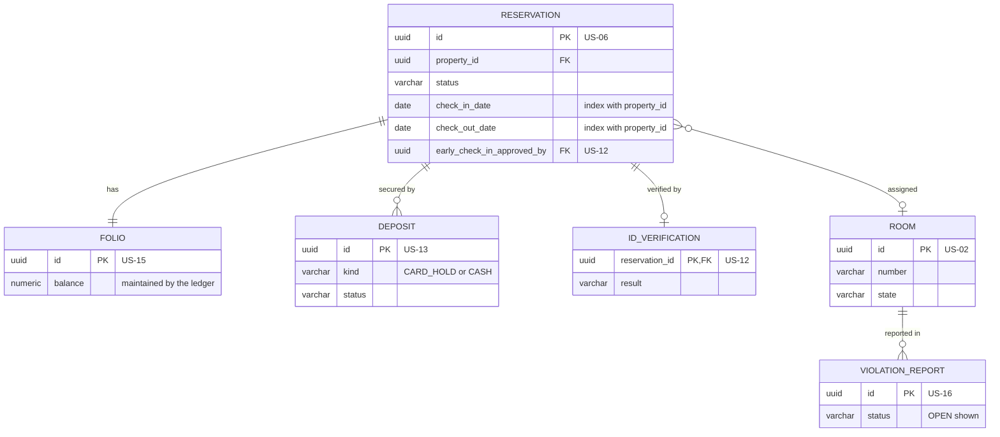
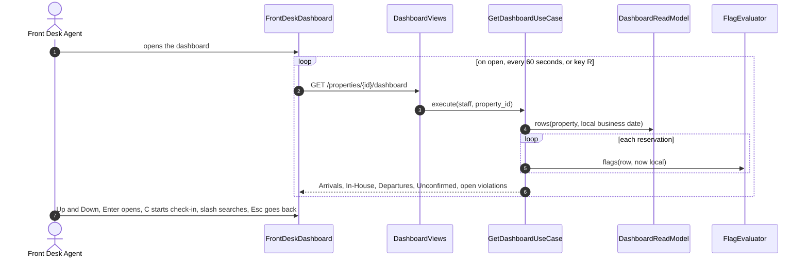

# US-10 — Front Desk Dashboard: Diagrams

> Source: `US-10-front-desk-dashboard.md`. Related: US-06 (Unconfirmed), US-12 (ID, early check-in), US-13 (deposit), US-16 (violation reports), US-17 (balance), US-18 (live room states).

## Business rules reflected

| Rule (US-10) | Where it appears |
|---|---|
| Lists for the agent's property and today (local date): Arrivals, In-House, Departures, Unconfirmed, open violation reports | `DashboardSnapshot` sections |
| Flags: missing deposit, missing ID, early check-in approval needed, Unconfirmed, outstanding balance on departure, late check-out | `RequirementFlag`, `FlagEvaluator` |
| Auto-refresh every 60 s plus a refresh key | `useDashboard` polling, key `R` |
| Shortcuts: ↑/↓, Enter, C, /, R, Esc | `DashboardKeyboardMap` |
| Search by guest name, confirmation code or room number | `SearchReservationsUseCase` |
| Agent sees own property; GM chooses | `PropertyScope` (US-01) |
| API ≤ 1.5 s for 95% of requests (exports and external services excluded) | Read model with indexes; performance test |

---

## 1. Class Diagram (Clean Architecture)

### Design notes
- **Flag rules (`FlagEvaluator`):**
  - `MISSING_DEPOSIT`: arrival or In-House without an authorized card hold and without a cash deposit (US-13).
  - `MISSING_ID_VERIFICATION`: arrival without a successful ID check (US-12).
  - `EARLY_CHECK_IN_APPROVAL_NEEDED`: arrival, local time before 4:00 PM, no approval (US-12).
  - `UNCONFIRMED`: status `UNCONFIRMED` (US-06).
  - `OUTSTANDING_BALANCE`: departure with folio balance ≠ $0.00 (US-17).
  - `LATE_CHECK_OUT`: departure still `IN_HOUSE` after 11:00 AM local time.
- **Business date** = the property's local date from the `Clock`.
- **Scope:** a Front Desk Agent's `property_id` must equal their own; the GM can pass any property.
- **Performance:** one query per section, using the indexes below, keeps the request under the 1.5 s p95 target.
- **Room states** on the dashboard also update live through the WebSocket of US-18; the 60-second polling refreshes everything else.

---

## 2. ER Diagram (sources of the read model)

---

## 3. Event Flow

### 3.1 Loading, auto-refresh and keyboard — Scenarios 1 to 5

### 3.2 Domain events

None emitted. The dashboard reads data produced by US-06, US-12, US-13, US-16, US-17 and room-state events from US-19 (pushed through US-18).
