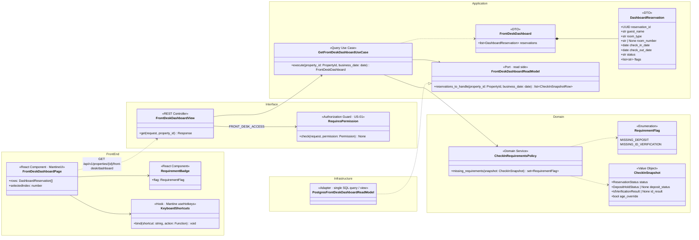
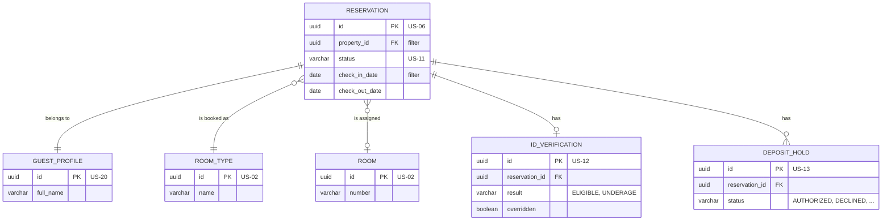
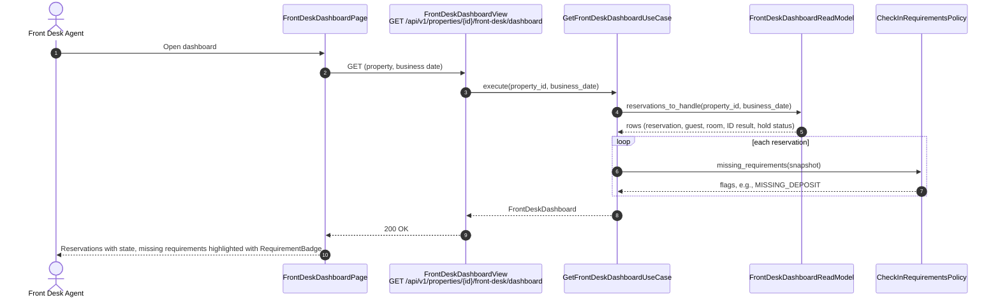
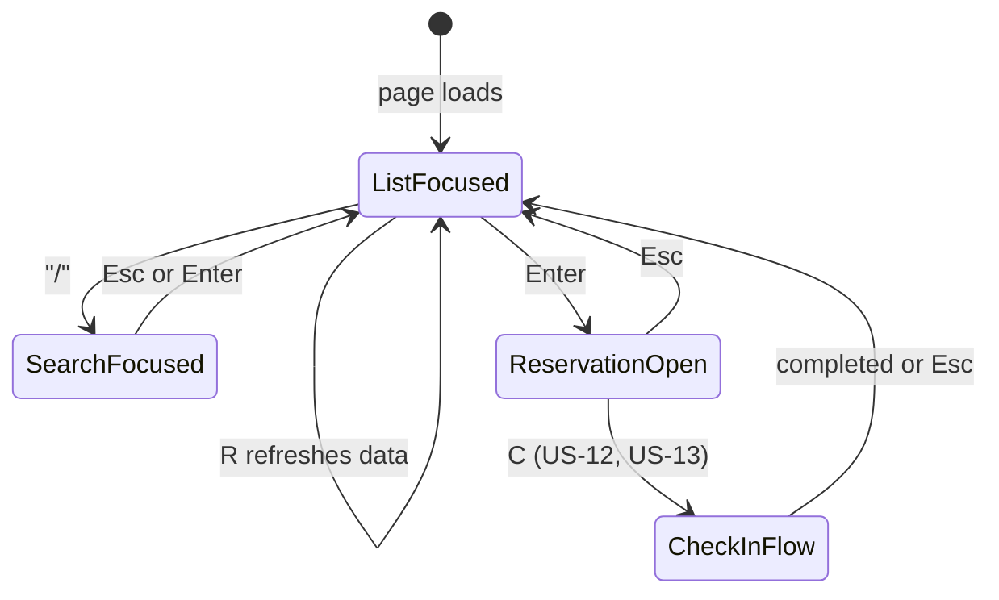

# US-10 — Front Desk Dashboard: Diagrams

> Sources: `US-10-front-desk-dashboard.md`, `US-12-check-in-with-age-verification.md`, `US-13-deposit-pre-authorization-hold.md`, `docs/Business Modeling/Business Modeling.md` (Personas, Section 5), `CLAUDE.md`.
> Elements tagged **PENDING** depend on business rules not defined yet. They are placeholders in the design, not decisions.
> Data is scoped per **Property** (Business Modeling, Section 5) even where the story text does not mention it.

---

## 1. Class Diagram (Clean Architecture + Front-end)

### Design notes
- **CQRS-style read side:** the dashboard is a query, not a domain operation. `FrontDeskDashboardReadModel` reads everything in **one** SQL query (or database view) joining reservation, guest, room, ID verification and deposit hold, so the screen is fast (business document: "extreme efficiency").
- **Flags are computed in the domain** (`CheckInRequirementsPolicy`), not in SQL or React, so the same rule can also block the check-in itself (US-13):
  - `MISSING_ID_VERIFICATION`: no successful ID verification (US-12) and no management override;
  - `MISSING_DEPOSIT`: no authorized deposit hold (US-13).
- **Which reservations appear (PENDING):** the full dashboard content (arrivals, in-house, departures) and any extra flags are undefined. Flags apply to reservations that are not yet In-House, because both requirements belong to check-in.
- **Keyboard-friendly (Scenario 3):**
  - **Navigate:** `↑`/`↓` move the selected row;
  - **Act:** `Enter` opens it, `C` starts check-in, `/` focuses the search, `R` refreshes;
  - this shortcut set is a UI proposal to confirm, implemented with MantineUI's `useHotkeys`.
- **Response-time targets** are PENDING.
- **Permission:** a `FRONT_DESK_ACCESS` permission is added to the role-permission matrix (US-01).

---

## 2. ER Diagram (sources of the read model)

### Design notes
- **No new table.** The dashboard reads the tables owned by US-02, US-06, US-12, US-13 and US-20.
- **Index:** `RESERVATION (property_id, check_in_date, status)` supports the main filter.
- **Database view:** the query can live in a view such as `front_desk_dashboard_v` so the read model stays a single, testable SQL statement.

---

## 3. Event Flow

### 3.1 Opening the dashboard — Scenarios 1 and 2

### 3.2 Keyboard navigation — Scenario 3

### 3.3 Domain events

No domain event is emitted; this story is read-only. Data freshness comes from reloading (`R` or periodic refresh). Pushing live updates to the dashboard is PENDING.
