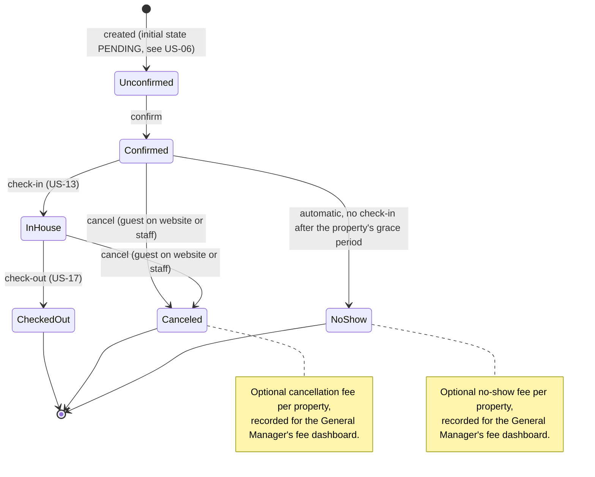
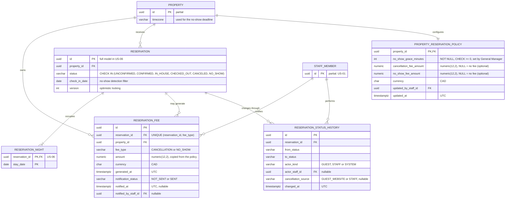
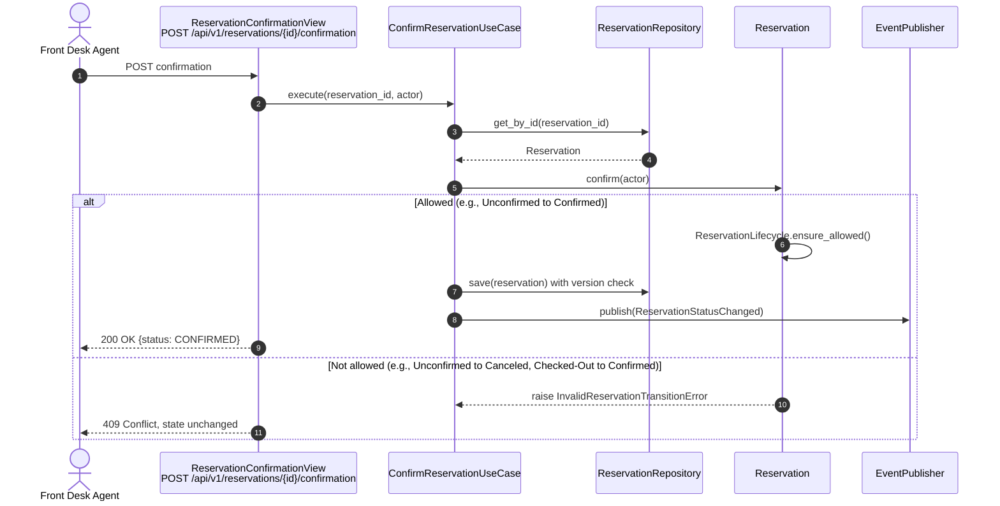
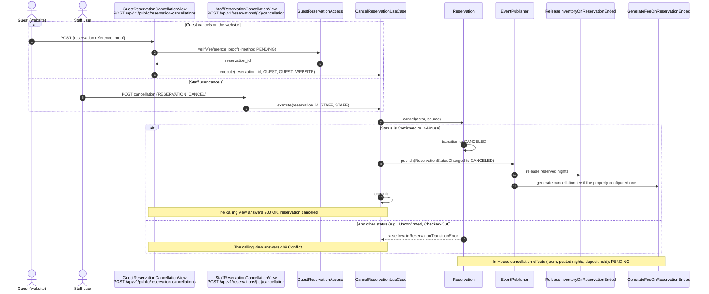
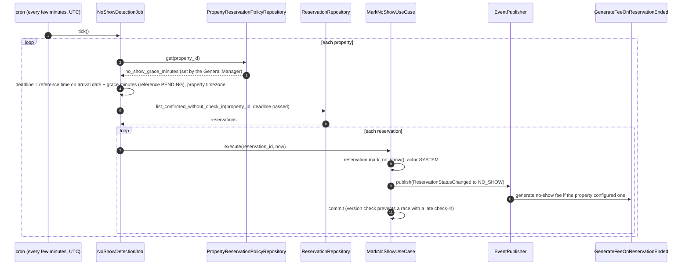
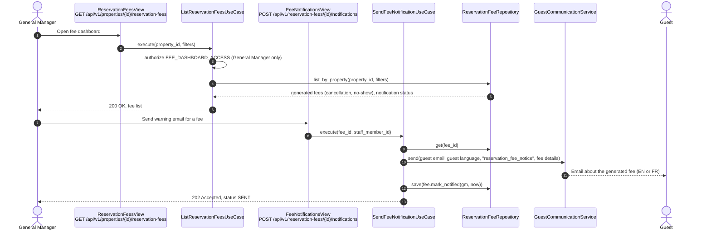
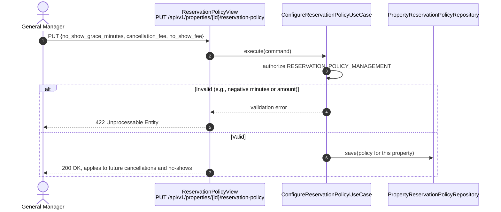

# US-11 — Reservation Lifecycle Management: Diagrams

> Sources: `US-11-reservation-lifecycle-management.md` (Business Rules updated on 2026-11-01), `docs/Business Modeling/Business Modeling.md` (Sections 2, 3 and 5), `CLAUDE.md`.
> Elements tagged **PENDING** depend on business rules not defined yet. They are placeholders in the design, not decisions.
> Data is scoped per **Property** (Business Modeling, Section 5). The no-show grace period and the fees are configured per property.

---

## 1. Reservation State Machine

### Transition rules (from the Business Rules)

| From | To | Trigger | Who |
|---|---|---|---|
| Unconfirmed | Confirmed | confirm | PENDING (see US-06) |
| Confirmed | In-House | check-in | Front Desk Agent (US-13) |
| In-House | Checked-Out | check-out | Front Desk Agent (US-17) |
| Confirmed | Canceled | cancel | Guest (website) or staff user |
| In-House | Canceled | cancel | Guest (website) or staff user |
| Confirmed | No-Show | grace period expired without check-in | System (scheduled job) |

Any other transition is rejected (Scenario 2). Unconfirmed reservations cannot be canceled, because the rule only allows canceling "valid" reservations (Confirmed or In-House).

---

## 2. Class Diagram (Clean Architecture)

```mermaid
classDiagram
    direction LR

    namespace Domain {
        class Reservation {
            <<Entity / Aggregate Root · US-06>>
            -ReservationId id
            -PropertyId property_id
            -ReservationStatus status
            -date check_in_date
            -int version
            +confirm(by: Actor) None
            +cancel(by: Actor, source: CancellationSource) None
            +mark_no_show(at_utc: datetime) None
            -transition_to(target: ReservationStatus, by: Actor) None
        }
        class ReservationStatus {
            <<Enumeration>>
            UNCONFIRMED
            CONFIRMED
            IN_HOUSE
            CHECKED_OUT
            CANCELED
            NO_SHOW
        }
        class CancellationSource {
            <<Enumeration>>
            GUEST_WEBSITE
            STAFF
        }
        class ReservationLifecycle {
            <<Domain Service / Transition Table>>
            +allowed_targets(current: ReservationStatus) set~ReservationStatus~
            +ensure_allowed(current, target) None
        }
        class Actor {
            <<Value Object>>
            +str kind "GUEST, STAFF or SYSTEM"
            +StaffMemberId | None staff_member_id
        }
        class PropertyReservationPolicy {
            <<Entity / Aggregate Root>>
            -PropertyId property_id
            -int no_show_grace_minutes
            -FeeRule | None cancellation_fee
            -FeeRule | None no_show_fee
            +no_show_deadline(reservation: Reservation, timezone: Timezone) datetime
            +fee_for(event: ReservationStatus) FeeRule | None
        }
        class FeeRule {
            <<Value Object · fee type PENDING>>
            +Money amount
        }
        class ReservationFee {
            <<Entity / Aggregate Root>>
            -ReservationFeeId id
            -ReservationId reservation_id
            -PropertyId property_id
            -FeeType type
            -Money amount
            -datetime generated_at_utc
            -FeeNotificationStatus notification_status
            -datetime | None notified_at_utc
            +generate(reservation, fee_type, rule)$ ReservationFee
            +mark_notified(by: StaffMemberId, at_utc: datetime) None
        }
        class FeeType {
            <<Enumeration>>
            CANCELLATION
            NO_SHOW
        }
        class FeeNotificationStatus {
            <<Enumeration>>
            NOT_SENT
            SENT
        }
        class ReservationStatusChanged {
            <<Domain Event>>
            +ReservationId reservation_id
            +PropertyId property_id
            +ReservationStatus from_status
            +ReservationStatus to_status
            +Actor actor
            +CancellationSource | None source
            +datetime occurred_at_utc
        }
        class ReservationFeeGenerated {
            <<Domain Event>>
            +ReservationFeeId fee_id
            +ReservationId reservation_id
            +FeeType type
            +Money amount
            +datetime occurred_at_utc
        }
        class InvalidReservationTransitionError {
            <<Domain Exception>>
        }
    }

    namespace Application {
        class ConfirmReservationUseCase {
            <<Use Case>>
            +execute(reservation_id, actor) None
        }
        class CancelReservationUseCase {
            <<Use Case>>
            +execute(reservation_id, actor, source: CancellationSource) None
        }
        class MarkNoShowUseCase {
            <<Use Case · system only>>
            +execute(reservation_id, at_utc) None
        }
        class NoShowDetectionJob {
            <<Scheduled Job · cron>>
            +tick() None
        }
        class ConfigureReservationPolicyUseCase {
            <<Use Case · General Manager>>
            +execute(command: ReservationPolicyCommand) None
        }
        class ListReservationFeesUseCase {
            <<Query Use Case · General Manager>>
            +execute(property_id, filters) list~ReservationFeeView~
        }
        class SendFeeNotificationUseCase {
            <<Use Case · General Manager>>
            +execute(fee_id, staff_member_id) None
        }
        class ReleaseInventoryOnReservationEnded {
            <<Event Handler>>
            +handle(event: ReservationStatusChanged) None
        }
        class GenerateFeeOnReservationEnded {
            <<Event Handler>>
            +handle(event: ReservationStatusChanged) None
        }
        class ReservationRepository {
            <<Port>>
            +get_by_id(reservation_id) Reservation
            +list_confirmed_without_check_in(property_id, deadline_before_utc) list~Reservation~
            +save(reservation) None
        }
        class PropertyReservationPolicyRepository {
            <<Port>>
            +get(property_id) PropertyReservationPolicy
            +save(policy) None
        }
        class ReservationFeeRepository {
            <<Port>>
            +add(fee) None
            +get(fee_id) ReservationFee
            +list_by_property(property_id, filters) list~ReservationFee~
            +save(fee) None
        }
        class RoomInventoryRepository {
            <<Port · US-06>>
            +release_nights(reservation_id) None
        }
        class GuestCommunicationService {
            <<Application Service · Staff Interface Language diagram>>
            +send(recipient, guest_language, template_key, context) None
        }
        class GuestReservationAccess {
            <<Port · guest identification PENDING>>
            +verify(reservation_reference, proof) ReservationId
        }
        class AuthorizeStaffActionUseCase {
            <<Use Case · US-01>>
            +execute(staff_member_id, permission) None
        }
        class Clock {
            <<Port>>
            +now_utc() datetime
        }
        class UnitOfWork {
            <<Port>>
            +commit() None
        }
        class EventPublisher {
            <<Port>>
            +publish(event: DomainEvent) None
        }
    }

    namespace Interface {
        class StaffReservationCancellationView {
            <<REST Controller>>
            +post(request, reservation_id) Response
        }
        class GuestReservationCancellationView {
            <<REST Controller · public website>>
            +post(request) Response
        }
        class ReservationConfirmationView {
            <<REST Controller>>
            +post(request, reservation_id) Response
        }
        class ReservationPolicyView {
            <<REST Controller>>
            +put(request, property_id) Response
            +get(request, property_id) Response
        }
        class ReservationFeesView {
            <<REST Controller · fee dashboard>>
            +get(request, property_id) Response
        }
        class FeeNotificationsView {
            <<REST Controller>>
            +post(request, fee_id) Response
        }
        class RunNoShowDetectionCommand {
            <<Django management command · invoked by cron>>
            +handle() None
        }
    }

    Reservation --> ReservationStatus
    Reservation --> ReservationLifecycle : delegates rule
    Reservation ..> CancellationSource
    ReservationLifecycle ..> InvalidReservationTransitionError : raises
    Reservation ..> ReservationStatusChanged : records
    PropertyReservationPolicy *-- FeeRule
    ReservationFee --> FeeType
    ReservationFee --> FeeNotificationStatus
    ReservationFee ..> ReservationFeeGenerated : records

    ConfirmReservationUseCase --> ReservationRepository
    CancelReservationUseCase --> ReservationRepository
    CancelReservationUseCase --> UnitOfWork
    CancelReservationUseCase --> EventPublisher
    MarkNoShowUseCase --> ReservationRepository
    MarkNoShowUseCase --> UnitOfWork
    MarkNoShowUseCase --> EventPublisher
    NoShowDetectionJob --> PropertyReservationPolicyRepository
    NoShowDetectionJob --> ReservationRepository
    NoShowDetectionJob --> Clock
    NoShowDetectionJob --> MarkNoShowUseCase
    ConfigureReservationPolicyUseCase --> AuthorizeStaffActionUseCase : RESERVATION_POLICY_MANAGEMENT
    ConfigureReservationPolicyUseCase --> PropertyReservationPolicyRepository
    ListReservationFeesUseCase --> AuthorizeStaffActionUseCase : FEE_DASHBOARD_ACCESS
    ListReservationFeesUseCase --> ReservationFeeRepository
    SendFeeNotificationUseCase --> AuthorizeStaffActionUseCase : FEE_DASHBOARD_ACCESS
    SendFeeNotificationUseCase --> ReservationFeeRepository
    SendFeeNotificationUseCase --> GuestCommunicationService
    ReleaseInventoryOnReservationEnded ..> ReservationStatusChanged : handles
    ReleaseInventoryOnReservationEnded --> RoomInventoryRepository
    GenerateFeeOnReservationEnded ..> ReservationStatusChanged : handles
    GenerateFeeOnReservationEnded --> PropertyReservationPolicyRepository
    GenerateFeeOnReservationEnded --> ReservationFeeRepository

    StaffReservationCancellationView --> CancelReservationUseCase
    GuestReservationCancellationView --> GuestReservationAccess
    GuestReservationCancellationView --> CancelReservationUseCase
    ReservationConfirmationView --> ConfirmReservationUseCase
    ReservationPolicyView --> ConfigureReservationPolicyUseCase
    ReservationFeesView --> ListReservationFeesUseCase
    FeeNotificationsView --> SendFeeNotificationUseCase
    RunNoShowDetectionCommand --> NoShowDetectionJob
```

### Design notes
- **Transition table (Scenarios 1 and 2):** `ReservationLifecycle` holds the table in section 1. Every change goes through `Reservation.transition_to`, so anything outside the table raises `InvalidReservationTransitionError` (`409 Conflict`).
- **Two ways to cancel (Scenario 3):**
  - **Staff:** `POST /api/v1/reservations/{id}/cancellation`, requiring a `RESERVATION_CANCEL` permission (which roles hold it is PENDING);
  - **Guest on the website:** `POST /api/v1/public/reservation-cancellations`;
  - both use `CancelReservationUseCase` and differ only in `CancellationSource`;
  - how a guest proves the reservation is theirs (e.g., confirmation code plus email) is PENDING, behind the `GuestReservationAccess` port.
- **Automatic No-Show:**
  - `NoShowDetectionJob` runs every few minutes through cron, like the Night Audit (US-14);
  - for each property, it finds Confirmed reservations whose no-show deadline has passed without check-in and marks them `NO_SHOW` with `Actor = SYSTEM`;
  - this is separate from the Night Audit, which settles the pending US-14 question "whether no-show processing happens during the Night Audit".
- **No-show deadline:** `PropertyReservationPolicy.no_show_deadline()` adds the property's grace period (minutes, set by the General Manager) to a reference time on the arrival date. The **reference time is PENDING**: the rule says "after a time", but not counted from when (e.g., check-in start at 4:00 PM, or the end of the arrival day).
- **Optional fees per property:**
  - `PropertyReservationPolicy` holds an optional `cancellation_fee` and `no_show_fee`, set by the General Manager;
  - on Canceled/No-Show, `GenerateFeeOnReservationEnded` creates a `ReservationFee` only if the property has that fee configured;
  - the amount is **copied** at generation time, so later policy changes do not alter fees already generated.
- **Fee dashboard:**
  - only General Managers can list fees (`FEE_DASHBOARD_ACCESS`);
  - from the dashboard they send a notification email to the guest, in the guest's language (EN/FR);
  - sending is a manual action, as the rule states, and each fee records whether and when it was notified.
- **Inventory:** Canceled and No-Show reservations release their nights (`RESERVATION_NIGHT`, US-06).
- **PENDING (raised in the review of the Business Rules):**
  - the fee type (fixed amount, percentage or first night) — `FeeRule` assumes a fixed `Money` amount for now;
  - whether generated fees are posted to the folio and how they are collected;
  - how canceling an **In-House** reservation interacts with the occupied room, posted nights, deposit hold and check-out;
  - OTA cancellations (US-07);
  - which staff roles can cancel.

---

## 3. ER Diagram (PostgreSQL persistence)

### Design notes
- **`PROPERTY_RESERVATION_POLICY`:** one row per property. A `NULL` fee amount means the property does not charge that fee, which matches "fees are optional". The fee columns assume a fixed amount until the fee type is defined.
- **`RESERVATION_FEE`:** `UNIQUE (reservation_id, fee_type)` guarantees a reservation never gets the same fee twice, even if the event handler runs again.
- **Indexes:**
  - `RESERVATION (property_id, status, check_in_date)` keeps the no-show job fast;
  - `RESERVATION_FEE (property_id, notification_status)` serves the fee dashboard.
- **Email content:** the dashboard emails reuse the guest's language stored with the reservation or profile.

---

## 4. Event Flow

### 4.1 Valid and invalid transitions — Scenarios 1 and 2

### 4.2 Cancellation by the guest or by staff — Scenario 3

### 4.3 Automatic No-Show — Scenario 3

### 4.4 Fee dashboard and guest notification

### 4.5 Configuring the property policy

### 4.6 Domain events

| Event | Emitted by | When | Payload | Consumers |
|---|---|---|---|---|
| `ReservationStatusChanged` | `Reservation` | Any allowed transition | `reservation_id`, `property_id`, `from_status`, `to_status`, `actor`, `source`, `occurred_at_utc` | Status history (same transaction); `ReleaseInventoryOnReservationEnded` and `GenerateFeeOnReservationEnded` for Canceled/No-Show |
| `ReservationFeeGenerated` | `ReservationFee` | A configured fee is generated | `fee_id`, `reservation_id`, `type`, `amount`, `occurred_at_utc` | Fee dashboard (read side) |
| `ReservationPolicyUpdated` | `ConfigureReservationPolicyUseCase` | General Manager changes the policy | `property_id`, `occurred_at_utc` | none |
