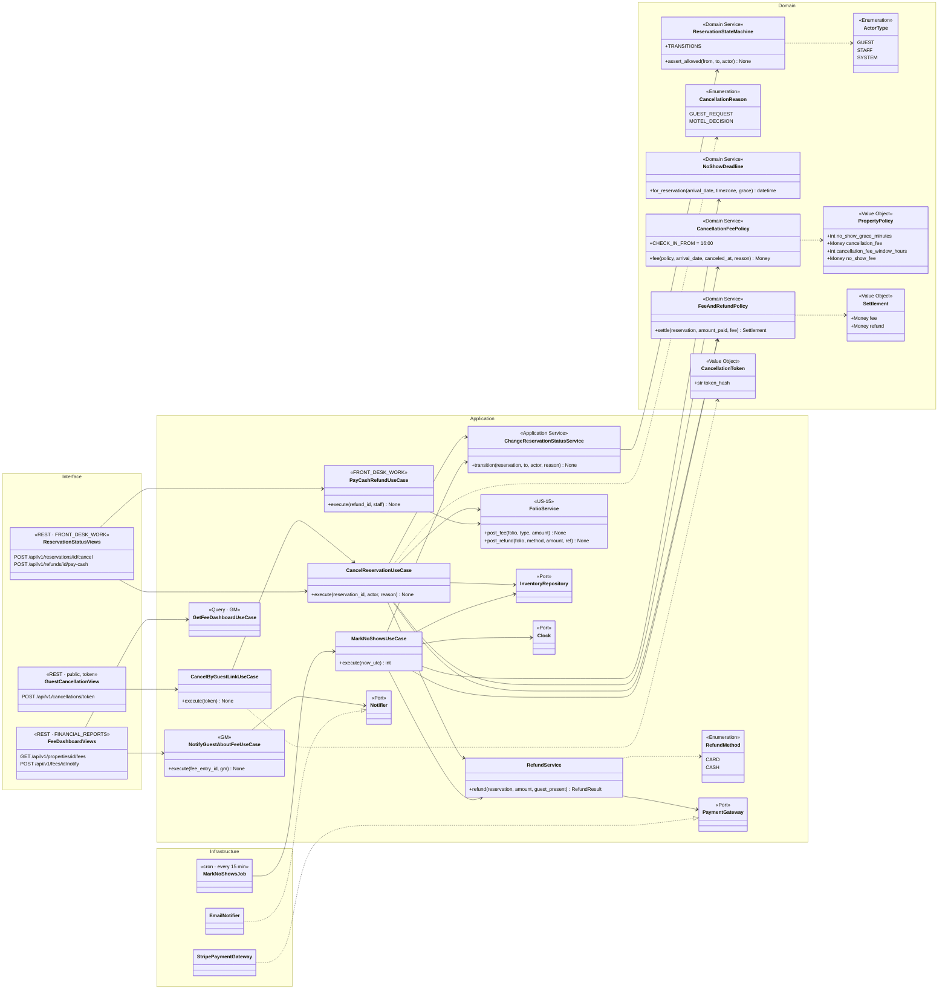
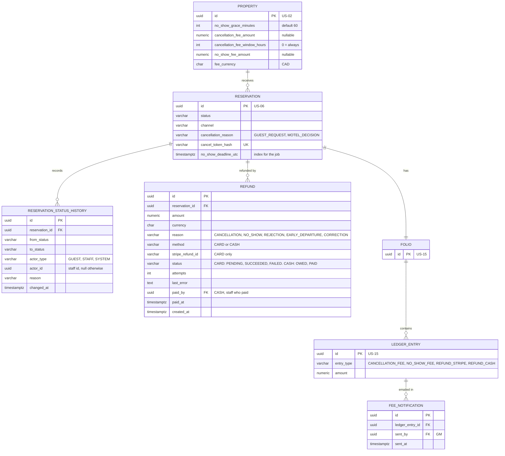
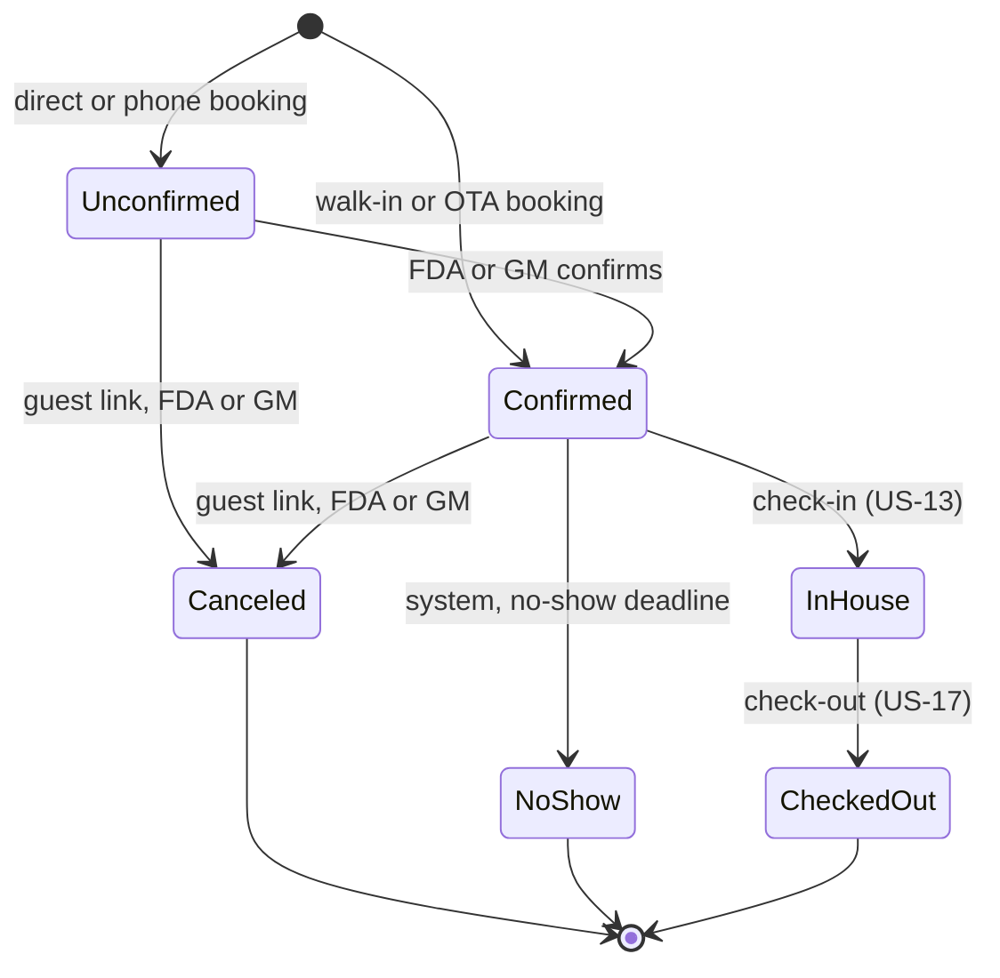
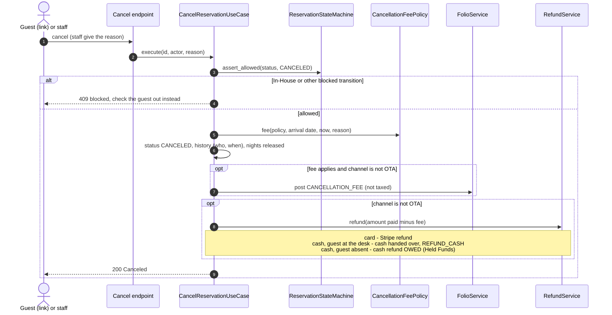
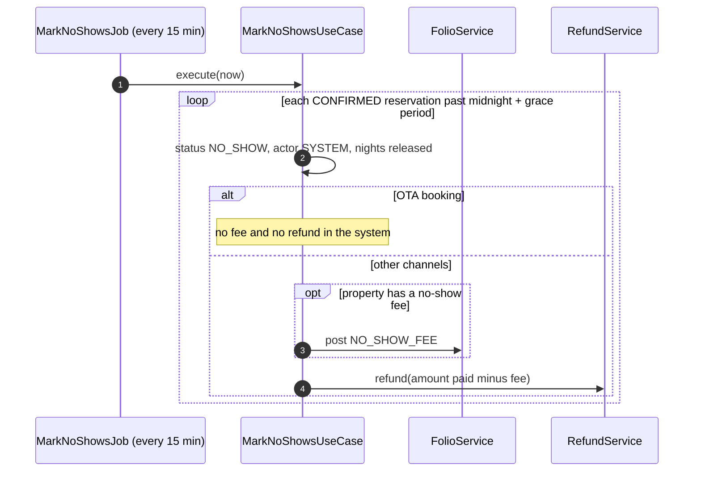

# US-11 — Reservation Lifecycle Management: Diagrams

> Source: `US-11-reservation-lifecycle-management.md`. Related: US-06 (rejection), US-07 (OTA), US-13 (check-in), US-15 (folio), US-17 (check-out and early departure), US-22 (Held Funds report for failed card refunds and owed cash refunds).

## Business rules reflected

| Rule (US-11) | Where it appears |
|---|---|
| States and the allowed transitions table; any other transition blocked | `ReservationStateMachine.TRANSITIONS`, state diagram 3.1 |
| In-House cannot be canceled; early departure is a check-out with unused nights refunded | No `IN_HOUSE → CANCELED` transition; US-17 |
| Guest cancels through a secure, unique link in both emails | `CancellationToken`, `GuestCancellationView` |
| Staff cancel a Confirmed reservation as guest's request (fees apply) or motel's decision (no fee, full refund) | `CancellationReason` |
| Rejecting an Unconfirmed booking never has a fee | `MOTEL_DECISION` for rejections (US-06) |
| No-show deadline: midnight ending the arrival day + grace period; checked every 15 minutes | `NoShowDeadline`, `MarkNoShowsJob` |
| Default grace period 60 minutes (1:00 AM), editable per property | `PROPERTY.no_show_grace_minutes` |
| Optional fixed cancellation and no-show fees per property | `PROPERTY.cancellation_fee_amount`, `no_show_fee_amount` (nullable) |
| Cancellation fee only within X hours before 4:00 PM on the arrival day; 0 = always | `CancellationFeePolicy`, `cancellation_fee_window_hours` |
| Refund minus the applicable fee, by the method used to pay: card → Stripe automatically; cash → at the desk | `RefundService` chooses `RefundMethod` from the folio payments |
| Cash refund to an absent guest stays owed, shown in Held Funds, paid later from the reservation | `REFUND.status = OWED`, `PayCashRefundUseCase`, Scenario 8 |
| Lifecycle refunds are not corrections, so Front Desk Agents perform them | `FRONT_DESK_WORK` permission on cancel and cash-refund endpoints |
| OTA bookings: No-Show allowed, no refund or fee | `FeeAndRefundPolicy` skips channel `OTA` |
| Canceled and No-Show release their nights | `RoomInventory.release()` |
| Every status change recorded with who and when | `RESERVATION_STATUS_HISTORY` |
| Fees shown in a GM-only dashboard with an email action | `FeeDashboardViews`, `NotifyGuestAboutFeeUseCase` |

---

## 1. Class Diagram (Clean Architecture)

### Design notes
- **Cancellation fee (`CancellationFeePolicy`):** fee = `cancellation_fee` only if the reason is `GUEST_REQUEST`, a fee is configured, and `canceled_at > check-in moment − X hours`, where the check-in moment is 4:00 PM local time on the arrival day. `X = 0` means the fee always applies. Scenario 4: $50 fee → refund = amount paid − $50.
- **No-show deadline (`NoShowDeadline`):** midnight at the end of the arrival day (local) + `no_show_grace_minutes`; default 60 → 1:00 AM. The job runs every 15 minutes and selects `CONFIRMED` reservations past their deadline.
- **Settlement (`FeeAndRefundPolicy`):** for channel `OTA`, fee and refund are both zero. Otherwise the fee is posted as a `CANCELLATION_FEE` or `NO_SHOW_FEE` charge (not taxed, US-04) and the refund is the amount paid minus the fee.
- **Refund failures:** `REFUND.status = FAILED` stays visible in the Held Funds report (US-22) with a "Retry refund" action.
- **Unconfirmed cancellations by staff** are rejections: reason `MOTEL_DECISION`, no fee (US-06). A guest canceling an Unconfirmed booking through the link is a `GUEST_REQUEST`.
- **Guest link:** the token is random, stored only as a hash, and unique per reservation; it is included in the "booking received" and "booking confirmed" emails.
- **Refund method (`RefundService`):** the method follows the folio's payments. Card payments (`STRIPE_CARD`) are refunded through Stripe (`REFUND_STRIPE` entry). Cash payments (`CASH`) are refunded in cash: if the guest is at the desk (cancellation at the desk, Scenario 7), the agent hands over the amount and the system posts `REFUND_CASH` at once; otherwise (No-Show, cancellation by link) a `REFUND` row with method `CASH` and status `OWED` is created and shown in the Held Funds report (US-22). `PayCashRefundUseCase` posts `REFUND_CASH` and sets the row to `PAID` when the guest collects it.
- **Permissions:** cancellations and cash refunds need `FRONT_DESK_WORK`; GM corrections (US-15) are a separate flow.

---

## 2. ER Diagram

---

## 3. Event Flow

### 3.1 Reservation state machine

### 3.2 Cancellation — Scenarios 3, 4 and 6

### 3.3 No-show job — Scenario 5

### 3.4 Domain events

| Event | Raised when | Consumers |
|---|---|---|
| `ReservationStatusChanged` | Any transition | Status history, dashboard (US-10) |
| `ReservationCanceled` | Cancellation | Inventory release, refund, fee dashboard |
| `ReservationMarkedNoShow` | No-show job | Inventory release, refund, fee dashboard |
| `FeeApplied` | Cancellation or no-show fee posted | Fee dashboard (GM) |
| `RefundFailed` | Stripe refund fails | Held Funds report (US-22) |
| `CashRefundOwed` / `CashRefundPaid` | Cash refund for an absent guest / paid at the desk | Held Funds report (US-22), folio |
| `GuestNotifiedAboutFee` | GM sends the fee email | Audit log |
