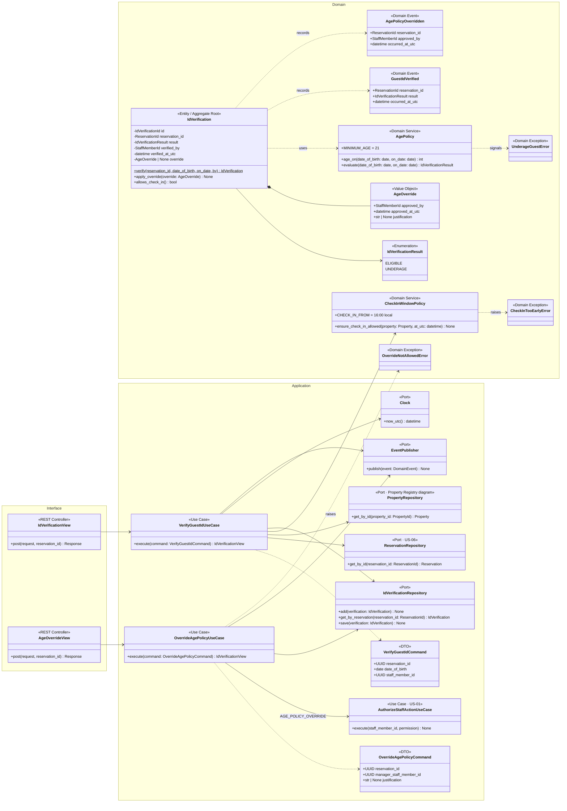
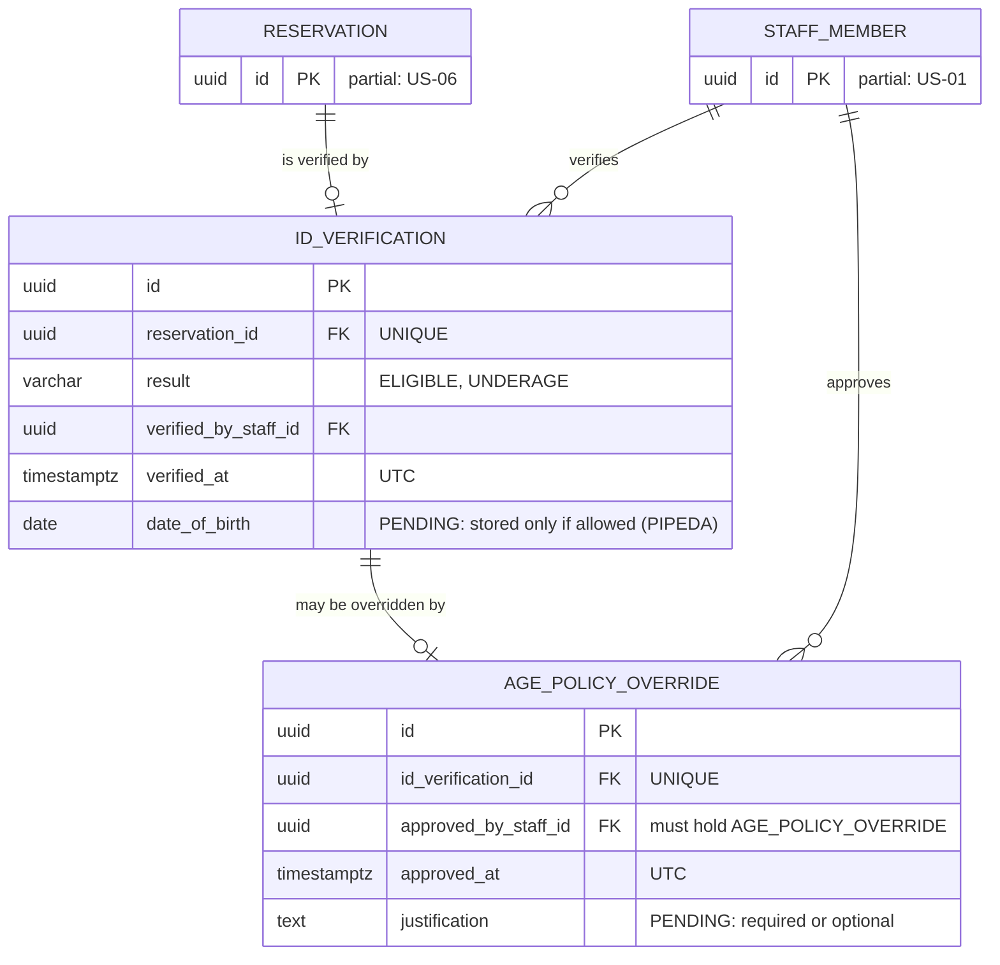
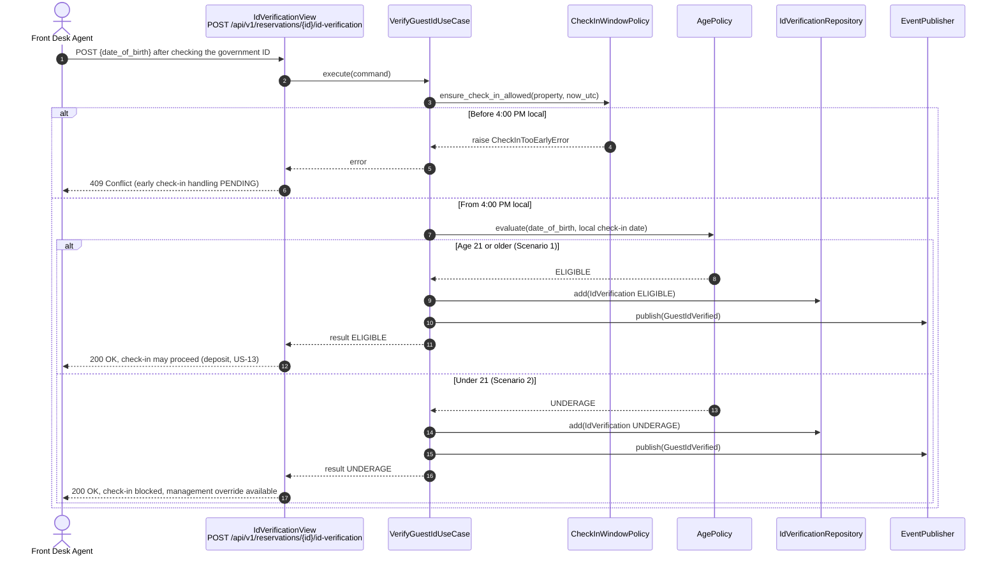
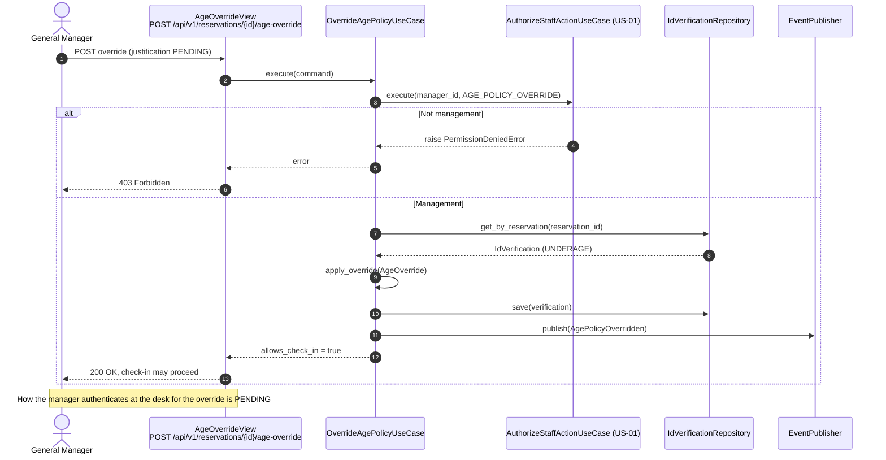

# US-12 — Check-in with Age Verification: Diagrams

> Sources: `US-12-check-in-with-age-verification.md`, `US-01-staff-authentication-and-role-based-access.md`, `docs/Business Modeling/Business Modeling.md` (Phase 2, Section 4), `CLAUDE.md`.
> Elements tagged **PENDING** depend on business rules not defined yet. They are placeholders in the design, not decisions.
> Data is scoped per **Property** (Business Modeling, Section 5) even where the story text does not mention it.

---

## 1. Class Diagram (Clean Architecture)

### Design notes
- **`AgePolicy`** calculates the age from the date of birth on the government ID, against the **property's local date** of check-in (`MINIMUM_AGE = 21`). Birthdays on the check-in day count as already reached.
- **Override (Scenario 3):**
  - `OverrideAgePolicyUseCase` checks the `AGE_POLICY_OVERRIDE` permission (management only, US-01) for the **manager** who approves, not for the agent at the desk;
  - how the manager authenticates for the override is PENDING;
  - whether a justification and an audit record are required is PENDING (`justification` is optional).
- **`allows_check_in()`** is true for `ELIGIBLE`, or for `UNDERAGE` with an override. US-13 asks this before completing the check-in.
- **Check-in window:** `CheckInWindowPolicy` enforces "check-in starts at 4:00 PM" in the property's timezone. Early check-in handling is PENDING; until it is defined, early attempts are rejected (`CheckInTooEarlyError`).
- **Data minimisation (PIPEDA):**
  - the date of birth is used to compute the result;
  - only the result is persisted by default;
  - which ID data may be stored is PENDING (see the ER notes).

---

## 2. ER Diagram (PostgreSQL persistence)

### Design notes
- **Minimal storage by default:** `ID_VERIFICATION` stores who verified, when and the result. Columns such as `date_of_birth`, ID type or ID number are added only if PIPEDA review allows them (PENDING).
- **Erasure:** any stored ID data is scrubbed by "Forget Me" (US-21).
- **One record per reservation:** `UNIQUE (reservation_id)` keeps one verification per reservation. A re-verification updates that record.

---

## 3. Event Flow

### 3.1 Verifying the ID — Scenarios 1 and 2

### 3.2 Management override — Scenario 3

### 3.3 Domain events

| Event | Emitted by | When | Payload | Consumers |
|---|---|---|---|---|
| `GuestIdVerified` | `VerifyGuestIdUseCase` | ID checked | `reservation_id`, `result`, `occurred_at_utc` | Front desk dashboard flag (US-10, read side) |
| `AgePolicyOverridden` | `OverrideAgePolicyUseCase` | Management override applied | `reservation_id`, `approved_by`, `occurred_at_utc` | PENDING (audit, if required) |
