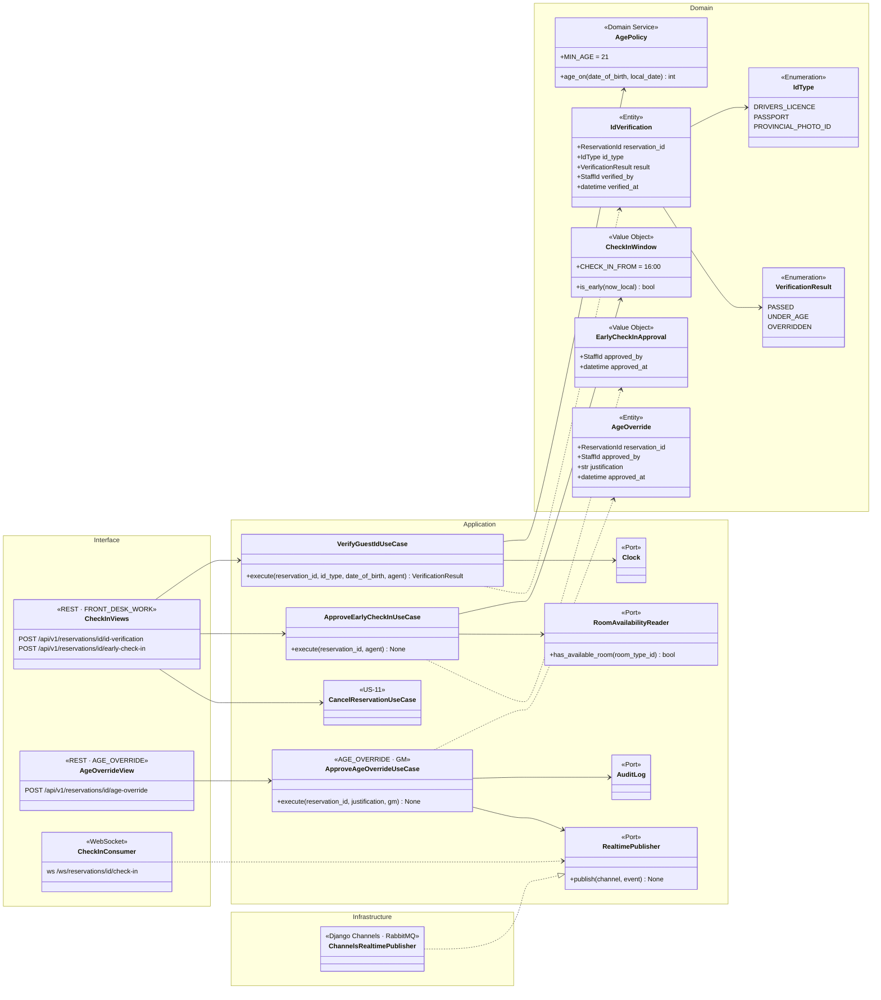
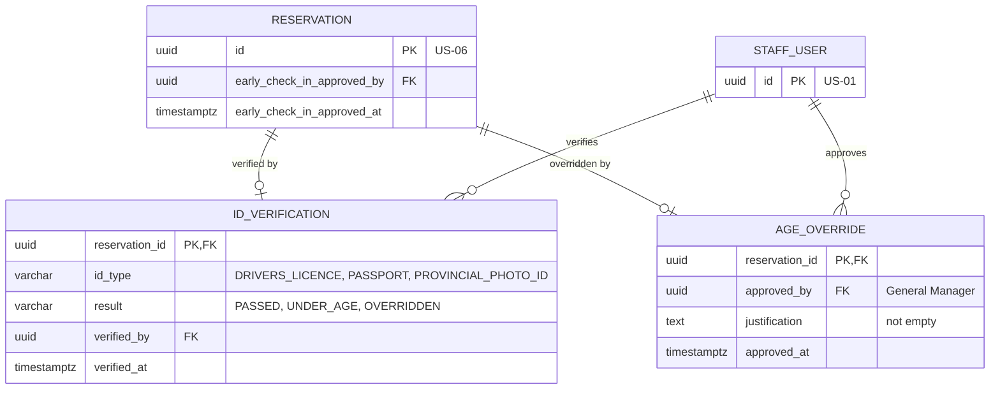
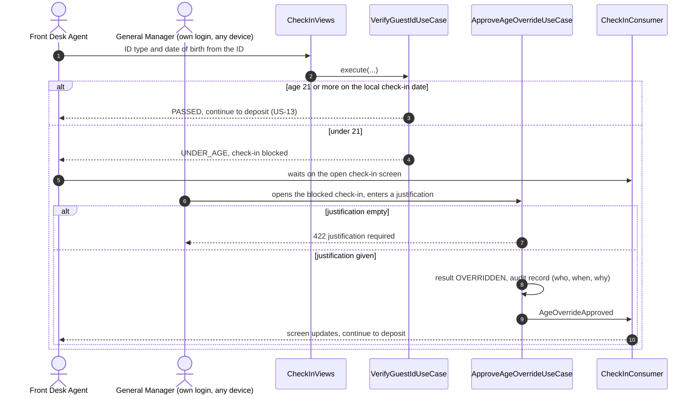
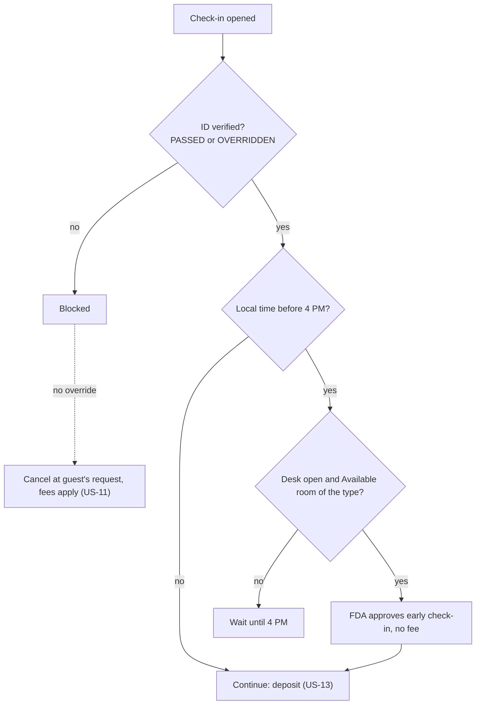

# US-12 — Check-in with Age Verification: Diagrams

> Source: `US-12-check-in-with-age-verification.md`. Related: US-01 (GM-only override), US-11 (cancellation at the guest's request), US-13 (rest of the check-in).

## Business rules reflected

| Rule (US-12) | Where it appears |
|---|---|
| Check-in from 4:00 PM local time | `CheckInWindow` |
| Only the registering guest shows ID | One `IdVerification` per reservation |
| Accepted IDs: driver's licence, passport, provincial/territorial photo ID | `IdType` |
| Age from the date of birth against the local check-in date | `AgePolicy.age_on(dob, local_date)` |
| Under 21 blocked unless the GM overrides (US-01) | `AgePolicy.MIN_AGE = 21`, `AGE_OVERRIDE` permission |
| GM approves from their own login, on any device; the agent's screen updates | `ApproveAgeOverrideUseCase`, WebSocket push |
| Justification required (non-empty); audit stores it, who and when | `AgeOverride`, `AUDIT_LOG` |
| No override: cancel at the guest's request, fee rules apply | `CancelReservationUseCase(GUEST_REQUEST)` (US-11) |
| Early check-in approved by an FDA, no fee, while the desk is open and an Available room of the type exists | `ApproveEarlyCheckInUseCase` |
| No ID data stored; only result, ID type and verifying agent | `ID_VERIFICATION` columns (no date of birth, no number) |

---

## 1. Class Diagram (Clean Architecture)

### Design notes
- **The date of birth is used in memory only** to compute the age; it is never persisted or logged.
- **Override (Scenarios 3 and 4):** `ApproveAgeOverrideUseCase` requires the `AGE_OVERRIDE` permission (GM only, US-01), a reservation whose verification result is `UNDER_AGE`, and a non-blank justification. It sets the result to `OVERRIDDEN`, writes the audit record and pushes `AgeOverrideApproved` to the check-in WebSocket channel, so the agent's open screen updates.
- **Early check-in (Scenario 5):** allowed when the local time is before 4:00 PM, the front desk is open (`FrontDeskHours`, US-02) and an `AVAILABLE`, active room of the booked type exists. No fee is posted.
- **No override:** the agent cancels with reason `GUEST_REQUEST`; US-11 applies the cancellation fee rules.

---

## 2. ER Diagram

---

## 3. Event Flow

### 3.1 ID check and GM override — Scenarios 1 to 4

### 3.2 Check-in gate before the deposit

### 3.3 Domain events

| Event | Raised when | Consumers |
|---|---|---|
| `GuestIdVerified` | ID result saved | Dashboard flag (US-10) |
| `AgeOverrideApproved` | GM approves | Agent's check-in screen (WebSocket), audit log |
| `EarlyCheckInApproved` | FDA approves | Dashboard flag (US-10) |
