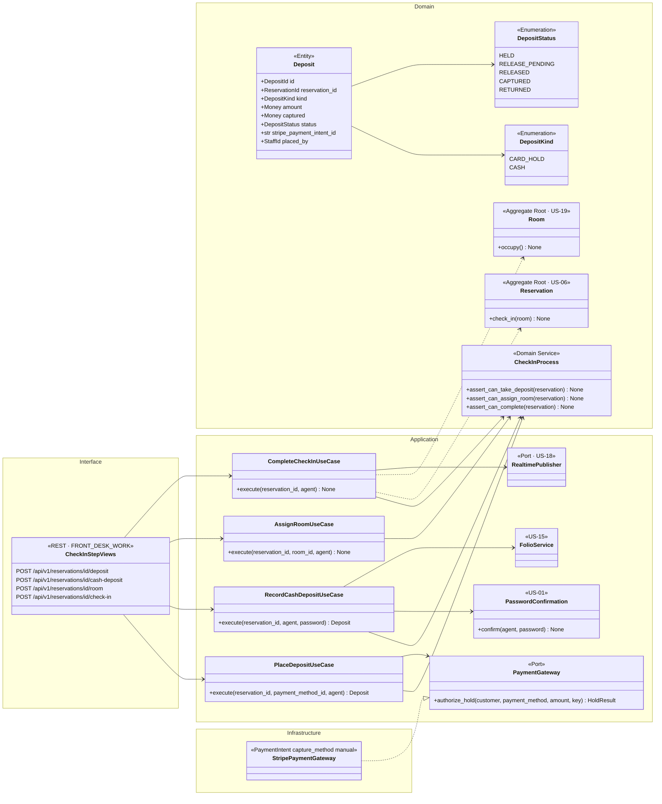
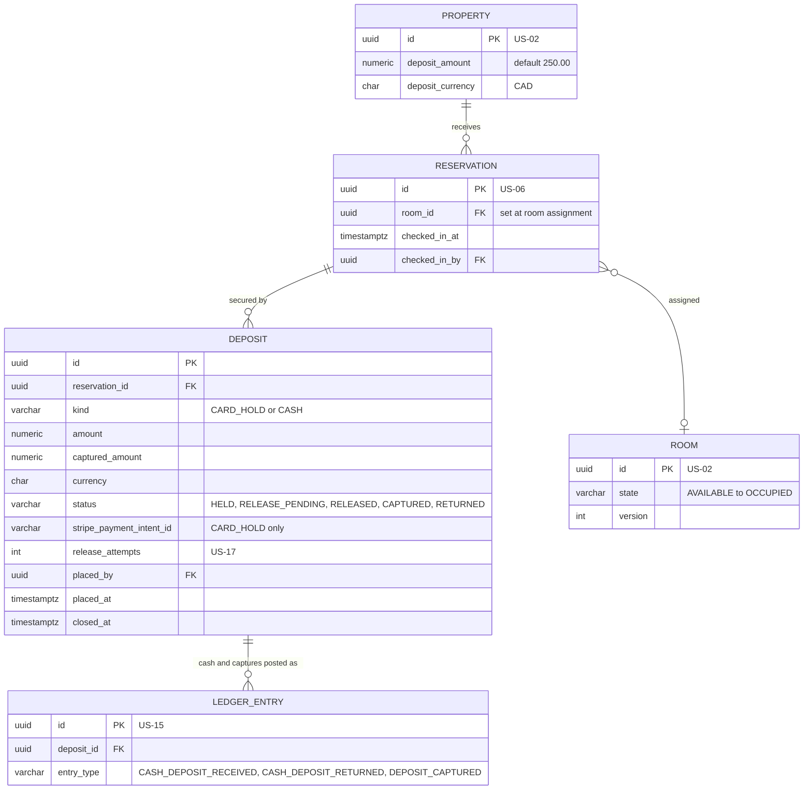
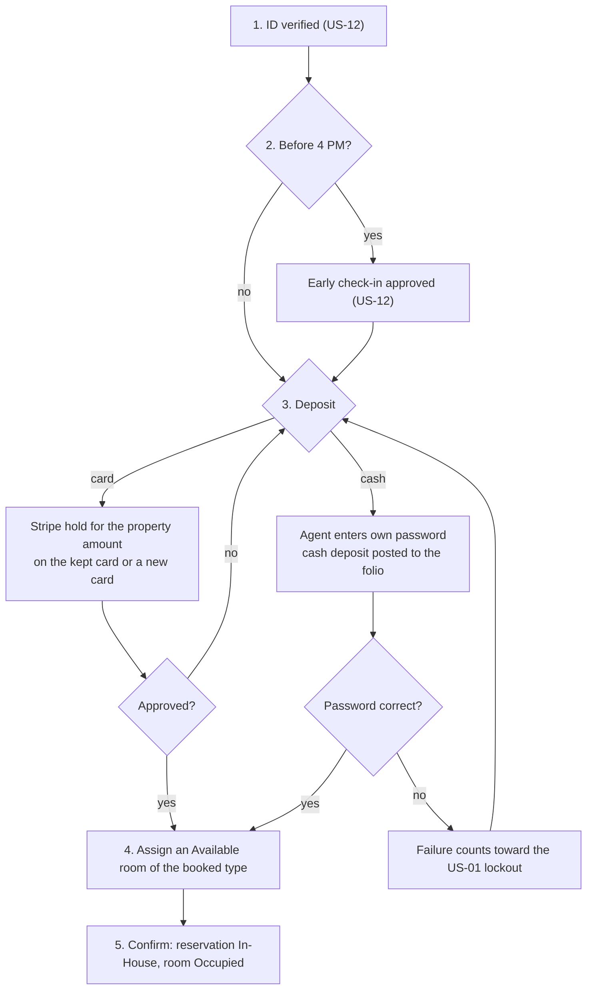
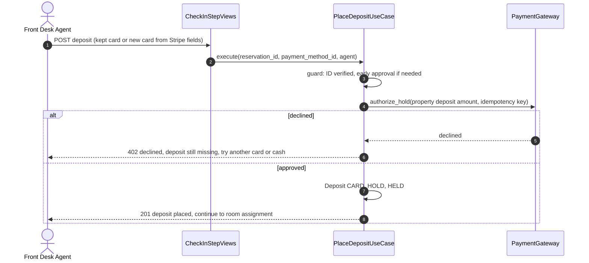

# US-13 — Deposit Pre-Authorization Hold: Diagrams

> Source: `US-13-deposit-pre-authorization-hold.md`. Related: US-01 (password lockout), US-06 (card kept by Stripe), US-12 (ID and early check-in), US-15 (folio), US-16 and US-17 (fines and check-out), US-19 (room state).

## Business rules reflected

| Rule (US-13) | Where it appears |
|---|---|
| Deposit is a Stripe pre-authorization hold; amount per property set by the GM; default $250 CAD | `PROPERTY.deposit_amount`, `PaymentGateway.authorize_hold()` |
| Order: ID → early approval → deposit → room assignment → confirmation; no deposit before the ID check | `CheckInProcess` guards, flowchart 3.1 |
| Hold on the card kept at booking; guests without a card enter one in Stripe fields or leave cash | `PlaceDepositUseCase` with `saved` or `new` PaymentMethod |
| Declined hold: try another card or take cash; check-in blocked until one succeeds | `DepositDeclined`, Scenario 2 |
| Cash deposit for the property's amount, confirmed with the agent's own password, recorded in the folio | `RecordCashDepositUseCase`, `CASH_DEPOSIT_RECEIVED` entry |
| Failed password confirmation counts toward the US-01 lockout | `StaffUser.register_failed_login()` |
| At check-out the cash deposit is returned in cash minus fines, recorded in the folio | US-17, `CASH_DEPOSIT_RETURNED` entry |
| No hold renewal | No renewal job |
| FDA assigns an Available room of the booked type | `AssignRoomUseCase`, Scenario 4 |
| Check-in sets In-House and Occupied | `CompleteCheckInUseCase`, Scenario 5 |

---

## 1. Class Diagram (Clean Architecture)

### Design notes
- **Guards (`CheckInProcess`):** the deposit needs a `PASSED` or `OVERRIDDEN` ID verification and, before 4:00 PM, an early check-in approval (US-12); room assignment needs a `HELD` deposit (card or cash); completion needs an assigned room.
- **Card hold:** a Stripe PaymentIntent with `capture_method = manual` for the property's `deposit_amount`, on the PaymentMethod kept at booking (US-06), or on a new one entered in Stripe fields at check-in (OTA guests, cash walk-ins). A hold is **not** a folio entry; only a capture becomes one (US-16, US-17).
- **Cash deposit:** the agent's password is checked by `PasswordConfirmation`; a wrong password increments the same counter as a failed login and can lock the account (US-01). The deposit posts `CASH_DEPOSIT_RECEIVED` (debit cash, credit cash deposits held, US-15).
- **Room assignment:** the room must be active, `AVAILABLE`, of the booked room type and at the agent's property; the optimistic lock on `ROOM.version` prevents two agents from taking the same room.
- **Completion:** in one transaction, the reservation goes `CONFIRMED → IN_HOUSE` (US-11) and the room `AVAILABLE → OCCUPIED` (US-19); after commit, the room state is pushed to the housekeeping board and dashboard (US-18).

---

## 2. ER Diagram

---

## 3. Event Flow

### 3.1 Check-in steps — Scenarios 1 to 5

### 3.2 Card hold — Scenarios 1 and 2

### 3.3 Domain events

| Event | Raised when | Consumers |
|---|---|---|
| `DepositHeld` | Card hold approved or cash deposit recorded | Dashboard flag (US-10) |
| `DepositDeclined` | Stripe declines the hold | Dashboard flag (US-10) |
| `RoomAssigned` | Room chosen | Check-in screen |
| `GuestCheckedIn` | Check-in completed | Reservation history (US-11), room state (US-19), housekeeping board (US-18), Night Audit (US-14) |
