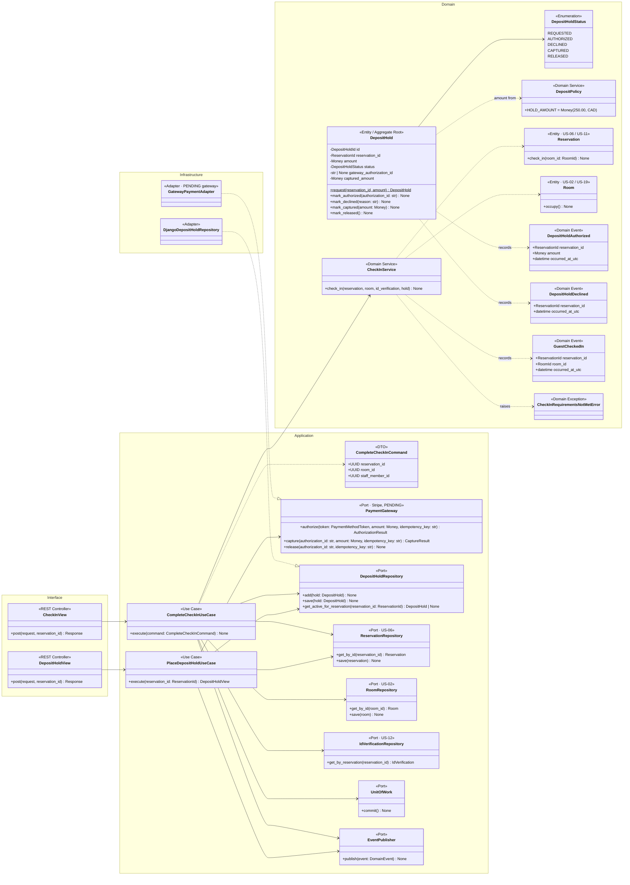
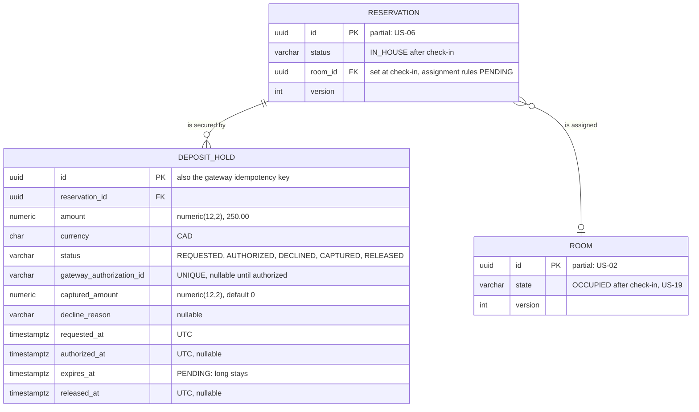
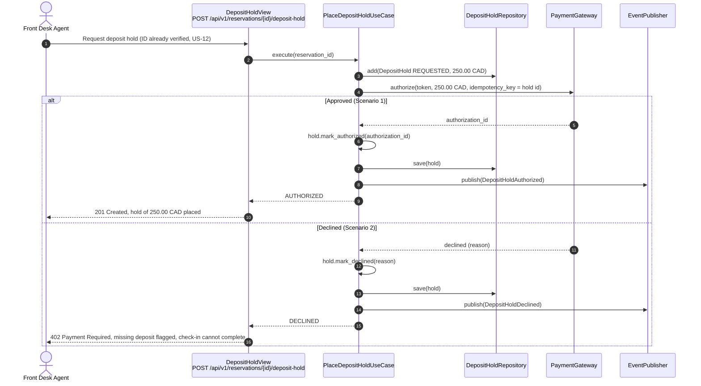
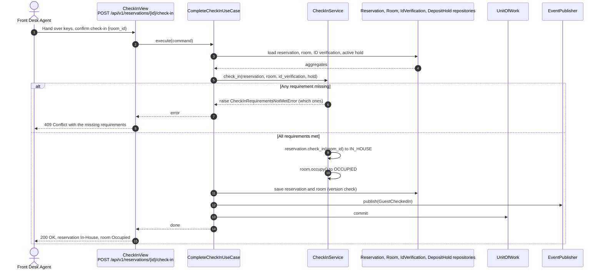

# US-13 — Deposit Pre-Authorization Hold: Diagrams

> Sources: `US-13-deposit-pre-authorization-hold.md`, `US-12-check-in-with-age-verification.md`, `US-19-room-state-machine-and-cleaning-verification.md`, `docs/Business Modeling/Business Modeling.md` (Phase 2, Section 4), `CLAUDE.md`.
> Elements tagged **PENDING** depend on business rules not defined yet. They are placeholders in the design, not decisions.
> Data is scoped per **Property** (Business Modeling, Section 5) even where the story text does not mention it.

---

## 1. Class Diagram (Clean Architecture)

### Design notes
- **`DepositHold` has its own lifecycle** (`REQUESTED → AUTHORIZED | DECLINED`, later `CAPTURED` in US-16 or `RELEASED` in US-17). The amount comes from `DepositPolicy` ($250.00 CAD as `Money`). Whether the amount differs per property is PENDING (Business Modeling, Section 5).
- **Gateway calls are idempotent:** every `PaymentGateway` call carries an idempotency key derived from the hold id, so a network retry never places two holds.
- **The hold is recorded before the gateway call** (status `REQUESTED`). This leaves a trace even if the process stops mid-call, so the hold can be reconciled.
- **`CheckInService` enforces all check-in requirements together (Scenario 3):**
  - the reservation is `CONFIRMED`;
  - the ID verification allows check-in (US-12, eligible or overridden);
  - the hold is `AUTHORIZED`;
  - the room is `AVAILABLE` (US-19).

  Then `Reservation` changes to `IN_HOUSE` and `Room` to `OCCUPIED` in a single transaction.
- **A declined hold (Scenario 2)** leaves the reservation without an authorized hold. The dashboard (US-10) then shows `MISSING_DEPOSIT`, and `CheckInService` refuses to complete the check-in.
- **Folio:** a hold is not a payment. A payment entry is posted only when funds are captured (US-16).
- **PENDING:**
  - guests without a credit card (e.g., cash);
  - hold expiration on long stays;
  - when and how the physical room is assigned (here the agent sends `room_id` at completion).

---

## 2. ER Diagram (PostgreSQL persistence)

### Design notes
- **One active hold per reservation:** a partial unique index enforces it (`UNIQUE (reservation_id) WHERE status IN ('REQUESTED','AUTHORIZED')`). Declined attempts remain as history.
- **Money columns:** amounts use `numeric(12,2)` with a currency column, following US-04.
- **Concurrency:** `RESERVATION.version` and `ROOM.version` stop two agents from checking different guests into the same room at the same time.

---

## 3. Event Flow

### 3.1 Placing the hold — Scenarios 1 and 2

### 3.2 Completing the check-in — Scenario 3

### 3.3 Domain events

| Event | Emitted by | When | Payload | Consumers |
|---|---|---|---|---|
| `DepositHoldAuthorized` | `PlaceDepositHoldUseCase` | Gateway approves the hold | `reservation_id`, `amount`, `occurred_at_utc` | Dashboard flag cleared (US-10, read side) |
| `DepositHoldDeclined` | `PlaceDepositHoldUseCase` | Gateway declines the hold | `reservation_id`, `occurred_at_utc` | Dashboard flag kept (US-10, read side) |
| `GuestCheckedIn` | `CompleteCheckInUseCase` | Check-in completed | `reservation_id`, `room_id`, `occurred_at_utc` | `ReservationStatusChanged` history (US-11); `RoomStateChanged` and real-time housekeeping board (US-18, US-19) |
