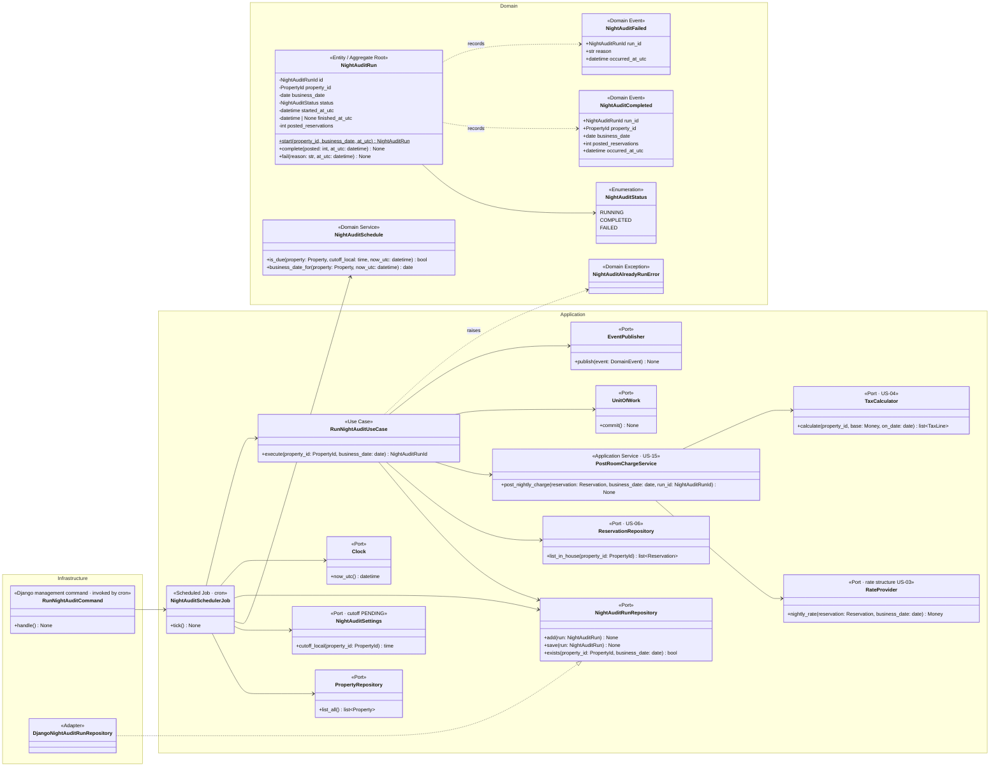
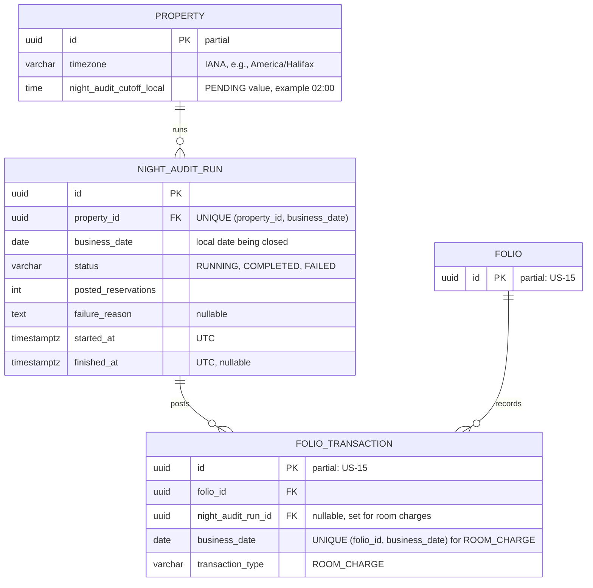
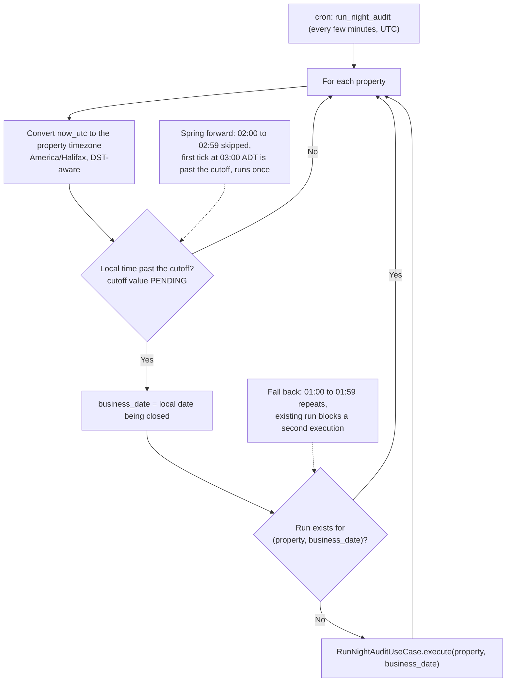
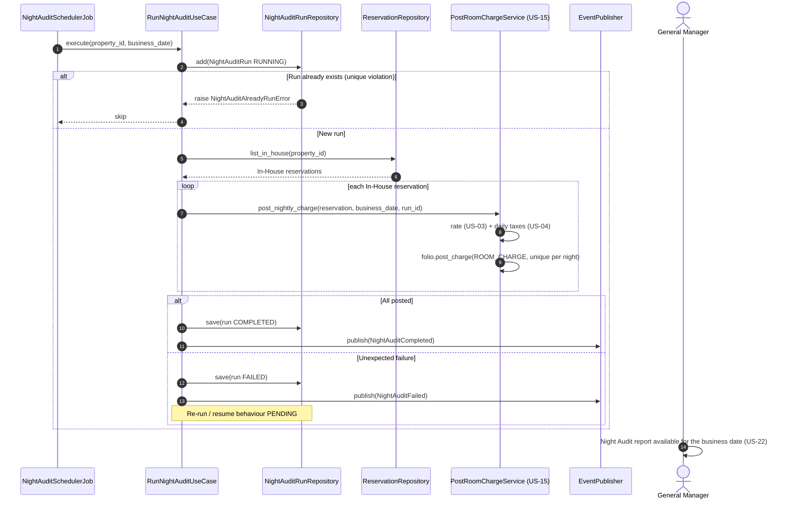

# US-14 — Night Audit (End of Day): Diagrams

> Sources: `US-14-night-audit-end-of-day.md`, `US-04-localized-tax-calculation.md`, `US-15-folio-ledger.md`, `docs/Business Modeling/Business Modeling.md` (Personas, Phase 3, Sections 4 and 5), `docs/Tech Stack/Tools.md` (cron), `CLAUDE.md`.
> Elements tagged **PENDING** depend on business rules not defined yet. They are placeholders in the design, not decisions.
> Data is scoped per **Property** (Business Modeling, Section 5): the Night Audit runs separately for each property.

---

## 1. Class Diagram (Clean Architecture)

### Design notes
- **Timezone-aware scheduling (Scenario 2):**
  - cron runs the Django command `run_night_audit` every few minutes, in UTC;
  - for each property, `NightAuditSchedule.is_due` converts "now" to the property's IANA timezone (`America/Halifax`) and returns true once local time is past the cutoff and no run exists yet for that business date;
  - cron itself never needs to know about daylight saving time.
- **DST edge case in Halifax:** the clocks change **at 2:00 AM local**, the example cutoff in the business document.
  - **Spring forward:** 2:00 to 2:59 does not exist, so the first tick after the jump (3:00 ADT) is "past the cutoff" and the audit runs once.
  - **Fall back:** 1:00 to 1:59 happens twice, and the existing run for that business date prevents a second run.
- **No double posting:** `NIGHT_AUDIT_RUN` is unique per `(property_id, business_date)`, and every room charge carries `(reservation_id, business_date)` as a unique posting key in the folio (US-15). A retry or a second scheduler instance cannot post the same night twice. Failure and re-run *behaviour* (e.g., resuming a failed run) is PENDING.
- **Business date (to confirm):** with a cutoff after midnight (e.g., 2:00 AM on Nov 2), the audit closes the **previous** local date (Nov 1), the night the guests stayed.
- **Posting:** `PostRoomChargeService` posts the nightly rate (rate structure from US-03) and the daily taxes (US-04) to each In-House reservation's folio (US-15).
- **PENDING:**
  - the exact cutoff time (`NightAuditSettings`);
  - no-show processing during the audit;
  - behaviour after a failure.

---

## 2. ER Diagram (PostgreSQL persistence)

### Design notes
- **`night_audit_cutoff_local`** is a property setting because the audit runs per property. Its value is PENDING.
- **Partial unique index against double posting:** `UNIQUE (folio_id, business_date) WHERE transaction_type = 'ROOM_CHARGE'`. A night can be charged only once per folio.
- **Timestamp types:** timestamps are `timestamptz` in UTC, while `business_date` is a local calendar date by definition.

---

## 3. Event Flow

### 3.1 Scheduler tick — Scenario 2

### 3.2 Posting nightly charges — Scenarios 1 and 3

### 3.3 Domain events

| Event | Emitted by | When | Payload | Consumers |
|---|---|---|---|---|
| `ChargePosted` | `Folio` (US-15) | Each nightly room charge and tax posted | see US-15 | Folio balance, reports (US-22) |
| `NightAuditCompleted` | `RunNightAuditUseCase` | Run finished for a property and business date | `run_id`, `property_id`, `business_date`, `posted_reservations`, `occurred_at_utc` | Night Audit report availability (US-22) |
| `NightAuditFailed` | `RunNightAuditUseCase` | Run failed | `run_id`, `reason`, `occurred_at_utc` | PENDING (e.g., alert the Night Auditor) |
