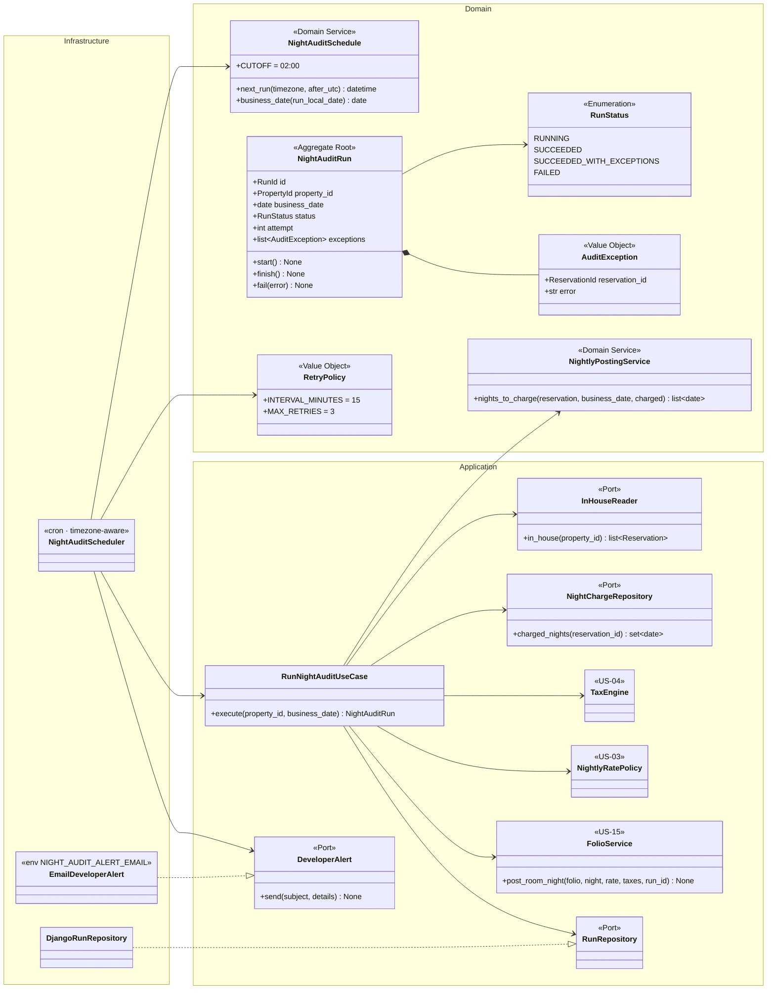
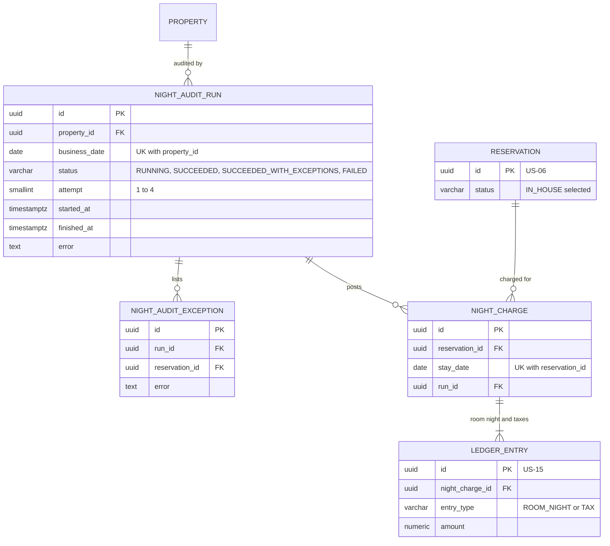
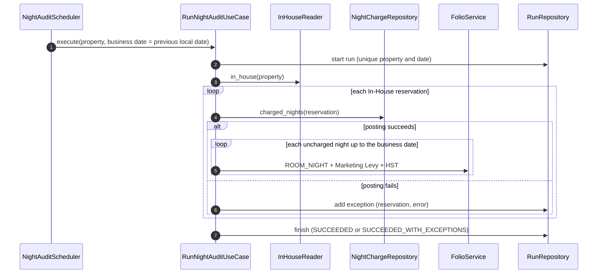
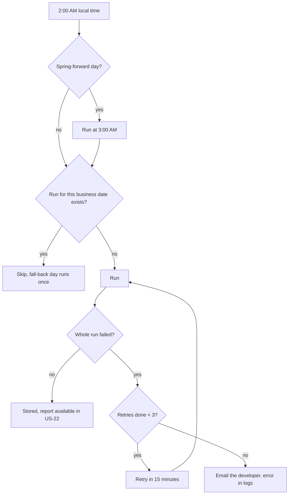

# US-14 — Night Audit (End of Day): Diagrams

> Source: `US-14-night-audit-end-of-day.md`. Related: US-03 (nightly rate), US-04 (taxes), US-06 (payment as credit), US-15 (folio), US-22 (Night Audit report and exceptions list).

## Business rules reflected

| Rule (US-14) | Where it appears |
|---|---|
| Automated process, separate per property | `RunNightAuditUseCase(property_id)`, one run per property |
| Fixed cutoff 2:00 AM local time | `NightAuditSchedule.CUTOFF = 02:00` |
| The 2:00 AM run closes the previous local date | `business_date = local_today − 1 day` |
| Posts room rate and taxes for the night of every In-House reservation | `NightlyPostingService` |
| Each night charged once; repeated runs skip charged nights | `UNIQUE (reservation_id, stay_date)` on `NIGHT_CHARGE` |
| Missed nights caught up at the next run | Posts every uncharged night up to the business date |
| Booking payment stays as a credit; charges posted against it | Folio entries (US-15) |
| Timezone-aware cron; UTC timestamps | `NightAuditScheduler` with `ZoneInfo` |
| DST: spring forward runs at 3:00 AM; fall back runs once | `NightAuditSchedule.next_run()` and the unique run key |
| One reservation fails → exceptions list, run continues | `NIGHT_AUDIT_EXCEPTION` |
| Whole run fails → retry every 15 minutes, 3 times, then email the developer | `RetryPolicy`, `DeveloperAlert` |
| Errors in application logs; every run stored in the database | `NIGHT_AUDIT_RUN`, logger |
| Developer email in an environment variable, default guibragon@gmail.com | `NIGHT_AUDIT_ALERT_EMAIL` setting |
| No-show processing not part of it | Handled by US-11 |

---

## 1. Class Diagram (Clean Architecture)

### Design notes
- **Schedule:** the scheduler wakes every minute and, for each property, computes the next 2:00 AM local run with `ZoneInfo("America/Halifax")`. On the spring-forward day 2:00 AM does not exist, so the first valid moment is 3:00 AM. On the fall-back day 2:00 AM happens once in the fold-0 interpretation; the unique key `(property_id, business_date)` guarantees a single run.
- **Per reservation (own savepoint):** `nights_to_charge` returns every night from check-in up to and including the business date that has no `NIGHT_CHARGE` yet (catch-up, Scenario 4; no double charge, Scenario 3). Each night posts one `ROOM_NIGHT` charge and one charge per tax line (levy, HST). A failure rolls back that reservation only and adds an exception (Scenario 5).
- **Run failure:** if the whole run fails (e.g., database unavailable), the run is marked `FAILED`, the error is logged, and the scheduler retries every 15 minutes up to 3 times; after the third failed retry, `DeveloperAlert` emails the address in `NIGHT_AUDIT_ALERT_EMAIL` (default guibragon@gmail.com).
- **Credit balance:** the booking payment (US-06) or OTA prepaid amount (US-07) is already a credit, so nightly charges bring the balance toward zero.

---

## 2. ER Diagram

---

## 3. Event Flow

### 3.1 Nightly run — Scenarios 1, 3, 4 and 5

### 3.2 Schedule, DST and retries — Scenario 2

### 3.3 Domain events

| Event | Raised when | Consumers |
|---|---|---|
| `NightAuditCompleted` | Run finishes | Night Audit report (US-22) |
| `RoomNightPosted` | Night charged | Folio balance (US-15), occupancy report (US-23) |
| `NightAuditFailed` | Third retry fails | Developer email |
