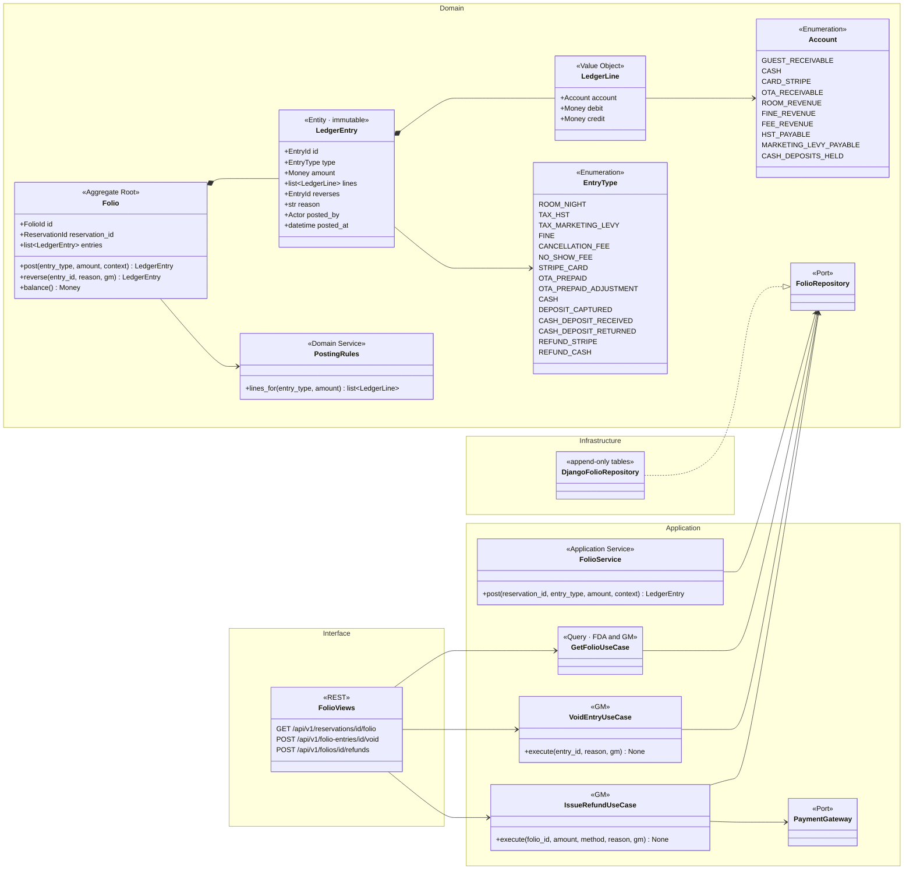
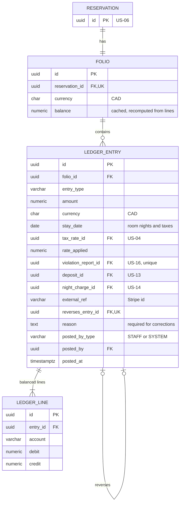
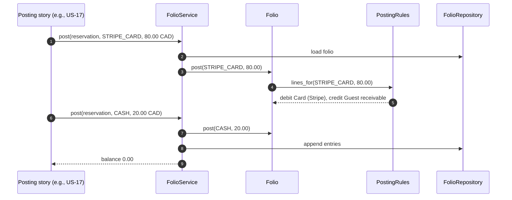
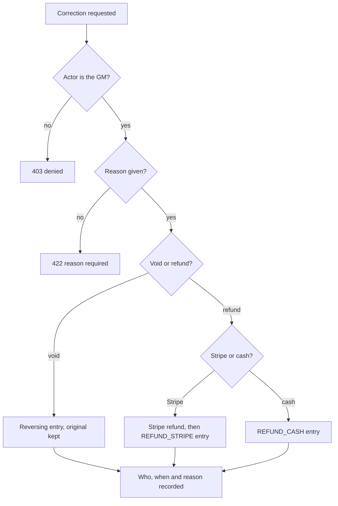

# US-15 — Folio Ledger: Diagrams

> Source: `US-15-folio-ledger.md`. Posting stories: US-06, US-07, US-09 (payments), US-11 (fees and refunds), US-13 (cash deposit), US-14 (room nights and taxes), US-16 (fines and captures), US-17 (check-out).

## Business rules reflected

| Rule (US-15) | Where it appears |
|---|---|
| Exactly one folio per reservation | `FOLIO.reservation_id` unique, created with the reservation |
| Double-entry ledger | `LedgerEntry` with balanced `LedgerLine` debits and credits |
| Charge types: room night, taxes (HST, levy), fines, cancellation fee, no-show fee | `EntryType` (charges) |
| Payment types: Stripe card, OTA prepaid, OTA prepaid adjustment, cash, deposit captured from a hold, cash deposit received and returned, refunds (Stripe or cash) | `EntryType` (payments) |
| Lifecycle refunds (cancellation, No-Show, early departure) are not corrections | Posted by the system or a Front Desk Agent via `FolioService`; only `VoidEntryUseCase` and `IssueRefundUseCase` are GM-only |
| Only these types; no manual charges | `PostingRules` maps each type to fixed accounts; no free-form endpoint |
| Split payments | Many payment entries per folio |
| Corrections GM only: void a charge, refund through Stripe or cash | `VoidEntryUseCase`, `IssueRefundUseCase` |
| Corrections add a reversing entry with a reason, who and when; never edit or delete | `reverses_entry_id`, append-only table |
| Starting accounts (adjustable by an accountant) | `Account` enum |
| CAD only | `Money.currency = CAD` check |
| FDA and GM view folios; Housekeepers never | `FRONT_DESK_WORK` permission (US-01) |

---

## 1. Class Diagram (Clean Architecture)

### Design notes
- **Posting rules (debit / credit):**

  | Entry type | Debit | Credit |
  |---|---|---|
  | `ROOM_NIGHT` | Guest receivable | Room revenue |
  | `TAX_HST` / `TAX_MARKETING_LEVY` | Guest receivable | HST payable / Marketing Levy payable |
  | `FINE` | Guest receivable | Fine revenue |
  | `CANCELLATION_FEE` / `NO_SHOW_FEE` | Guest receivable | Fee revenue |
  | `STRIPE_CARD` | Card (Stripe) | Guest receivable |
  | `OTA_PREPAID` | OTA receivable | Guest receivable |
  | `OTA_PREPAID_ADJUSTMENT` | Guest receivable | OTA receivable |
  | `CASH` | Cash | Guest receivable |
  | `DEPOSIT_CAPTURED` | Card (Stripe) | Guest receivable |
  | `CASH_DEPOSIT_RECEIVED` | Cash | Cash deposits held |
  | `CASH_DEPOSIT_RETURNED` | Cash deposits held | Cash |
  | `REFUND_STRIPE` / `REFUND_CASH` | Guest receivable | Card (Stripe) / Cash |

- **Balance** = debits − credits on guest receivable. Cash deposit entries do not touch guest receivable, so they never change the amount the guest owes; fines deducted from a cash deposit are settled at check-out (US-17).
- **OTA prepaid adjustment:** when an OTA guest leaves early (US-17), the unused part of the OTA prepaid amount is reversed (`OTA_PREPAID_ADJUSTMENT`). No money moves in the system; the OTA refunds the guest.
- **Void (Scenario 5):** only charge entries can be voided; the reversing entry swaps debits and credits, stores `reverses_entry_id`, the reason and the GM. An entry can be reversed only once.
- **Refund correction:** `REFUND_STRIPE` calls Stripe first and posts after success; `REFUND_CASH` is posted when the GM hands back cash.
- **Database protection:** no `UPDATE` or `DELETE` grants on the ledger tables for the application role; a trigger rejects both.

---

## 2. ER Diagram

### Design notes
- `CHECK` per entry: the sum of debits equals the sum of credits (deferred constraint trigger).
- Amounts are `numeric(12,2)`; `currency` is `CAD` by `CHECK`.

---

## 3. Event Flow

### 3.1 Posting and split payment — Scenarios 2 and 4

### 3.2 Correction — Scenarios 5 and 6

### 3.3 Domain events

| Event | Raised when | Consumers |
|---|---|---|
| `FolioOpened` | Reservation created | — |
| `LedgerEntryPosted` | Any posting | Dashboard balance flag (US-10), reports (US-22, US-23) |
| `LedgerEntryReversed` | GM void | Audit log, reports |
| `RefundIssued` | GM refund | Audit log |
