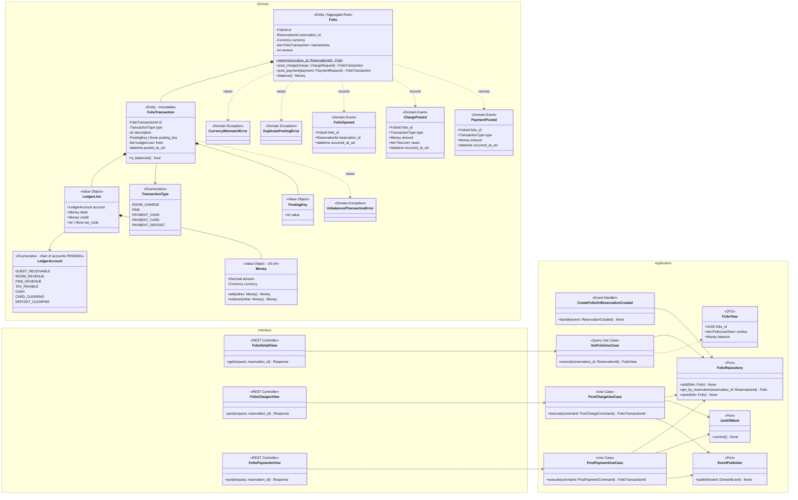
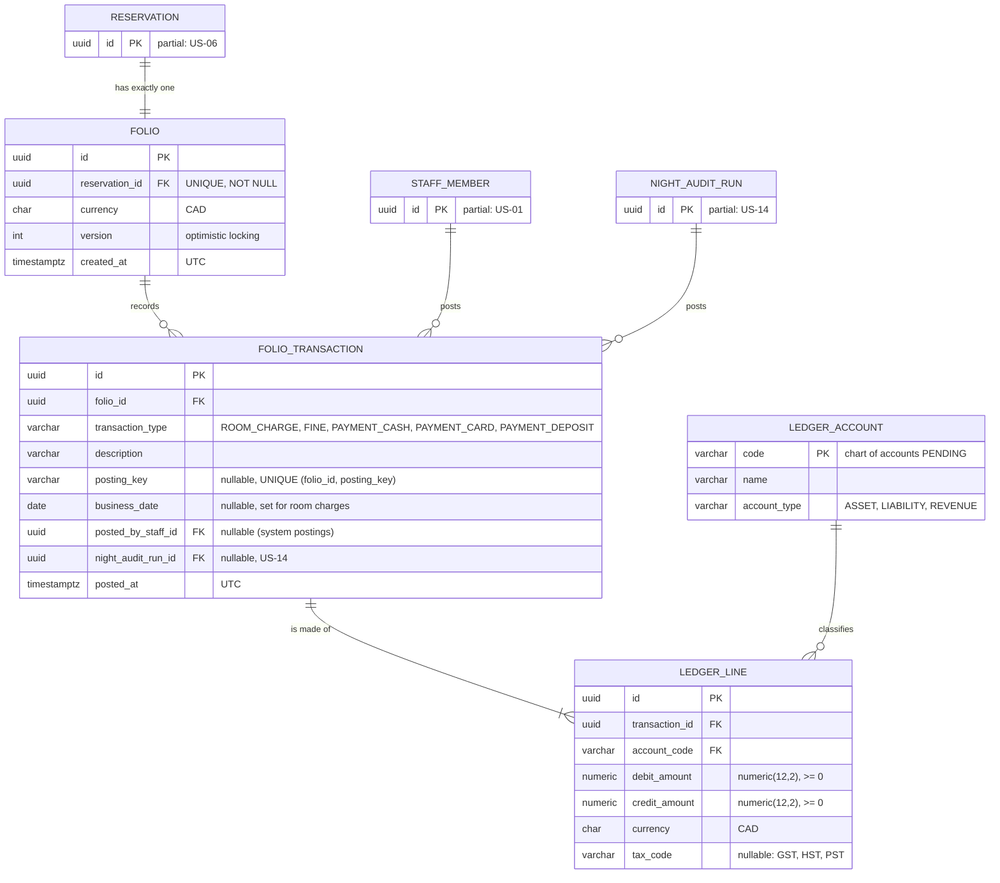
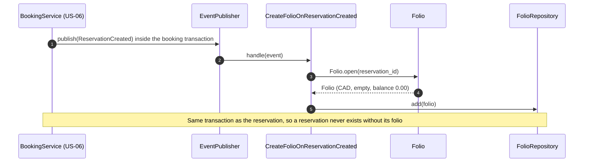
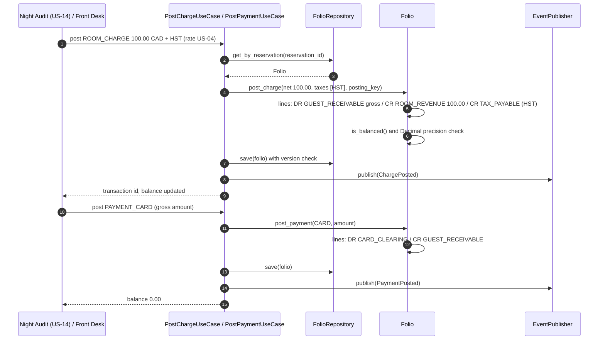

# US-15 — Folio Ledger: Diagrams

> Sources: `US-15-folio-ledger.md`, `US-04-localized-tax-calculation.md`, `docs/Business Modeling/Business Modeling.md` (Section 2 "Folio", Section 4 "Financial Precision"), `CLAUDE.md`.
> Elements tagged **PENDING** depend on business rules not defined yet. They are placeholders in the design, not decisions.
> Data is scoped per **Property** (Business Modeling, Section 5) through the reservation each folio belongs to.

---

## 1. Class Diagram (Clean Architecture)

### Design notes
- **Double-entry:** every `FolioTransaction` has at least two `LedgerLine`s, and the sum of debits equals the sum of credits (`UnbalancedTransactionError` otherwise).
  - **Charge** (e.g., room night with HST): debit `GUEST_RECEIVABLE` for the gross amount; credit `ROOM_REVENUE` for the net amount and `TAX_PAYABLE` (with `tax_code`) for the tax.
  - **Payment** (cash, card or deposit): debit `CASH` / `CARD_CLEARING` / `DEPOSIT_CLEARING`; credit `GUEST_RECEIVABLE`.
- **Balance:** `balance()` is the debit balance of `GUEST_RECEIVABLE`. It must be `0.00` for check-out (US-17).
- **Immutability:** posted transactions are never edited or deleted. Corrections such as voids and refunds will be new reversing transactions; their rules and who authorizes them are PENDING.
- **`PostingKey`** makes postings idempotent. For example, `ROOM_CHARGE:{business_date}` lets the Night Audit (US-14) post each night only once (`DuplicatePostingError`).
- **Money everywhere:** amounts are `Money` (`Decimal` plus currency, US-04). Mixing currencies raises `CurrencyMismatchError`. The folio currency is CAD.
- **The chart of accounts is a minimal proposal** to satisfy double-entry. The final account list is PENDING validation by the business or an accountant.
- **PENDING:** whether split folios are supported (the model keeps one folio per reservation).
- **Permission:** reading and posting require `FINANCIAL_DATA_ACCESS`, so Housekeepers are denied (US-01).

---

## 2. ER Diagram (PostgreSQL persistence)

### Design notes
- **Balanced transactions in the database:** a deferred constraint trigger checks that `SUM(debit_amount) = SUM(credit_amount)` per `transaction_id` at commit time.
- **Line checks:** `CHECK (debit_amount = 0 OR credit_amount = 0)` keeps each line one-sided, and `CHECK (debit_amount >= 0 AND credit_amount >= 0)` forbids negative amounts.
- **Append-only:** `FOLIO_TRANSACTION` and `LEDGER_LINE` are insert-only. The application database user has no `UPDATE`/`DELETE` privilege on them.
- **Balance query:** `SUM(debit) - SUM(credit)` on `GUEST_RECEIVABLE` lines of the folio. It can be cached on `FOLIO` later if needed.

---

## 3. Event Flow

### 3.1 Folio created with the reservation — Scenario 1

### 3.2 Posting a charge and a payment — Scenarios 2 and 3

### 3.3 Domain events

| Event | Emitted by | When | Payload | Consumers |
|---|---|---|---|---|
| `FolioOpened` | `Folio` | Reservation created | `folio_id`, `reservation_id`, `occurred_at_utc` | none |
| `ChargePosted` | `Folio` | Room charge or fine posted | `folio_id`, `type`, `amount`, `taxes`, `occurred_at_utc` | Reports (US-22) |
| `PaymentPosted` | `Folio` | Cash, card or deposit payment posted | `folio_id`, `type`, `amount`, `occurred_at_utc` | Check-out readiness (US-17, read side) |
