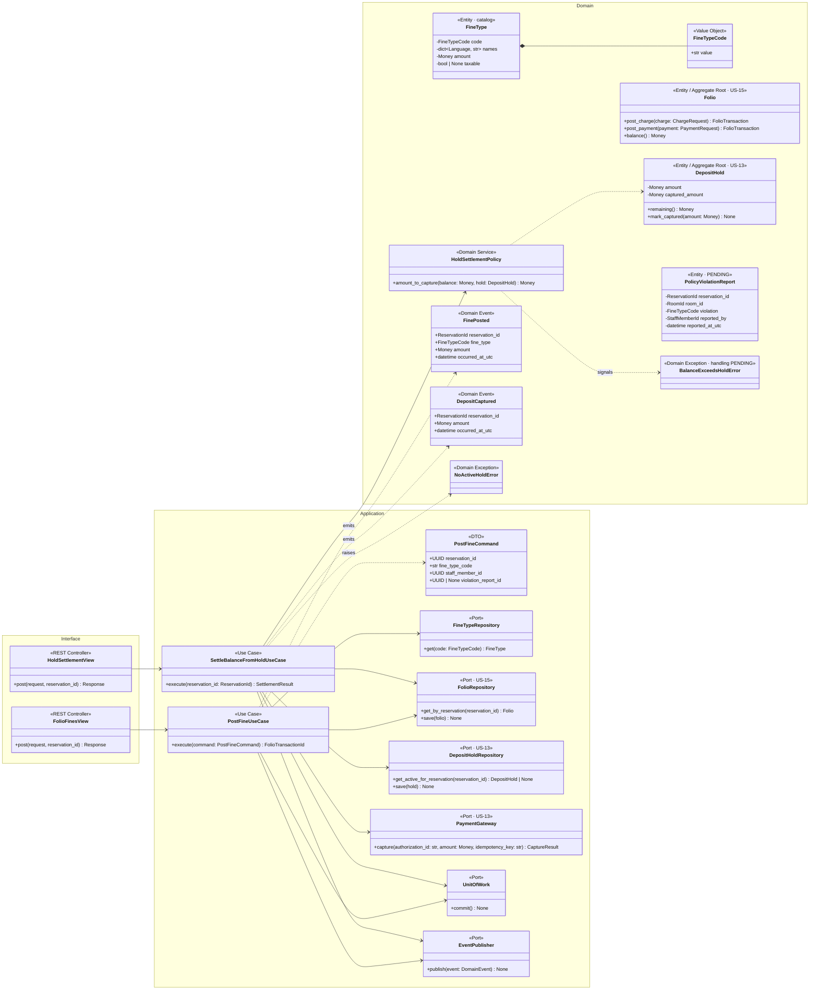
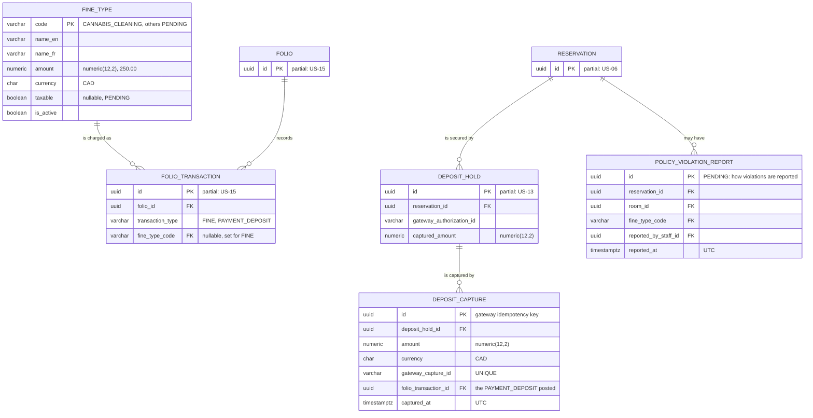
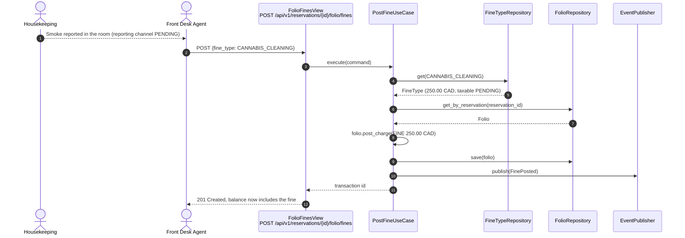
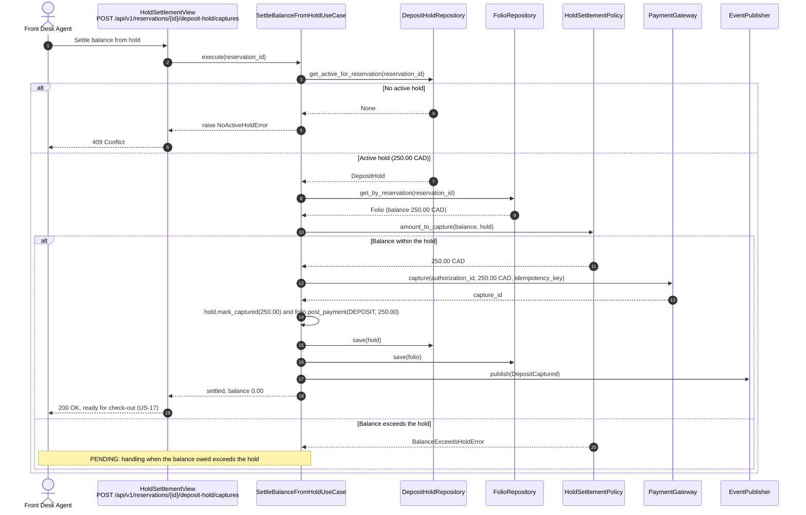

# US-16 — Policy Violation Fine: Diagrams

> Sources: `US-16-policy-violation-fine.md`, `US-13-deposit-pre-authorization-hold.md`, `US-15-folio-ledger.md`, `docs/Business Modeling/Business Modeling.md` (Phase 4, Scenario B), `CLAUDE.md`.
> Elements tagged **PENDING** depend on business rules not defined yet. They are placeholders in the design, not decisions.
> Data is scoped per **Property** (Business Modeling, Section 5) even where the story text does not mention it.

---

## 1. Class Diagram (Clean Architecture)

### Design notes
- **Fines come from a catalog (`FineType`)**, not free text. The only defined fine is `CANNABIS_CLEANING` = $250.00 CAD, with EN/FR names for invoices. Other fine types (pets, damages) are PENDING and will be added as catalog data.
- **Posting a fine (Scenario 1)** creates a `FINE` transaction in the folio (US-15): debit `GUEST_RECEIVABLE`, credit `FINE_REVENUE`. Whether fines are taxable is PENDING (`taxable` is nullable); if they are, `TAX_PAYABLE` lines are added like any charge.
- **Settling from the hold (Scenario 2):**
  - `HoldSettlementPolicy` returns the amount to capture: the outstanding balance, limited to the hold's remaining amount;
  - the capture goes to the gateway with an idempotency key (US-13);
  - on success, `PAYMENT_DEPOSIT` is posted to the folio (debit `DEPOSIT_CLEARING`, credit `GUEST_RECEIVABLE`) and the hold records the captured amount.
- **Order of operations:** the gateway capture happens **before** the local commit. If the commit then fails, a retry repeats the capture with the same idempotency key, and the gateway returns the original result instead of capturing twice.
- **PENDING:**
  - how housekeeping reports a violation (`PolicyViolationReport` is drawn only as a placeholder);
  - what happens when the balance exceeds the hold (`BalanceExceedsHoldError`);
  - whether fines are taxable.
- **Permission:** posting fines requires `FINANCIAL_DATA_ACCESS` (Front Desk Agent, US-01).

---

## 2. ER Diagram (PostgreSQL persistence)

### Design notes
- **`DEPOSIT_CAPTURE`** keeps each capture with its gateway reference and the folio payment it produced, so captures can be reconciled with the gateway's records.
- **Captured amount limit:** a check, or trigger, guarantees `DEPOSIT_HOLD.captured_amount` never exceeds `DEPOSIT_HOLD.amount`.
- **`POLICY_VIOLATION_REPORT` is PENDING.** It exists only if housekeeping reports violations through the system.

---

## 3. Event Flow

### 3.1 Posting the fine — Scenario 1

### 3.2 Settling the balance from the hold — Scenario 2

### 3.3 Domain events

| Event | Emitted by | When | Payload | Consumers |
|---|---|---|---|---|
| `FinePosted` | `PostFineUseCase` | Fine charged to the folio | `reservation_id`, `fine_type`, `amount`, `occurred_at_utc` | Reports (US-22) |
| `DepositCaptured` | `SettleBalanceFromHoldUseCase` | Funds captured from the hold | `reservation_id`, `amount`, `occurred_at_utc` | Check-out (US-17): no release needed when fully captured |
