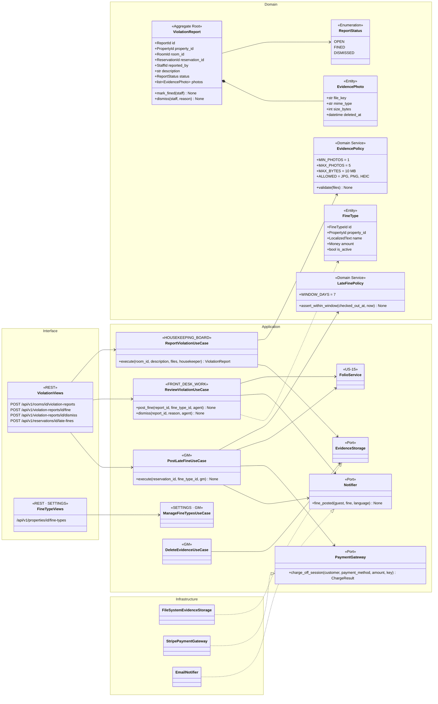
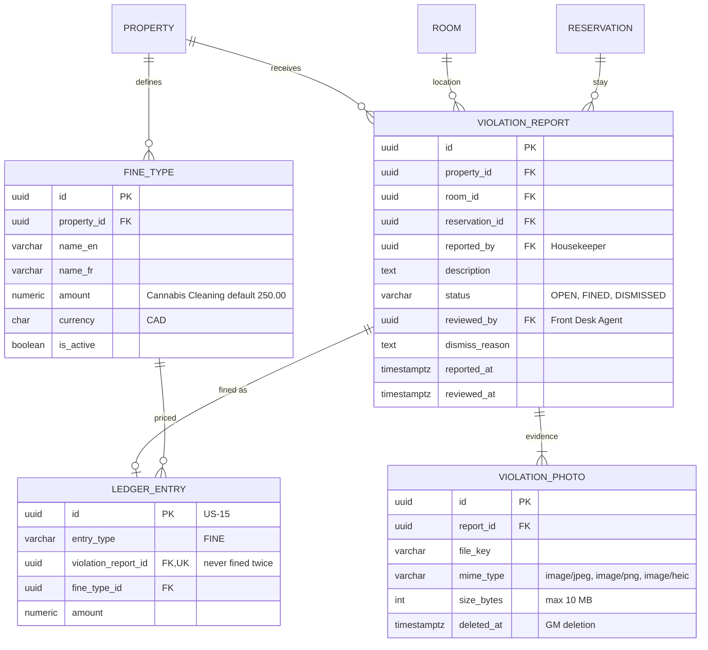
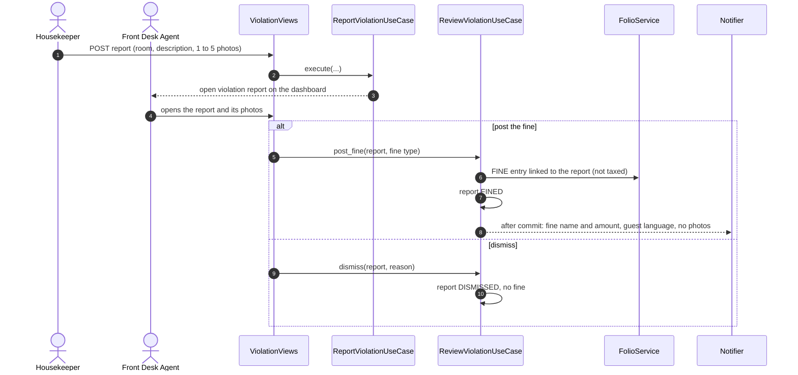
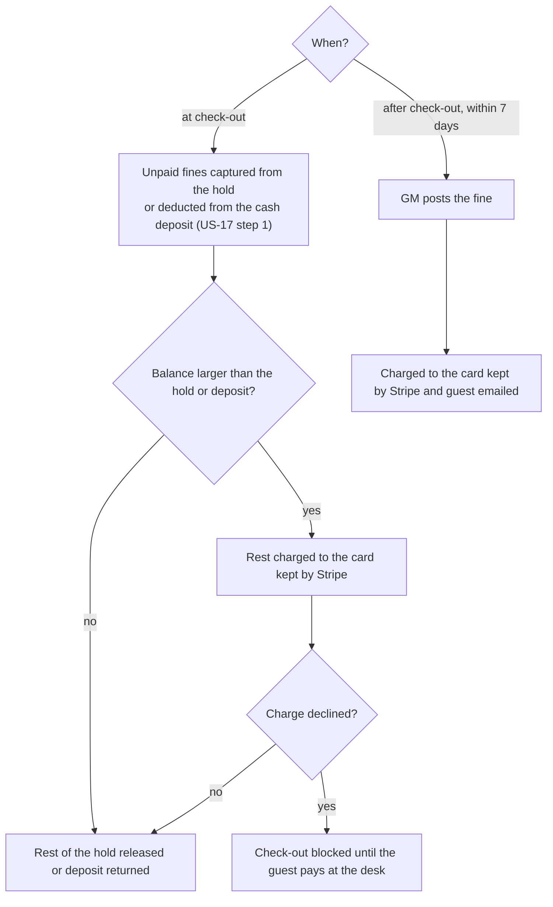

# US-16 — Policy Violation Fine: Diagrams

> Source: `US-16-policy-violation-fine.md`. Related: US-01 (permissions), US-04 (not taxed), US-06 (card kept by Stripe), US-10 (open reports on the dashboard), US-13 (hold and cash deposit), US-15 (folio), US-17 (collection at check-out).

## Business rules reflected

| Rule (US-16) | Where it appears |
|---|---|
| Cannabis Cleaning Fine $250 CAD by default, editable by the GM | Seeded `FINE_TYPE` per property |
| Other fine types and amounts defined by the GM on a settings page | `FineTypeViews` (`SETTINGS`) |
| Fines per property; removal deactivates | `FINE_TYPE.property_id`, `is_active` |
| Not taxed | `FINE` entry posts no tax lines |
| Housekeeper reports with 1–5 photos (JPG, PNG, HEIC), ≤ 10 MB each | `EvidencePolicy`, `ReportViolationUseCase` |
| Evidence kept until the GM deletes it | `DeleteEvidenceUseCase` (GM), `deleted_at` |
| FDA reviews: posts the fine linked to the report, or dismisses with a reason; never fined twice | `ReviewViolationUseCase`, `UNIQUE (violation_report_id)` on the fine entry |
| Guest emailed (fine name and amount, no photos) in their language | `Notifier.fine_posted()` |
| Collected at check-out from the hold or cash deposit | US-17 step 1 |
| Excess charged to the kept card; if declined, check-out blocked until paid at the desk | US-17 steps 2 and 4 |
| GM can post a fine within 7 days after check-out, charged to the kept card, with an email | `PostLateFineUseCase` |

---

## 1. Class Diagram (Clean Architecture)

### Design notes
- **Report:** the Housekeeper reports from the housekeeping board for a room; the system links the report to the reservation currently In-House in that room. The report appears on the front desk dashboard as an open violation report (US-10).
- **Review:** only `OPEN` reports can be fined or dismissed. Posting a fine writes a `FINE` entry (debit guest receivable, credit fine revenue, no tax) with `violation_report_id`; the unique constraint makes a second fine impossible even under concurrency. After commit, the guest gets an email with the fine name and amount, without photos.
- **Collection** is not done at posting time; it happens at check-out (US-17 steps 1 and 2).
- **Late fine:** the GM picks a fine type for a `CHECKED_OUT` reservation whose check-out was within the last 7 days; the system posts the fine and charges it off-session to the card kept by Stripe, then posts `STRIPE_CARD`, and emails the guest. Cash and OTA guests without a kept card: not described by US-16.
- **Evidence:** files are validated by type and size before storage; the GM can delete them (soft delete of the row, file removed from storage).

---

## 2. ER Diagram

---

## 3. Event Flow

### 3.1 Report, review and email — Scenarios 1 to 3

### 3.2 Collection — Scenarios 4 to 6

### 3.3 Domain events

| Event | Raised when | Consumers |
|---|---|---|
| `ViolationReported` | Housekeeper submits a report | Front desk dashboard (US-10) |
| `FinePosted` | FDA posts a fine or GM posts a late fine | Guest email, folio balance (US-15) |
| `ViolationReportDismissed` | FDA dismisses | Dashboard |
| `EvidenceDeleted` | GM deletes photos | Audit log |
