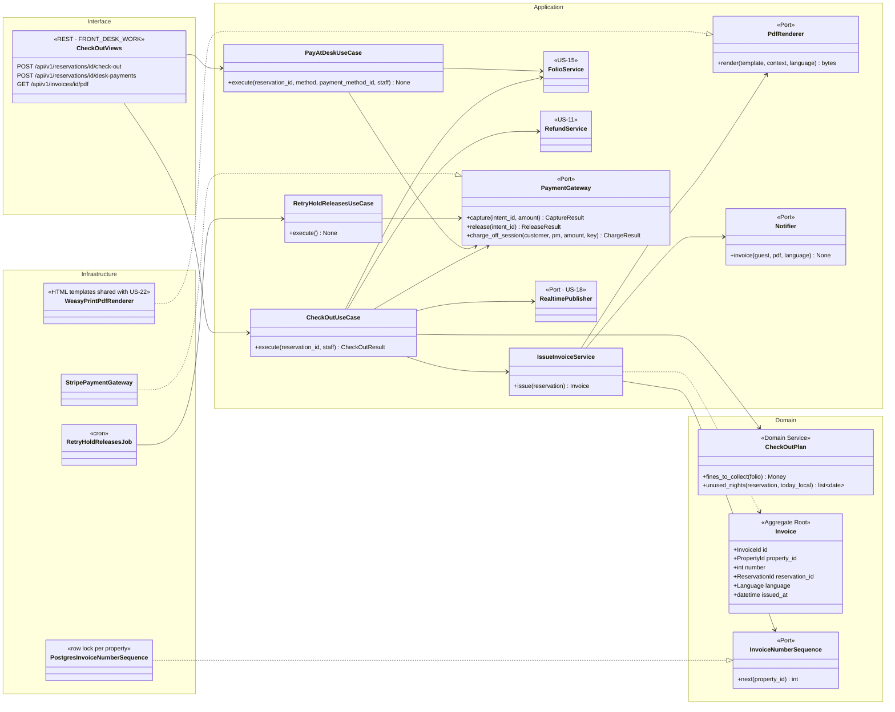
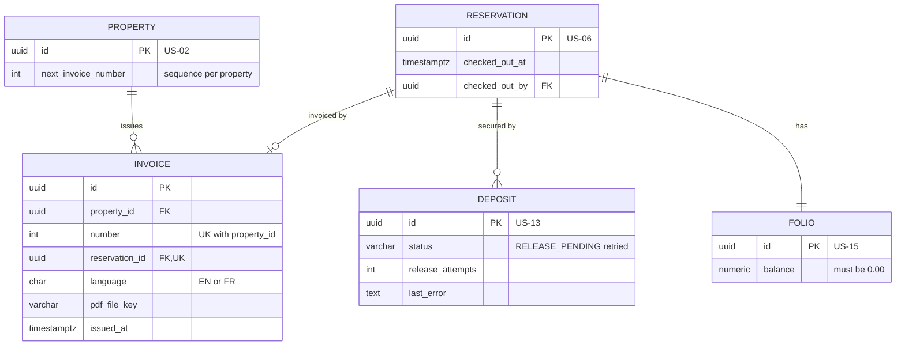
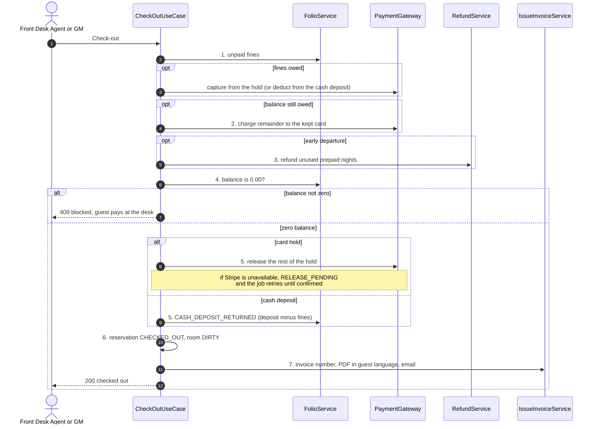

# US-17 — Check-out with Zero Balance: Diagrams

> Source: `US-17-check-out-with-zero-balance.md`. Related: US-06 (kept card), US-10 (late check-out flag), US-11 (early departure refund), US-13 (hold and cash deposit), US-15 (folio), US-16 (fines), US-19 (room Dirty), US-22 (Held Funds report and shared PDF templates).

## Business rules reflected

| Rule (US-17) | Where it appears |
|---|---|
| Check-out by 11:00 AM; later = late check-out flag, no fee | `FlagEvaluator` (US-10); no fee entry |
| Seven steps in order | `CheckOutUseCase`, sequence 3.1 |
| Balance must be $0.00 | Step 4 guard `OutstandingBalance` |
| No card on file: pay at the desk (Stripe fields or cash) | `PayAtDeskUseCase` |
| Partial capture releases the rest of the hold | `PaymentGateway.capture(amount)` releases the remainder |
| Clean stay: whole hold released | Step 5 |
| Stripe unavailable on release: check-out completes, release retried until confirmed | `DEPOSIT.status = RELEASE_PENDING`, `RetryHoldReleasesJob` |
| Invoice: sequential per property; property, guest, dates, nightly charges, taxes per line, fines, payments, refunds, $0.00; PDF in the guest's language | `IssueInvoiceService`, `INVOICE`, WeasyPrint |
| FDA or GM perform check-out; no self check-out | `FRONT_DESK_WORK` permission |

---

## 1. Class Diagram (Clean Architecture)

### Design notes
- **Step 1 – fines:** unpaid fines (balance owed, US-16) are captured from the card hold (`DEPOSIT_CAPTURED` entry, up to the hold amount) or deducted from the cash deposit (`CASH` payment from the deposit).
- **Step 2 – remainder:** any balance still owed is charged off-session to the card kept by Stripe (`STRIPE_CARD`). Guests with no kept card (OTA, cash walk-ins) must pay at the desk first (`PayAtDeskUseCase`, Stripe fields or cash).
- **Step 3 – early departure:** nights from today to the original check-out date were prepaid but never charged by the Night Audit; their rate and taxes are refunded through Stripe (`REFUND_STRIPE`) and released from inventory (Scenario 5).
- **Step 4 – zero balance:** if the balance is not $0.00 (e.g., the step 2 charge was declined), the use case stops with `OutstandingBalance` and nothing after step 4 runs (Scenario 2).
- **Step 5 – release:** a captured hold releases its remainder automatically (Scenario 4: capture $250 of $300 → $50 released); an untouched hold is released. If Stripe is unreachable, the deposit is set to `RELEASE_PENDING` and the check-out continues (Scenario 6); `RetryHoldReleasesJob` retries until Stripe confirms. A cash deposit is returned in cash minus fines (`CASH_DEPOSIT_RETURNED`).
- **Step 6:** reservation `IN_HOUSE → CHECKED_OUT` (US-11), room `OCCUPIED → DIRTY` (US-19), pushed to the housekeeping board (US-18).
- **Step 7:** the invoice number comes from a per-property sequence (row lock, no gaps); the PDF is rendered with WeasyPrint in the guest's language and emailed after commit.

---

## 2. ER Diagram

---

## 3. Event Flow

### 3.1 The seven check-out steps — Scenarios 1, 2, 4, 5 and 6

### 3.2 Domain events

| Event | Raised when | Consumers |
|---|---|---|
| `DepositCaptured` | Fine captured from the hold | Folio (US-15) |
| `DepositReleaseFailed` | Stripe unavailable on release | Retry job, Held Funds report (US-22) |
| `DepositReleased` | Stripe confirms | Held Funds report clears the line |
| `GuestCheckedOut` | Step 6 | Room state (US-19), housekeeping board (US-18), dashboard (US-10) |
| `InvoiceIssued` | Step 7 | Guest email |
