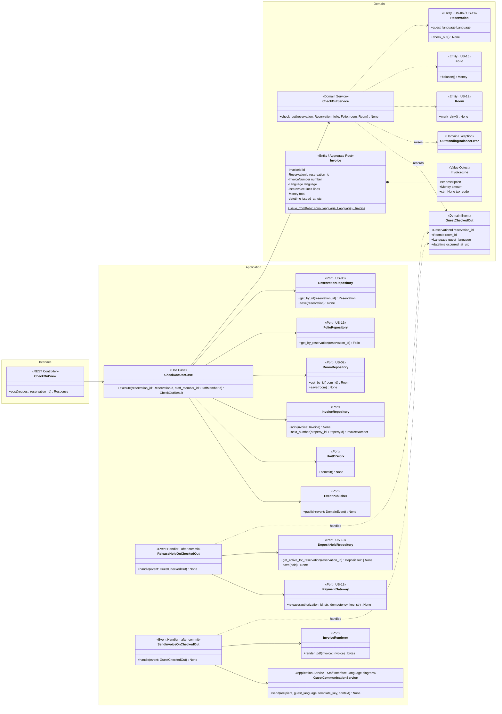
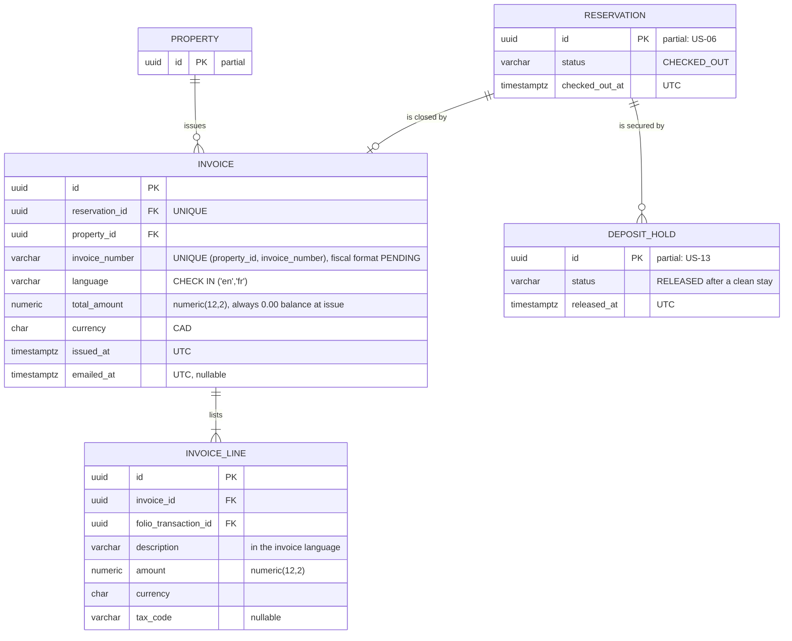
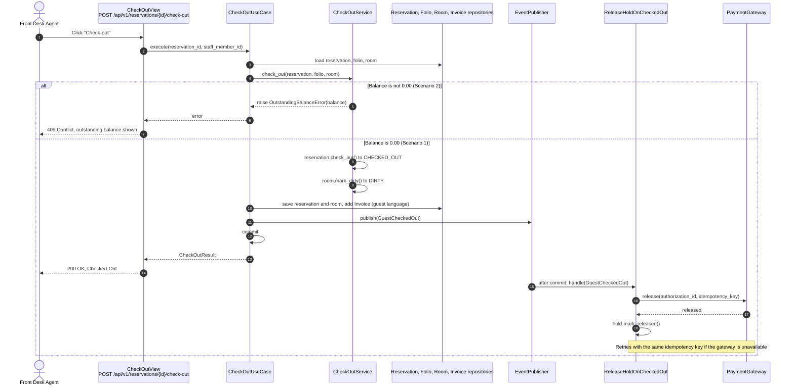
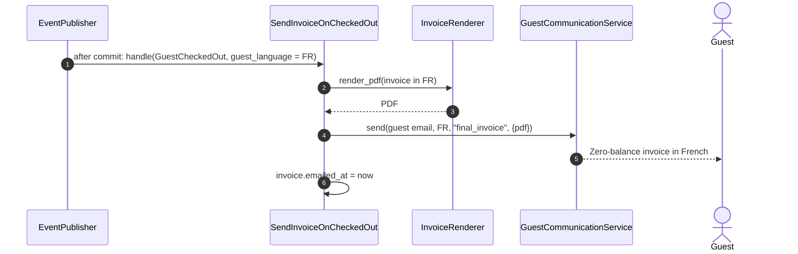

# US-17 — Check-out with Zero Balance: Diagrams

> Sources: `US-17-check-out-with-zero-balance.md`, `US-13-deposit-pre-authorization-hold.md`, `US-15-folio-ledger.md`, `US-19-room-state-machine-and-cleaning-verification.md`, `docs/Business Modeling/Business Modeling.md` (Phase 4), `CLAUDE.md`.
> Elements tagged **PENDING** depend on business rules not defined yet. They are placeholders in the design, not decisions.
> Data is scoped per **Property** (Business Modeling, Section 5) even where the story text does not mention it.

---

## 1. Class Diagram (Clean Architecture)

### Design notes
- **`CheckOutService` enforces the zero-balance rule (Scenario 2):** `folio.balance()` must equal `Money(0.00, CAD)`, otherwise `OutstandingBalanceError`. Only then does the reservation change to `CHECKED_OUT` (US-11) and the room to `DIRTY` (US-19), in one transaction.
- **The invoice is issued in the same transaction** from the folio's posted lines, in the guest's language (Scenario 3). Each property has its own invoice number sequence. Fiscal invoice-numbering requirements are PENDING.
- **External calls run after commit:**
  - **Hold release** (`ReleaseHoldOnCheckedOut`) runs after commit, so a gateway outage never blocks a check-out. It retries with the same idempotency key until the gateway confirms.
  - **Invoice email** (`SendInvoiceOnCheckedOut`) also runs after commit.
- **Hold handling (Scenario 1):**
  - **Clean stay:** the hold was never captured, so it is released in full.
  - **Fully captured (US-16):** there is nothing to release.
  - **Partially captured:** releasing the remainder is PENDING.
- **Check-out deadline:** check-out is strictly by 11:00 AM local time. Late check-out handling is PENDING, so the use case does not block or charge after 11:00 until it is defined.
- **PENDING:** when room charges are paid (booking, check-in or check-out). The model works for any of them because it only checks the final balance.

---

## 2. ER Diagram (PostgreSQL persistence)

### Design notes
- **The invoice is a snapshot of the folio at check-out.** Its lines reference the folio transactions they came from, but keep their own description and amount, so later changes (e.g., anonymization, US-21) never alter an issued invoice.
- **Numbering:** invoice numbers are unique per property, generated from a per-property sequence.
- **Hold release status:** `DEPOSIT_HOLD.status = 'RELEASED'` plus `released_at` show that the after-commit release succeeded.

---

## 3. Event Flow

### 3.1 Check-out — Scenarios 1 and 2

### 3.2 Invoice email in the guest's language — Scenario 3

### 3.3 Domain events

| Event | Emitted by | When | Payload | Consumers |
|---|---|---|---|---|
| `GuestCheckedOut` | `CheckOutService` | Zero-balance check-out completed | `reservation_id`, `room_id`, `guest_language`, `occurred_at_utc` | `ReleaseHoldOnCheckedOut`, `SendInvoiceOnCheckedOut` (after commit); status history (US-11); housekeeping board (US-18) |
| `RoomStateChanged` | `Room` (US-19) | Room moved to DIRTY | see US-19 | Real-time housekeeping board (US-18) |
