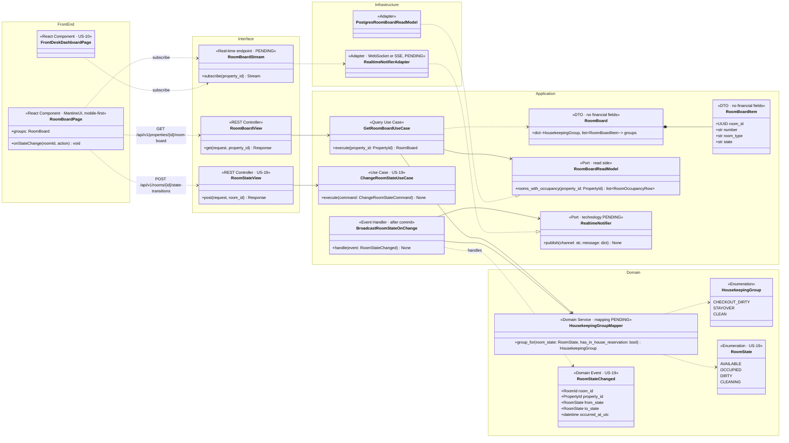
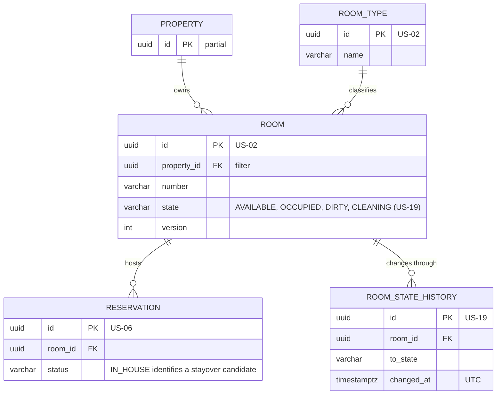
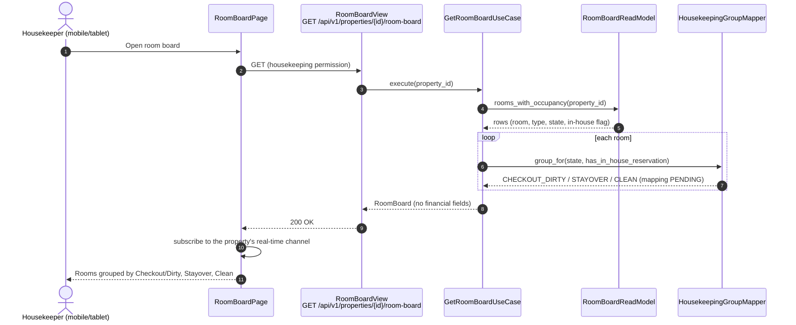
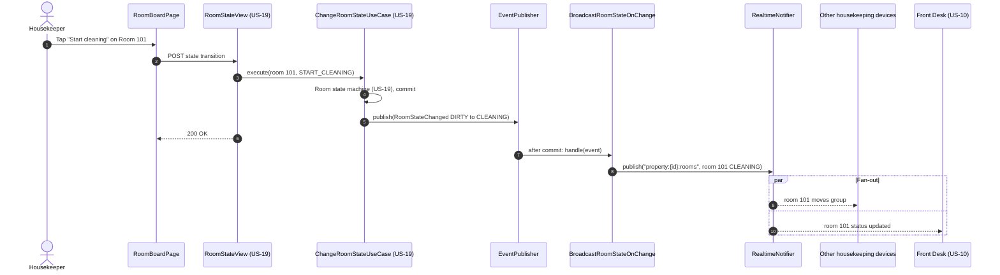

# US-18 — Housekeeping Room Board: Diagrams

> Sources: `US-18-housekeeping-room-board.md`, `US-19-room-state-machine-and-cleaning-verification.md`, `US-01-staff-authentication-and-role-based-access.md`, `docs/Business Modeling/Business Modeling.md` (Personas), `docs/Tech Stack/Tools.md`, `CLAUDE.md`.
> Elements tagged **PENDING** depend on business rules not defined yet. They are placeholders in the design, not decisions.
> Data is scoped per **Property** (Business Modeling, Section 5) even where the story text does not mention it.

---

## 1. Class Diagram (Clean Architecture + Front-end)

### Design notes
- **No financial data by construction (Scenario 3):**
  - `RoomBoard` and `RoomBoardItem` have no rate, balance or guest-payment fields, and the read model does not select them;
  - the endpoint needs only a housekeeping permission, never `FINANCIAL_DATA_ACCESS`;
  - financial endpoints still deny Housekeepers (US-01).
- **Grouping:** `HousekeepingGroupMapper` turns a room's state (plus whether it has an In-House reservation) into the board groups `Checkout/Dirty`, `Stayover` and `Clean`. The exact mapping is PENDING (US-18 business rules), and it lives only in this class, so the decision changes one place.
- **Real-time (Scenario 2):**
  - state changes go through the US-19 state machine;
  - after commit, `BroadcastRoomStateOnChange` pushes the change to every subscriber of the property's channel (housekeeping devices and the front desk).
- **Real-time technology is PENDING.** WebSockets (e.g., Django Channels) or Server-Sent Events are candidates, and neither is in `Tools.md`. `RealtimeNotifier` keeps the choice behind a port.
- **Mobile/tablet:** `RoomBoardPage` is mobile-first with large touch targets (MantineUI responsive grid). Each group is a section; each room is a card with the actions its state allows.

---

## 2. ER Diagram (sources of the read model)

### Design notes
- **No new table.** The board reads `ROOM`, `ROOM_TYPE` and the In-House `RESERVATION` of each room. Financial tables (`FOLIO`, `DEPOSIT_HOLD`, rates) are never joined.
- **Index:** `ROOM (property_id, state)` keeps the board query fast on mobile connections.

---

## 3. Event Flow

### 3.1 Opening the board — Scenario 1

### 3.2 Instant update for all users — Scenario 2

### 3.3 Domain events

| Event | Emitted by | When | Payload | Consumers |
|---|---|---|---|---|
| `RoomStateChanged` | `Room` (US-19) | Any room state transition (check-in, check-out, cleaning, verification) | `room_id`, `property_id`, `from_state`, `to_state`, `occurred_at_utc` | `BroadcastRoomStateOnChange` (after commit) |
