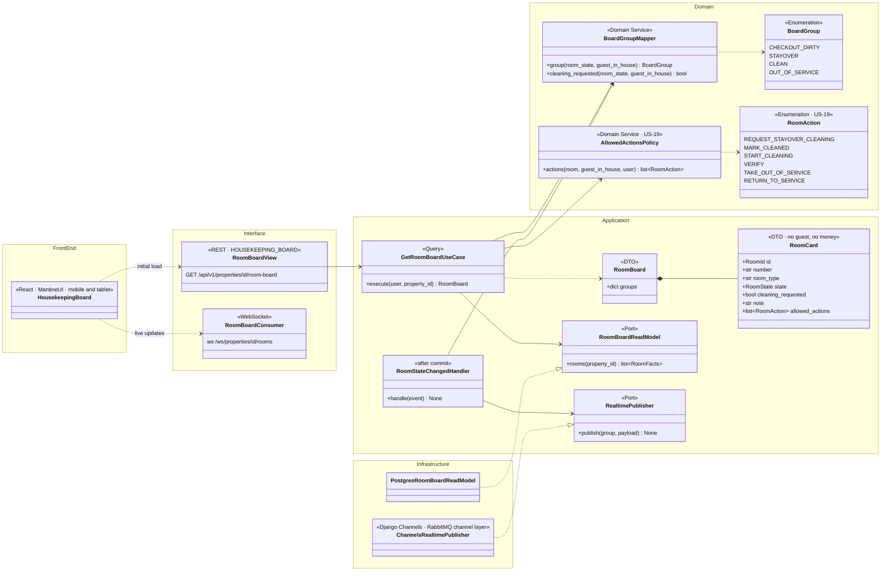
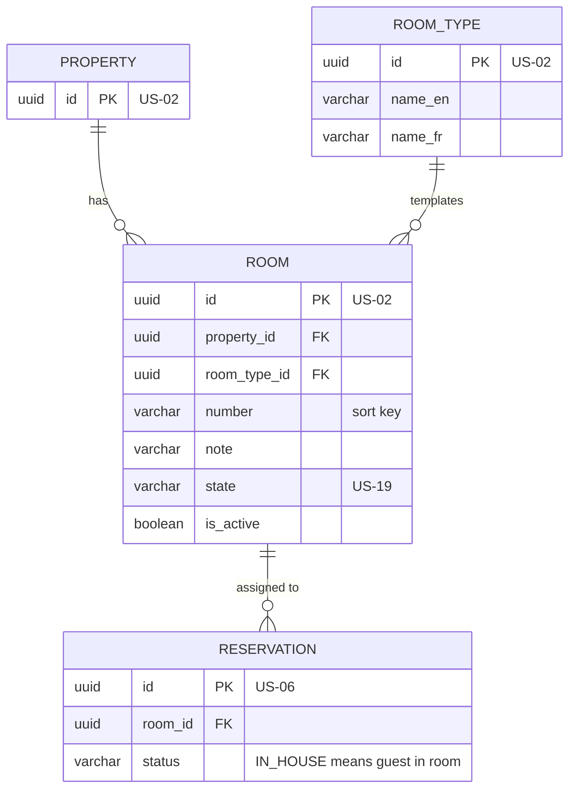
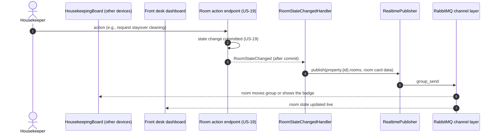
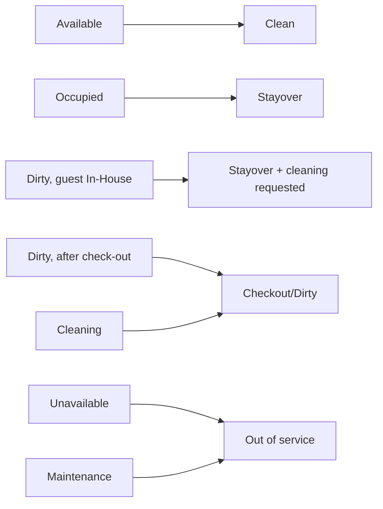

# US-18 — Housekeeping Room Board: Diagrams

> Source: `US-18-housekeeping-room-board.md`. Related: US-01 (permissions, Head Housekeeper), US-02 (room note), US-10 (dashboard receives the same pushes), US-19 (states and actions).

## Business rules reflected

| Rule (US-18) | Where it appears |
|---|---|
| Works on mobile and tablet | `HousekeepingBoard` responsive React/MantineUI page |
| Real-time with WebSockets (Django Channels), RabbitMQ as message layer | `RoomBoardConsumer`, `ChannelsRealtimePublisher` |
| State → group mapping (Clean, Stayover, Stayover + badge, Checkout/Dirty, Out of service) | `BoardGroupMapper` |
| Everyone sees Out of service; only Head Housekeeper or GM act on it | `AllowedActionsPolicy` |
| Card: number, type, state, badge, note, allowed actions | `RoomCard` DTO |
| No financial data, no guest names | `RoomCard` has no guest or money fields |
| Own property (GM chooses); sorted by room number within each group | `PropertyScope`, ordering |
| State changes also pushed to the front desk dashboard | Same group `property.{id}.rooms` consumed by US-10 |

---

## 1. Class Diagram (Clean Architecture)

### Design notes
- **Mapping (`BoardGroupMapper`):** `AVAILABLE` → Clean; `OCCUPIED` → Stayover; `DIRTY` with the guest In-House → Stayover + "cleaning requested"; `DIRTY` after check-out → Checkout/Dirty; `CLEANING` → Checkout/Dirty; `UNAVAILABLE`, `MAINTENANCE` → Out of service.
- **"Guest In-House"** comes from the reservation assigned to the room with status `IN_HOUSE`. The board uses it only as a boolean; no name is sent.
- **Allowed actions** are computed on the server per user (US-19 rules); actions on Out of service rooms appear only for a Head Housekeeper or the GM. The buttons call the US-19 endpoints.
- **Push payload** per change: room id, number, type, state, group, badge, note. Each client recomputes its own allowed actions on receipt by refetching the card, so permissions stay server-side.
- **Consumers:** the WebSocket connection is authenticated with the staff session and joins `property.{id}.rooms` only if the property is in the user's scope.

---

## 2. ER Diagram (sources of the read model)

---

## 3. Event Flow

### 3.1 Live update — Scenarios 2 and 4

### 3.2 Group mapping

### 3.3 Domain events

Consumes `RoomStateChanged` (US-19). Emits none.
