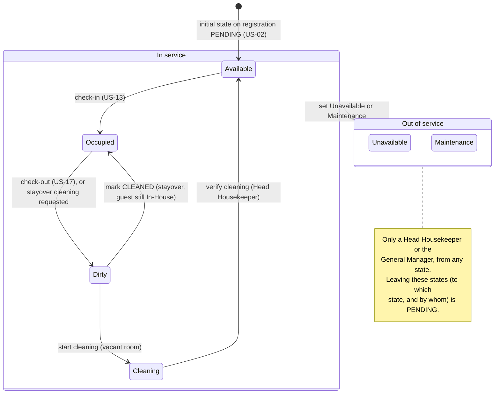
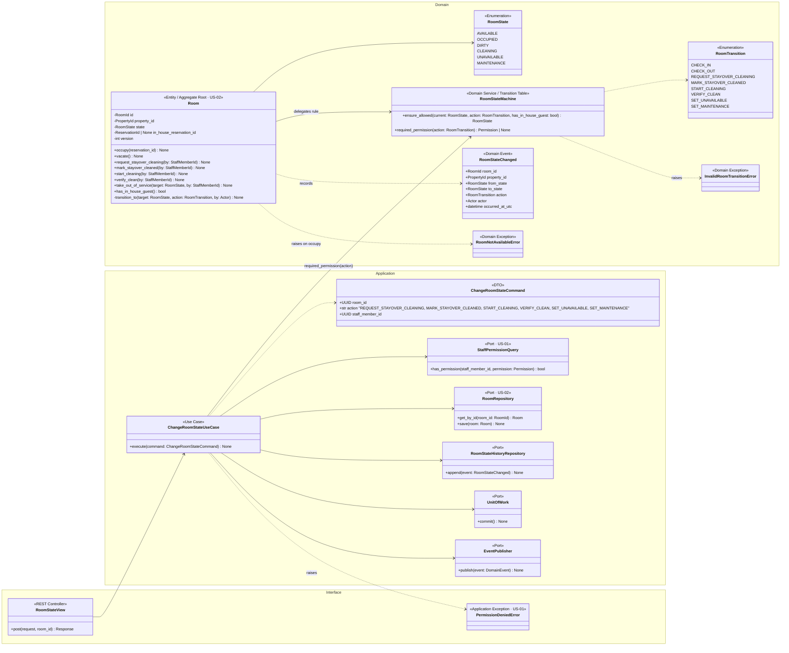
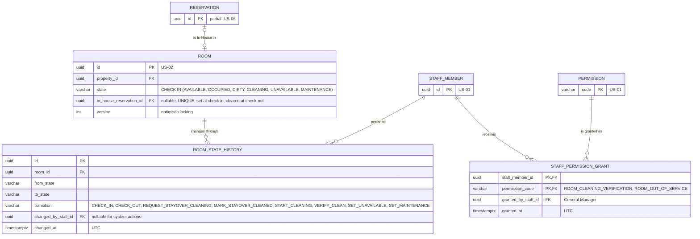
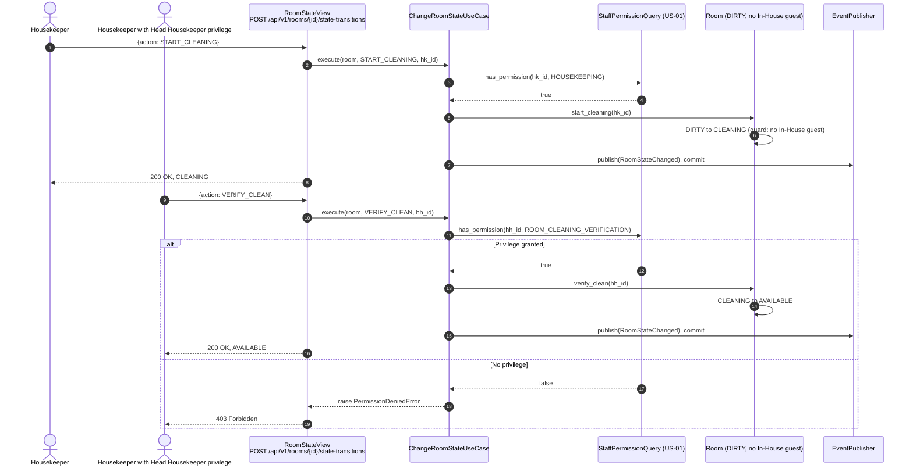
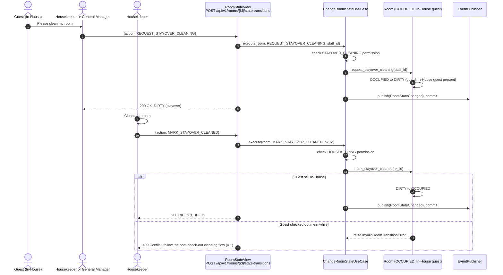
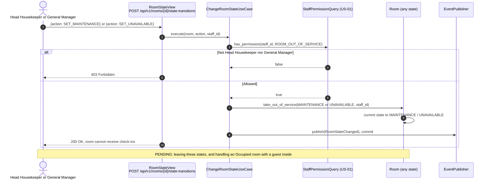
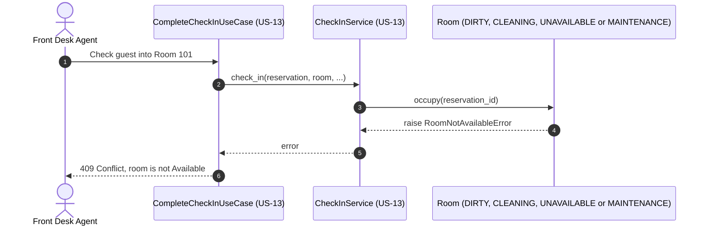

# US-19 — Room State Machine and Cleaning Verification: Diagrams

> Sources: `US-19-room-state-machine-and-cleaning-verification.md` (Business Rules updated on 2026-11-02), `US-01-staff-authentication-and-role-based-access.md`, `US-13-deposit-pre-authorization-hold.md`, `US-17-check-out-with-zero-balance.md`, `docs/Business Modeling/Business Modeling.md` (Section 2 "The Room State Machine"), `CLAUDE.md`.
> Elements tagged **PENDING** depend on business rules not defined yet. They are placeholders in the design, not decisions.
> Data is scoped per **Property** (Business Modeling, Section 5) even where the story text does not mention it.
>
> **Head Housekeeper:** per US-01, Head Housekeeper is a *privilege* the General Manager grants to any Housekeeper, not a separate role. It is modelled as individual permission grants.

### Business rules reflected in this design

| Rule | Where it is modelled |
|---|---|
| Available → Occupied (check-in) → Dirty (check-out) → Cleaning → Available | `RoomStateMachine` transition table |
| Only the Head Housekeeper's verification moves a room from Cleaning to Available | `VERIFY_CLEAN` requires `ROOM_CLEANING_VERIFICATION` |
| A guest can only be checked into an Available room | `Room.occupy()` guard |
| Only a Head Housekeeper or a General Manager can move a room from any state to Unavailable or Maintenance | `SET_UNAVAILABLE` / `SET_MAINTENANCE` require `ROOM_OUT_OF_SERVICE` |
| Stayover cleaning: on the guest's request, a Housekeeper or General Manager moves the room to Dirty; after cleaning, the Housekeeper marks it cleaned and it returns to Occupied | `REQUEST_STAYOVER_CLEANING` (Occupied → Dirty) and `MARK_STAYOVER_CLEANED` (Dirty → Occupied), allowed only while the room has an In-House guest |

---

## 1. Room State Machine

### Transition table

| From | To | Action | Who | Guard |
|---|---|---|---|---|
| Available | Occupied | `CHECK_IN` | Front Desk Agent, via US-13 | Room assigned to the reservation |
| Occupied | Dirty | `CHECK_OUT` | Front Desk Agent, via US-17 | Clears the In-House guest |
| Occupied | Dirty | `REQUEST_STAYOVER_CLEANING` | Housekeeper or General Manager | Room has an In-House guest |
| Dirty | Occupied | `MARK_STAYOVER_CLEANED` | Housekeeper | Room still has an In-House guest |
| Dirty | Cleaning | `START_CLEANING` | Housekeeper | Room has **no** In-House guest (after check-out) |
| Cleaning | Available | `VERIFY_CLEAN` | Head Housekeeper (privilege) | — |
| Any state | Unavailable | `SET_UNAVAILABLE` | Head Housekeeper or General Manager | — |
| Any state | Maintenance | `SET_MAINTENANCE` | Head Housekeeper or General Manager | — |

`Dirty` has two meanings depending on whether a guest is still In-House. The guard decides which exit is allowed: a stayover room goes back to `Occupied`, while a vacated room goes through `Cleaning` and verification to `Available`.

---

## 2. Class Diagram (Clean Architecture)

### Design notes
- **One transition table, one entry point:**
  - `RoomStateMachine` holds the table above, including the guard on whether the room has an In-House guest;
  - `Room.transition_to` is the only way to change a state, so anything outside the table raises `InvalidRoomTransitionError` (`409 Conflict`).
- **`in_house_reservation_id` tells the two kinds of Dirty apart:**
  - it is set by check-in (`occupy`, US-13) and cleared by check-out (`vacate`, US-17);
  - with a guest present, `Dirty` can only go back to `Occupied` (`MARK_STAYOVER_CLEANED`), and `START_CLEANING` / `VERIFY_CLEAN` are refused;
  - without a guest, the room must go `Cleaning` → `Available` through verification.
- **Permissions per action:** `required_permission(action)` returns the permission each action needs, and the use case checks it for the staff member before the domain runs.

  | Action | Permission | Granted to |
  |---|---|---|
  | `REQUEST_STAYOVER_CLEANING` | `STAYOVER_CLEANING` | Housekeeper role, General Manager role |
  | `MARK_STAYOVER_CLEANED`, `START_CLEANING` | `HOUSEKEEPING` | Housekeeper role |
  | `VERIFY_CLEAN` | `ROOM_CLEANING_VERIFICATION` | Housekeepers with the Head Housekeeper privilege (individual grant) |
  | `SET_UNAVAILABLE`, `SET_MAINTENANCE` | `ROOM_OUT_OF_SERVICE` | Head Housekeeper privilege (individual grant) and General Manager role |
- **Scenario 2:** `Room.occupy()` accepts only `AVAILABLE`, so check-in is blocked for `DIRTY`, `CLEANING`, `UNAVAILABLE` and `MAINTENANCE` rooms.
- **Who triggers which actions:**
  - **Housekeeping and the General Manager:** stayover, cleaning, verification and out-of-service actions go through `POST /api/v1/rooms/{id}/state-transitions`.
  - **Front desk:** `CHECK_IN` and `CHECK_OUT` are triggered only by the check-in (US-13) and check-out (US-17) use cases.
- **Stayover requests:** the guest does not use the system. They ask a Housekeeper or the General Manager, who records the request.
- **Concurrency:** `Room.version` (optimistic locking) prevents two devices from applying conflicting transitions at the same time; the second one receives `409 Conflict`.
- **PENDING:**
  - how a room leaves `Unavailable` or `Maintenance` (to which state, e.g., `Dirty` or `Available`, and who can do it);
  - the difference between `Unavailable` and `Maintenance`;
  - what happens when an **Occupied** room is moved to `Unavailable` or `Maintenance` while a guest is In-House (e.g., moving the guest to another room);
  - whether out-of-service rooms are removed from sellable inventory (US-06) and from occupancy reports (US-23), and for which nights;
  - whether a reason or note is required when taking a room out of service;
  - the initial state of a newly registered room.

---

## 3. ER Diagram (PostgreSQL persistence)

### Design notes
- **Two new states:** `ROOM.state` now accepts `UNAVAILABLE` and `MAINTENANCE`.
- **`ROOM.in_house_reservation_id` is new:**
  - `UNIQUE`, so a reservation can be In-House in only one room;
  - a check constraint keeps it consistent: it must be set when `state = 'OCCUPIED'`, and it may only be set for `OCCUPIED` or `DIRTY` (stayover);
  - it also helps the housekeeping board (US-18) tell stayover rooms from vacated rooms.
- **Head Housekeeper privilege:** `STAFF_PERMISSION_GRANT` carries both privilege permissions, `ROOM_CLEANING_VERIFICATION` and `ROOM_OUT_OF_SERVICE`, granted by the General Manager to individual Housekeepers. The General Manager role has them through the role-permission matrix (US-01).
- **`ROOM_STATE_HISTORY`** keeps who did each action and when, written in the same transaction as the state change.

---

## 4. Event Flow

### 4.1 Cleaning after check-out and verification — Scenarios 1 and 3

### 4.2 Stayover cleaning requested by the guest

### 4.3 Taking a room out of service

### 4.4 Blocked check-in — Scenario 2

### 4.5 Domain events

| Event | Emitted by | When | Payload | Consumers |
|---|---|---|---|---|
| `RoomStateChanged` | `Room` | Any allowed transition | `room_id`, `property_id`, `from_state`, `to_state`, `action`, `actor`, `occurred_at_utc` | Room state history (same transaction); real-time housekeeping board (US-18, after commit) |
