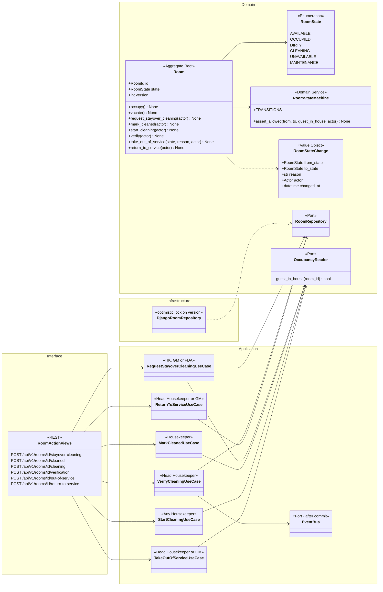
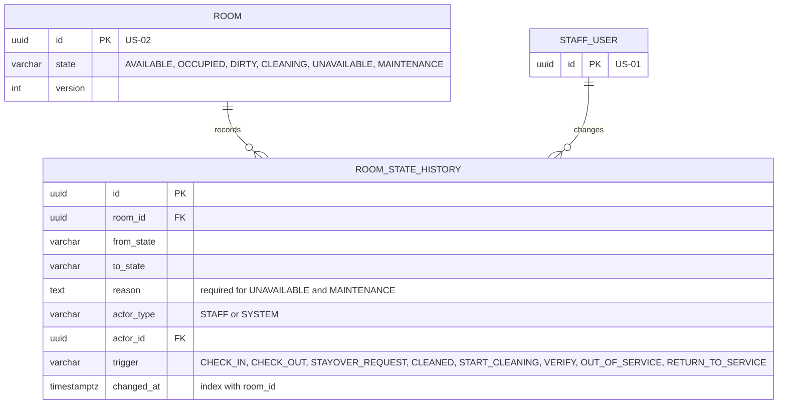
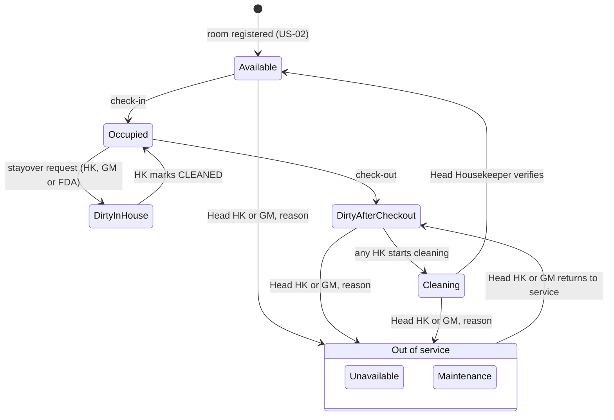
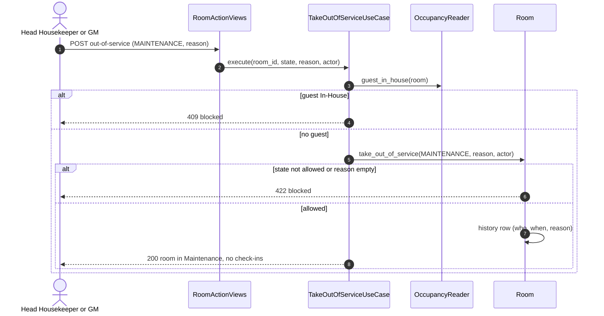

# US-19 — Room State Machine and Cleaning Verification: Diagrams

> Source: `US-19-room-state-machine-and-cleaning-verification.md`. Related: US-01 (Head Housekeeper privilege), US-13 (check-in), US-17 (check-out), US-18 (board), US-23 (room history for available room-nights).

## Business rules reflected

| Rule (US-19) | Where it appears |
|---|---|
| States: Available, Occupied, Dirty, Cleaning, Unavailable, Maintenance | `RoomState` |
| Allowed transitions table; any other blocked | `RoomStateMachine.TRANSITIONS`, state diagram 3.1 |
| Only Head Housekeeper verification moves Cleaning → Available; may verify own cleaning | `VerifyCleaningUseCase` guard; no "different person" check |
| Check-in only into an Available room | `Room.occupy()` guard |
| Maintenance for repairs, Unavailable for other reasons | Two states, reason text |
| Only Head Housekeeper or GM move to Unavailable/Maintenance, reason required | `TakeOutOfServiceUseCase` |
| Not while a guest is In-House | `GuestInHouse` guard |
| Return from Unavailable/Maintenance goes to Dirty | `ReturnToServiceUseCase` |
| Stayover cleaning: HK, GM or FDA move to Dirty; HK marks CLEANED → Occupied | `RequestStayoverCleaningUseCase`, `MarkCleanedUseCase` |
| Every change recorded with who and when | `ROOM_STATE_HISTORY` |

---

## 1. Class Diagram (Clean Architecture)

### Design notes
- **The two Dirty cases** are told apart by whether a reservation with status `IN_HOUSE` is assigned to the room (`OccupancyReader`): with a guest, `DIRTY → OCCUPIED` (mark CLEANED); after check-out, `DIRTY → CLEANING` (start cleaning).
- **Out of service** is allowed from `AVAILABLE`, `DIRTY` (after check-out) or `CLEANING`, never from `OCCUPIED` or a Dirty room with a guest In-House (Scenario 6). The reason is required and saved in the history.
- **Check-in and check-out transitions** (`occupy()`, `vacate()`) are called by US-13 and US-17 inside their own transactions.
- **Every change** appends a `ROOM_STATE_HISTORY` row and raises `RoomStateChanged` after commit, which US-18 pushes to the board and dashboard. US-23 reads this history to know which rooms were out of service at the 2:00 AM Night Audit.
- **Concurrency:** `ROOM.version` prevents two users from applying conflicting actions at the same time.

---

## 2. ER Diagram

---

## 3. Event Flow

### 3.1 Room state machine

> `DirtyInHouse` and `DirtyAfterCheckout` are the same stored state (`DIRTY`), shown separately to make the guest-in-house rule visible.

### 3.2 Taking a room out of service — Scenarios 5 and 6

### 3.3 Domain events

| Event | Raised when | Consumers |
|---|---|---|
| `RoomStateChanged` | Any transition | Housekeeping board and dashboard (US-18, US-10), occupancy report (US-23) |
