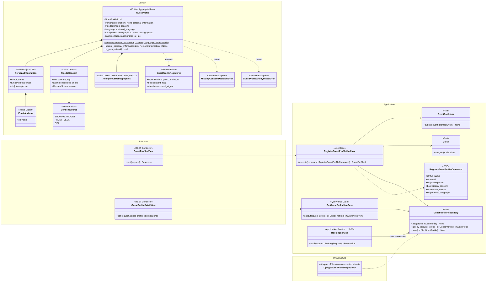
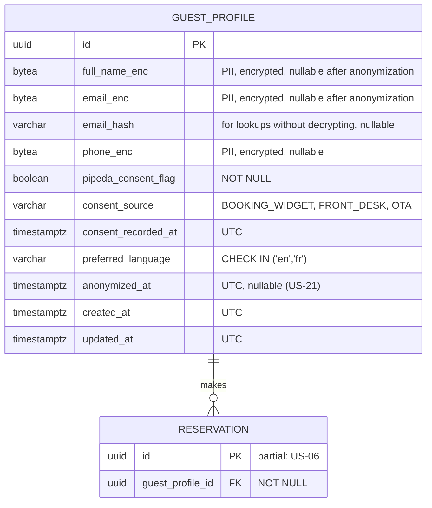
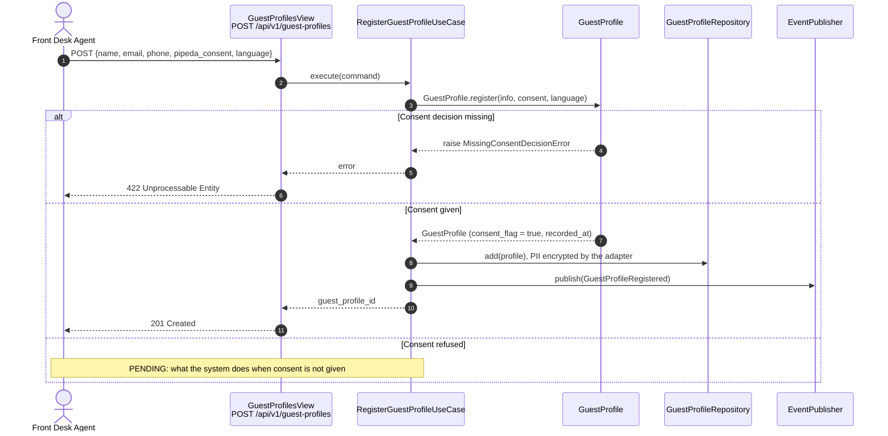
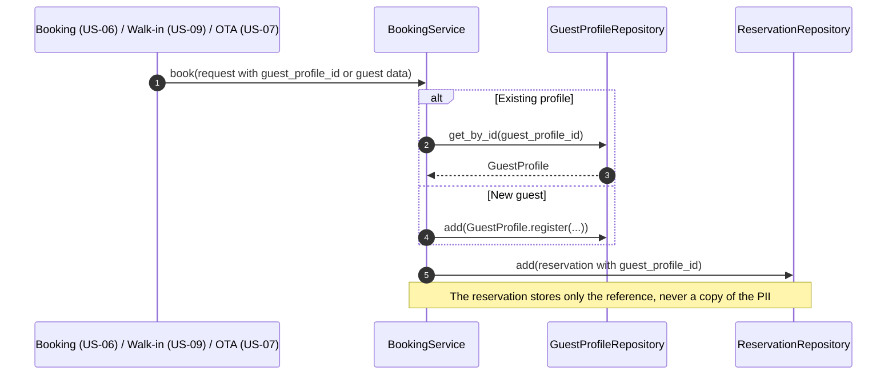

# US-20 — Guest Profile with PIPEDA Consent: Diagrams

> Sources: `US-20-guest-profile-with-pipeda-consent.md`, `US-21-forget-me-pii-anonymization.md`, `docs/Business Modeling/Business Modeling.md` (Section 2 "GuestProfile", Section 4 "Strict Security & PIPEDA"), `CLAUDE.md`.
> Elements tagged **PENDING** depend on business rules not defined yet. They are placeholders in the design, not decisions.
> Whether guest profiles are shared across properties is PENDING (Business Modeling, Section 5); this design keeps profiles property-independent and links them through reservations.

---

## 1. Class Diagram (Clean Architecture)

### Design notes
- **PII is isolated in one value object:** all PII sits in `PersonalInformation`, kept apart from the rest of the profile. "Forget Me" (US-21) can then remove PII in one operation, and the rest of the system references guests only by `GuestProfileId`.
- **Consent is stored with its context (Scenario 1):**
  - `PipedaConsent` keeps the flag required by the business document, when it was recorded (UTC) and from which channel;
  - a profile cannot be registered without an explicit consent decision (`MissingConsentDecisionError`);
  - what the system does when consent is **not** given is PENDING.
- **Scenario 2:** reservations reference `guest_profile_id` (US-06). The profile is created or reused by `BookingService` when a booking is made.
- **Anonymized profiles are read-only:** after anonymization (US-21), updates raise `GuestProfileAnonymizedError`.
- **Encryption at rest (technical recommendation):** PII columns are encrypted at rest, e.g., PostgreSQL `pgcrypto` or application-level field encryption, so database backups do not expose PII in clear text.
- **PENDING:**
  - mandatory profile fields (only name and email are assumed);
  - matching a returning guest to an existing profile;
  - sharing profiles across properties.
- **Permission:** reading PII requires a `GUEST_DATA_ACCESS` permission (role-permission matrix, US-01).

---

## 2. ER Diagram (PostgreSQL persistence)

### Design notes
- **Encrypted columns:** `*_enc` columns hold encrypted values. `email_hash` (a keyed hash) supports finding a returning guest without decrypting every row; matching rules are PENDING.
- **`pipeda_consent_flag NOT NULL`** makes the database itself reject a profile without a consent decision.
- **Anonymous demographic columns** are added once US-21 defines which ones are kept.
- **Field names are illustrative** until the mandatory profile fields are defined.

---

## 3. Event Flow

### 3.1 Registering a profile — Scenario 1

### 3.2 Linking the profile to a reservation — Scenario 2

### 3.3 Domain events

| Event | Emitted by | When | Payload | Consumers |
|---|---|---|---|---|
| `GuestProfileRegistered` | `RegisterGuestProfileUseCase` / `BookingService` | Profile created | `guest_profile_id`, `consent_flag`, `occurred_at_utc` (no PII) | none |
