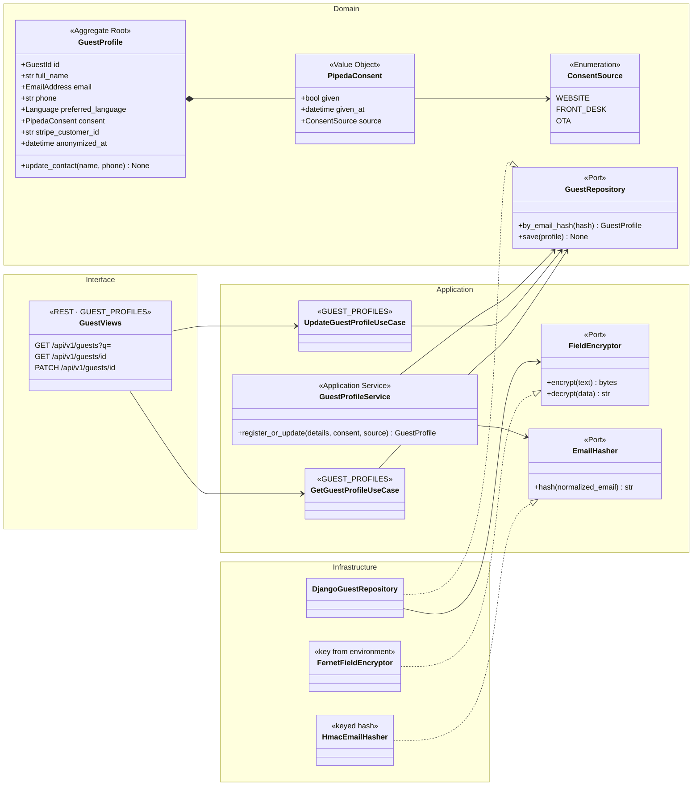
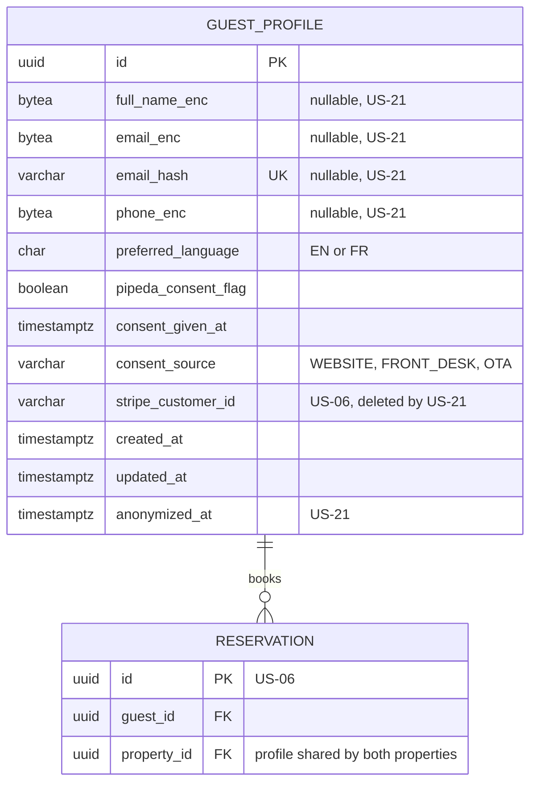
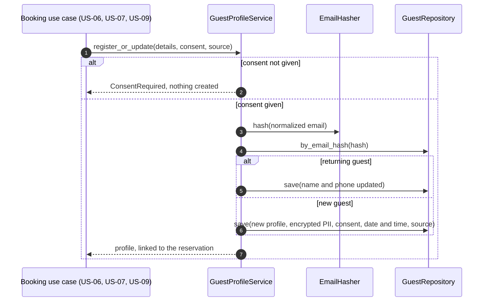

# US-20 — Guest Profile with PIPEDA Consent: Diagrams

> Source: `US-20-guest-profile-with-pipeda-consent.md`. Related: US-06, US-07, US-09 (where profiles are created), US-21 (anonymization).

## Business rules reflected

| Rule (US-20) | Where it appears |
|---|---|
| Fields: full name, email, phone, preferred language, consent (yes/no, date and time, source) | `GuestProfile`, `PipedaConsent` |
| `PIPEDA_consent_flag` required on the profile | `GUEST_PROFILE.pipeda_consent_flag` |
| No consent → no registration; OTA consent via the OTA, source "OTA" | `GuestProfileService` guard; `ConsentSource.OTA` |
| Consent covers reservations and stays only; no marketing emails in V1 | No marketing port or flag |
| Returning guest matched by email (case-insensitive); name and phone updated | `email_hash` of the normalized email, `register_or_update()` |
| One profile shared by all properties | No `property_id` on the profile |
| Full name, email and phone encrypted | `*_enc` columns, `FieldEncryptor` port |
| Kept until "Forget Me"; no automatic deletion | No retention job; US-21 |
| Supports anonymization | Nullable PII columns (US-21) |
| FDA and GM view and edit; no guest self-edit | `GUEST_PROFILES` permission; no public endpoint |

---

## 1. Class Diagram (Clean Architecture)

### Design notes
- **Matching:** the email is trimmed and lower-cased, then hashed with a keyed hash (`email_hash`, unique). Encrypted columns cannot be searched, so the hash is the lookup key (Scenario 4).
- **`register_or_update()`:** refuses when consent is not given (Scenario 3), so the calling booking use case creates nothing; for an existing profile it updates the name and phone and keeps the original consent record; for OTA bookings the consent is recorded with source `OTA`.
- **Preferred language** is updated from the latest booking language.
- **Encryption** happens in the repository adapter, so the domain works with plain values and the database stores only ciphertext.

---

## 2. ER Diagram

---

## 3. Event Flow

### 3.1 Registration during a booking — Scenarios 1 to 4

### 3.2 Domain events

| Event | Raised when | Consumers |
|---|---|---|
| `GuestProfileCreated` | New profile | — |
| `GuestProfileUpdated` | Returning guest or staff edit | Audit log (no PII in details) |
