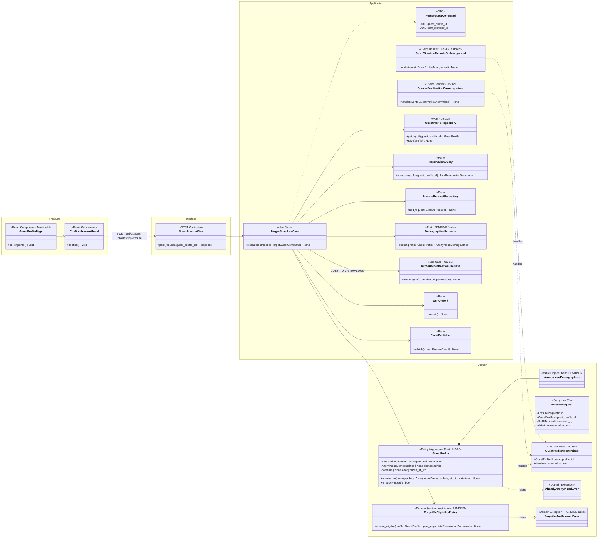
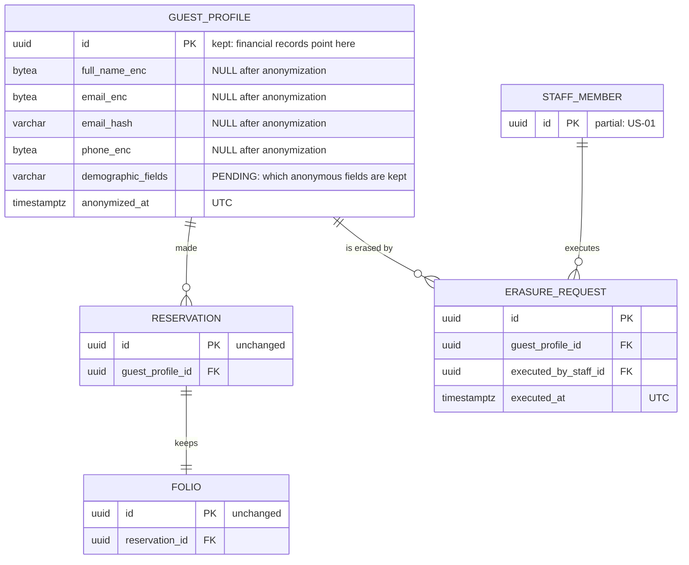
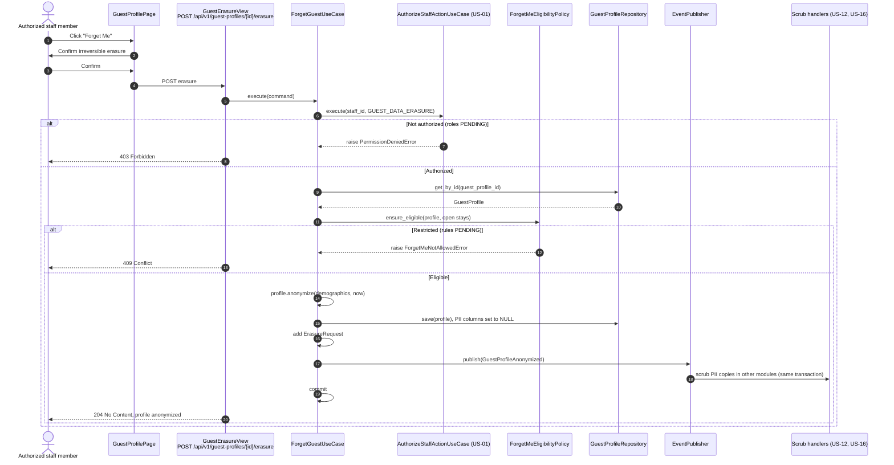
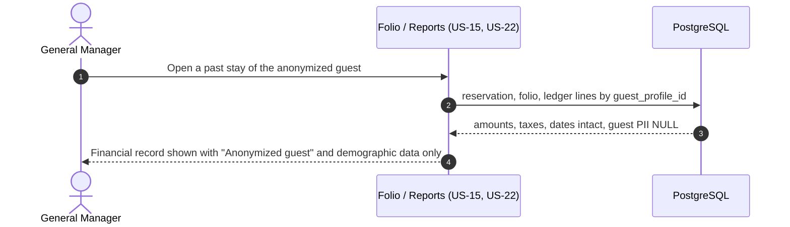

# US-21 — Forget Me (PII Anonymization): Diagrams

> Sources: `US-21-forget-me-pii-anonymization.md`, `US-20-guest-profile-with-pipeda-consent.md`, `docs/Business Modeling/Business Modeling.md` (Section 4 "Strict Security & PIPEDA"), `CLAUDE.md`.
> Elements tagged **PENDING** depend on business rules not defined yet. They are placeholders in the design, not decisions.

---

## 1. Class Diagram (Clean Architecture)

### Design notes
- **`GuestProfile.anonymize()` (Scenario 1):**
  - removes `PersonalInformation` entirely (columns set to `NULL`, not overwritten with fake data);
  - keeps only `AnonymousDemographics` and sets `anonymized_at_utc`;
  - is irreversible, and a second call raises `AlreadyAnonymizedError`.
- **Financial records stay intact (Scenario 2):**
  - reservations, folios, ledger lines and invoices reference the guest only by `guest_profile_id`, which survives anonymization;
  - totals, taxes and the audit trail are therefore unchanged, and the records are now attached to anonymous demographic data.
- **PII copies elsewhere are scrubbed by event handlers.** `GuestProfileAnonymized` notifies modules that may hold guest PII, such as ID verification data (US-12, if stored) and violation reports (US-16, if stored), each in its own handler. The profile module does not need to know about them (Open/Closed principle).
- **`ErasureRequest`** records that an erasure happened, who executed it and when, without any PII. This is evidence of compliance.
- **Confirmation:** the UI asks for an explicit confirmation (`ConfirmErasureModal`) because the action cannot be undone.
- **PENDING:**
  - which roles can execute "Forget Me" (`GUEST_DATA_ERASURE` permission, assignment PENDING);
  - which demographic data is kept (`DemographicsExtractor`);
  - restrictions such as In-House guests or open balances (`ForgetMeEligibilityPolicy`);
  - whether names on already-issued invoices (US-17) must be kept for tax retention or removed, which needs legal review.

---

## 2. ER Diagram (PostgreSQL persistence)

### Design notes
- **Consistency check:** `CHECK (anonymized_at IS NULL OR (full_name_enc IS NULL AND email_enc IS NULL AND email_hash IS NULL AND phone_enc IS NULL))` makes the database guarantee an anonymized profile holds no PII.
- **`ERASURE_REQUEST` contains no PII,** only references and timestamps.
- **Backups:** encrypted backups age out according to the retention policy. The backup retention period itself is PENDING.

---

## 3. Event Flow

### 3.1 Forget Me — Scenario 1

### 3.2 Financial records after anonymization — Scenario 2

### 3.3 Domain events

| Event | Emitted by | When | Payload | Consumers |
|---|---|---|---|---|
| `GuestProfileAnonymized` | `GuestProfile` (via `ForgetGuestUseCase`) | "Forget Me" executed | `guest_profile_id`, `occurred_at_utc` (no PII) | `ScrubIdVerificationOnAnonymized`, `ScrubViolationReportsOnAnonymized` (same transaction) |
