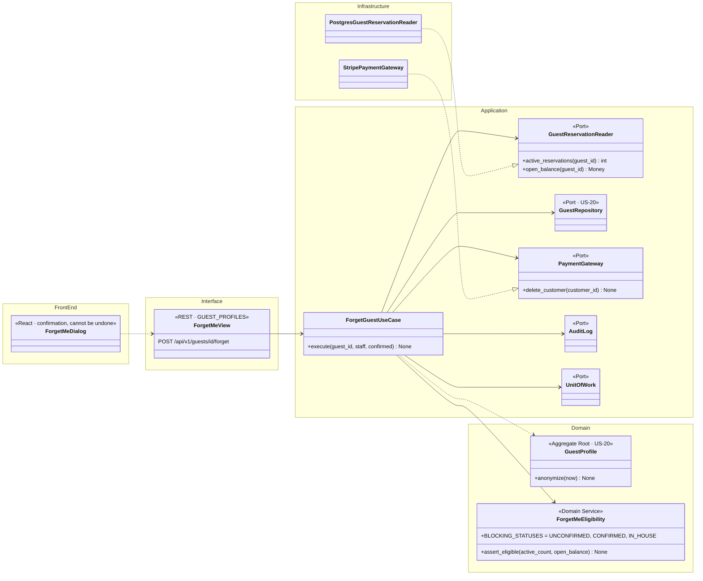
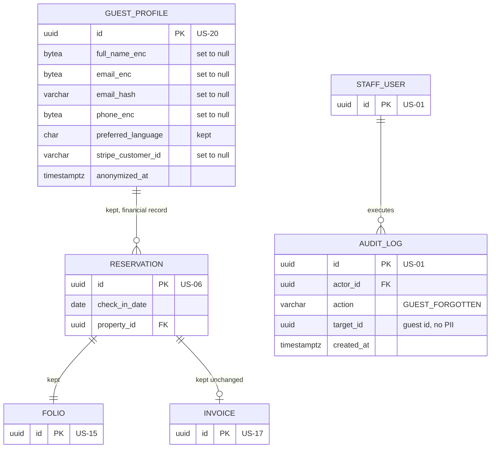
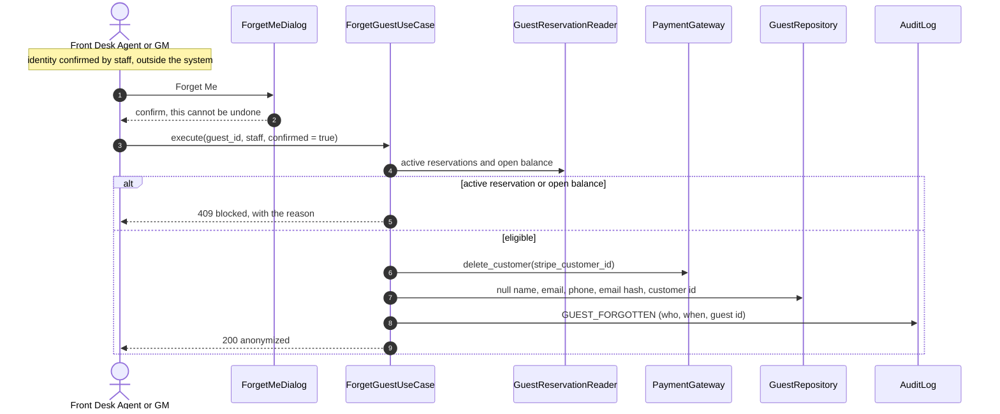

# US-21 — Forget Me (PII Anonymization): Diagrams

> Source: `US-21-forget-me-pii-anonymization.md`. Related: US-01 (permissions), US-06 (Stripe customer), US-15 (financial records), US-17 (invoices), US-20 (profile).

## Business rules reflected

| Rule (US-21) | Where it appears |
|---|---|
| Action in the Guest Profile module | `POST /api/v1/guests/{id}/forget` |
| FDA and GM can execute it | `GUEST_PROFILES` permission |
| Staff verify identity manually; the system does not | No identity-check step in the use case |
| Blocked while the guest has an Unconfirmed, Confirmed or In-House reservation, or an open balance | `ForgetMeEligibility` |
| Keeps only the preferred language and the financial records (dates, property, amounts) | Profile row kept with `preferred_language`; folios and reservations untouched |
| `full_name_enc`, `email_enc`, `phone_enc`, `email_hash` set to null | `GuestProfile.anonymize()` |
| Saved card and customer record at Stripe deleted | `PaymentGateway.delete_customer()` |
| Issued invoices kept unchanged | `INVOICE` rows and PDFs not touched |
| Confirmation required; cannot be undone | Front-end confirmation dialog + `confirm=true` in the request |
| Audit log with who and when, no personal data | `AUDIT_LOG` entry `GUEST_FORGOTTEN` with the guest id only |

---

## 1. Class Diagram (Clean Architecture)

### Design notes
- **Order:** eligibility check → delete the Stripe customer (which also removes its saved cards) → in one transaction, null the four PII columns, clear `stripe_customer_id`, set `anonymized_at`, write the audit entry.
- **Stripe first:** if Stripe fails, nothing is anonymized and the staff member can retry, so the system never loses the customer id while the card still exists at Stripe.
- **Open balance** = any folio of the guest with a balance different from $0.00.
- **Reservations, folios, ledger entries and invoices** keep their foreign key to the anonymized profile, so the financial records (dates, property, amounts) remain intact (Scenario 2). The invoice PDFs already issued are not regenerated.
- **Repeat calls** on an anonymized profile return `409 already anonymized`.

---

## 2. ER Diagram

---

## 3. Event Flow

### 3.1 Forget Me — Scenarios 1 to 3

### 3.2 Domain events

| Event | Raised when | Consumers |
|---|---|---|
| `GuestForgotten` | Anonymization committed | Audit log |
