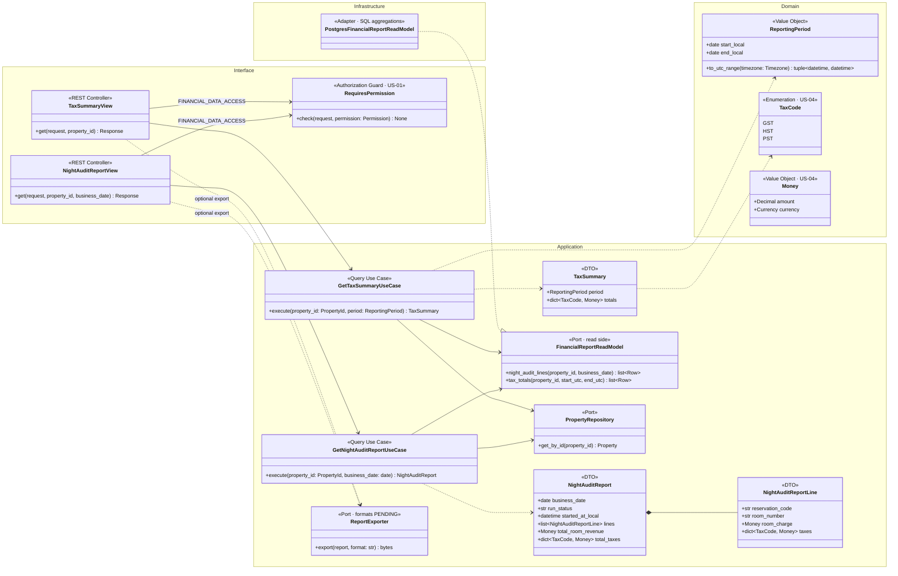
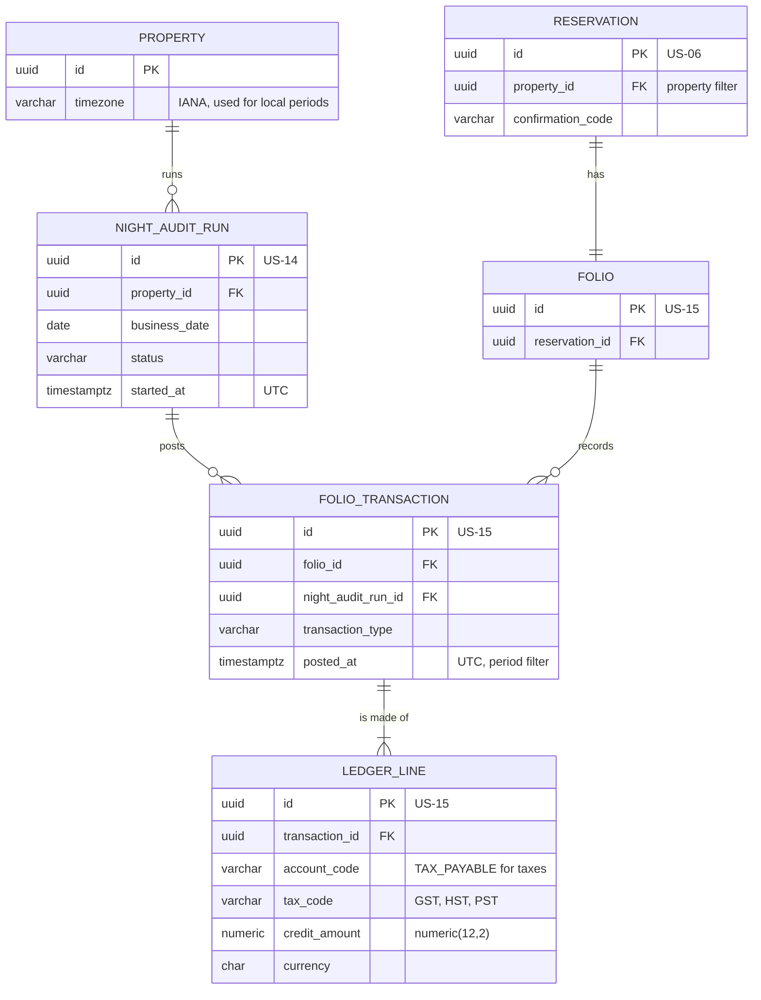
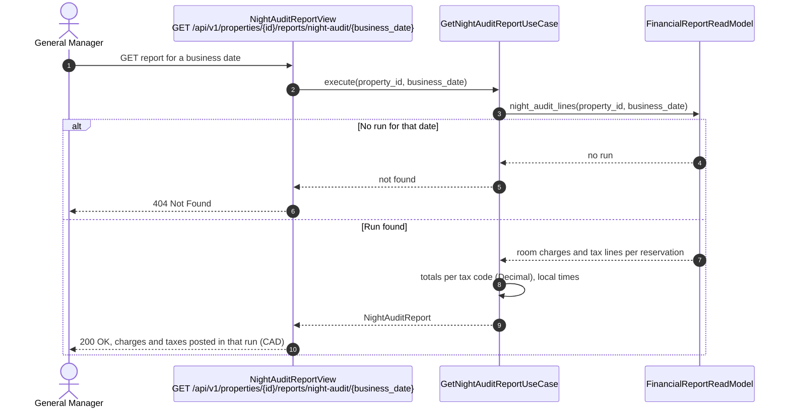
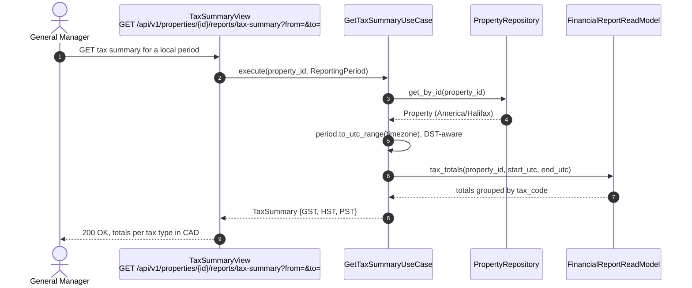

# US-22 — Night Audit and Tax Reports: Diagrams

> Sources: `US-22-night-audit-and-tax-reports.md`, `US-14-night-audit-end-of-day.md`, `US-15-folio-ledger.md`, `US-04-localized-tax-calculation.md`, `docs/Business Modeling/Business Modeling.md` (Personas, Section 4), `CLAUDE.md`.
> Elements tagged **PENDING** depend on business rules not defined yet. They are placeholders in the design, not decisions.
> Reports are generated per **Property** (Business Modeling, Section 5). Whether consolidated reports are needed is PENDING.

---

## 1. Class Diagram (Clean Architecture)

### Design notes
- **Read side only:** reports are queries over data already posted by the Night Audit (US-14) and the folio ledger (US-15). Nothing is recalculated, so the reports always match what was charged.
- **Night Audit report (Scenario 1):** it lists the folio transactions linked to the `NIGHT_AUDIT_RUN` of the property and business date, with room charges and taxes per reservation, plus totals.
- **Tax summary (Scenario 2):**
  - it sums the `TAX_PAYABLE` ledger lines grouped by `tax_code` (GST/HST/PST) for a period;
  - `ReportingPeriod.to_utc_range` converts the local start and end dates to a UTC interval using the property's timezone, because timestamps are stored in UTC;
  - this includes the DST days, which are not 24 hours long.
- **Display:** amounts are shown in CAD as `Money` (`Decimal`) and times in the property's local timezone.
- **Permission:** both endpoints require `FINANCIAL_DATA_ACCESS` (General Manager, US-01).
- **PENDING:**
  - detailed content, layout and export formats (`ReportExporter`);
  - consolidated reports across properties.

---

## 2. ER Diagram (sources of the read model)

### Design notes
- **No new table.** Indexes support the two queries: `FOLIO_TRANSACTION (night_audit_run_id)`, `FOLIO_TRANSACTION (posted_at)` and `LEDGER_LINE (account_code, tax_code)`.
- **Tax corrections:** the tax summary uses `SUM(credit_amount) - SUM(debit_amount)` on `TAX_PAYABLE`, so future reversing entries (corrections, PENDING in US-15) are netted automatically.

---

## 3. Event Flow

### 3.1 Night Audit report — Scenario 1

### 3.2 Tax summary — Scenario 2

### 3.3 Domain events

No domain event is emitted; this story is read-only. It consumes the data produced by `NightAuditCompleted` (US-14) and `ChargePosted` (US-15).
