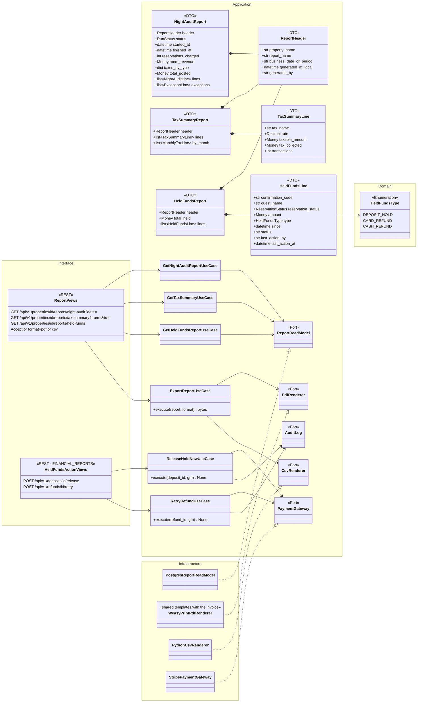
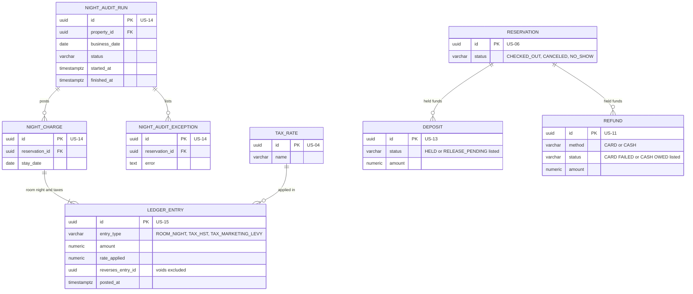
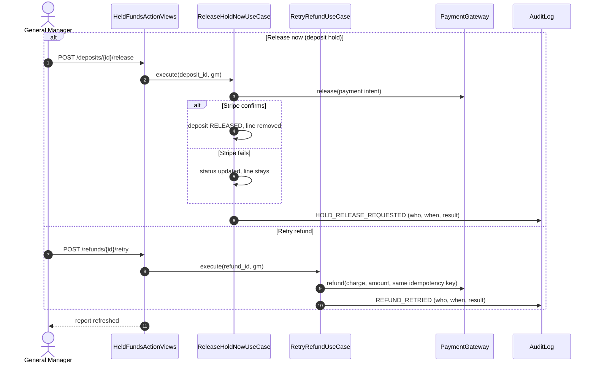
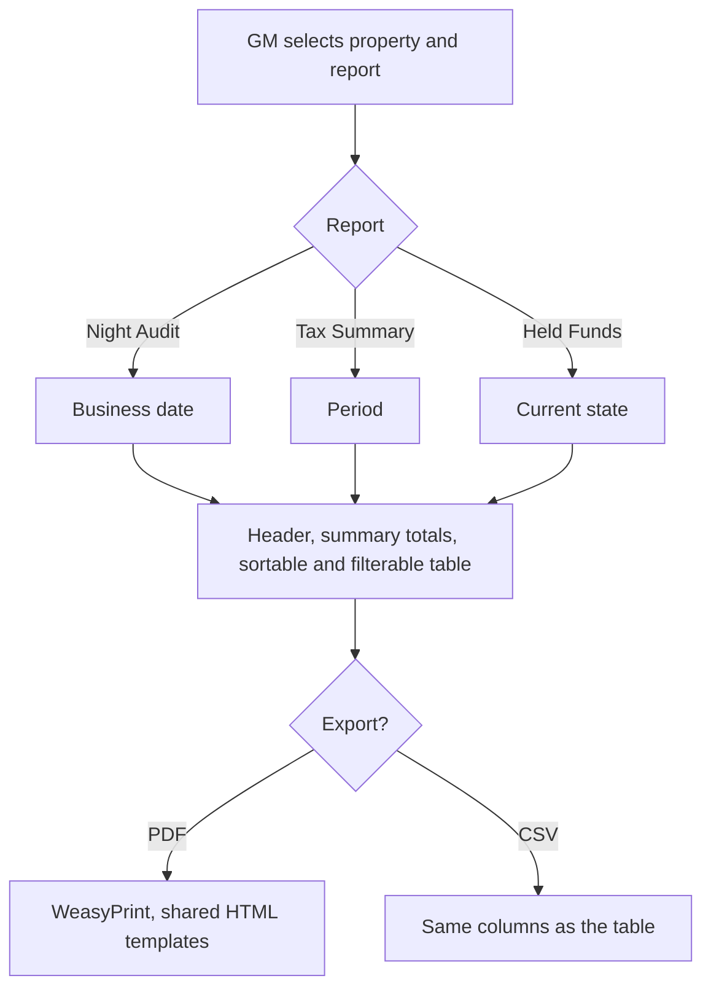

# US-22 — Night Audit, Tax Summary and Held Funds Reports: Diagrams

> Source: `US-22-night-audit-and-tax-reports.md`. Related: US-01 (GM-only reports), US-04 (taxes), US-11 (failed refunds), US-14 (Night Audit runs and exceptions), US-17 (pending hold releases, shared PDF templates), US-23 (same header and export).

## Business rules reflected

| Rule (US-22) | Where it appears |
|---|---|
| Amounts in CAD; dates and times in the property's timezone (stored in UTC) | `ReportFormatter` |
| One property at a time; the GM switches; no combined report | `property_id` in every route |
| Night Audit report content (run status and times, reservations charged, room revenue, taxes per type, total, detail lines, exceptions list) | `NightAuditReport` DTO |
| Tax Summary content (per tax and rate: taxable amount, tax collected, transactions; monthly breakdown for periods over one month); fines and fees not taxed | `TaxSummaryReport` DTO |
| Held Funds report (GM only): Checked-Out, Canceled or No-Show reservations with an unreleased hold, a failed card refund or an owed cash refund | `HeldFundsReadModel` |
| Cash refund lines have no action; they leave the report when paid at the desk (US-11) | `REFUND.method = CASH`, `status = OWED` |
| Held Funds columns: code, guest, reservation status, amount, type, since, status, who acted and when | `HeldFundsLine` DTO |
| "Release now" and "Retry refund" act immediately through Stripe and are audit-logged | `ReleaseHoldNowUseCase`, `RetryRefundUseCase` |
| Common header, summary totals, sortable and filterable detail table | `ReportHeader`, front-end table |
| PDF and CSV export; PDFs with WeasyPrint from HTML templates shared with the invoice | `PdfRenderer`, `CsvRenderer` |

---

## 1. Class Diagram (Clean Architecture)

### Design notes
- **Permissions (US-01 default matrix):** Night Audit report → `NIGHT_AUDIT_REPORT`; Tax Summary and Held Funds → `FINANCIAL_REPORTS`. Both are GM-only by default; Housekeepers can never receive them.
- **Night Audit report** reads `NIGHT_AUDIT_RUN`, its `NIGHT_CHARGE` rows and ledger entries, and `NIGHT_AUDIT_EXCEPTION` (US-14) for one business date.
- **Tax Summary** groups `TAX_*` ledger entries by tax and `rate_applied` for the period (net of voids); the taxable amount is the sum of the `ROOM_NIGHT` amounts (plus the rounded levy for HST, per US-04); the monthly breakdown appears when the period spans more than one month.
- **Held Funds** lists `DEPOSIT` rows with status `HELD` or `RELEASE_PENDING` on reservations that are `CHECKED_OUT`, `CANCELED` or `NO_SHOW`, plus `REFUND` rows with method `CARD` and status `FAILED`, and rows with method `CASH` and status `OWED` (no action button; they disappear when a Front Desk Agent or the GM pays the guest at the desk, US-11). "Since" is the check-out or failure time. "Release now" and "Retry refund" call Stripe immediately; success clears the line, failure updates its status; both write an audit entry.
- **Guest name** is decrypted for display; anonymized guests (US-21) show a placeholder such as "Anonymized guest".
- **Exports** use the same DTO: CSV for the table, PDF through the shared HTML templates and WeasyPrint. Exports are excluded from the 1.5 s performance rule (US-10).

---

## 2. ER Diagram (sources of the read model)

---

## 3. Event Flow

### 3.1 Held Funds actions — Scenarios 3 and 4

### 3.2 Viewing and exporting — Scenarios 1, 2 and 5

### 3.3 Domain events

| Event | Raised when | Consumers |
|---|---|---|
| `HoldReleaseRequested` | GM presses "Release now" | Audit log |
| `RefundRetried` | GM presses "Retry refund" | Audit log |
