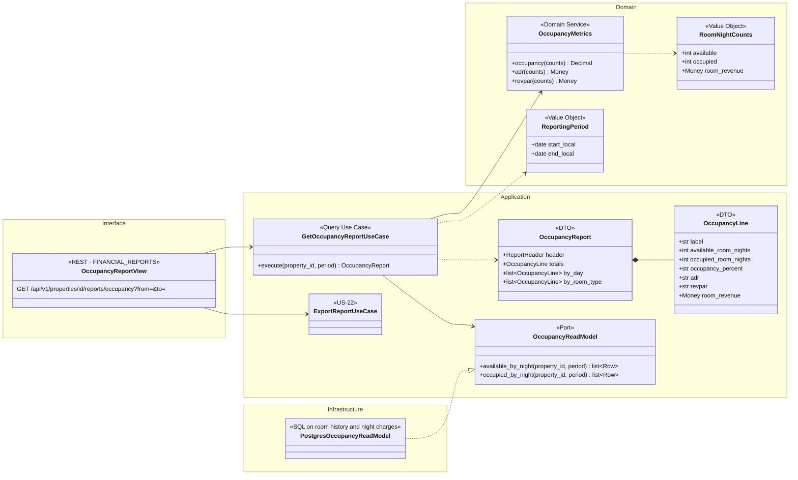
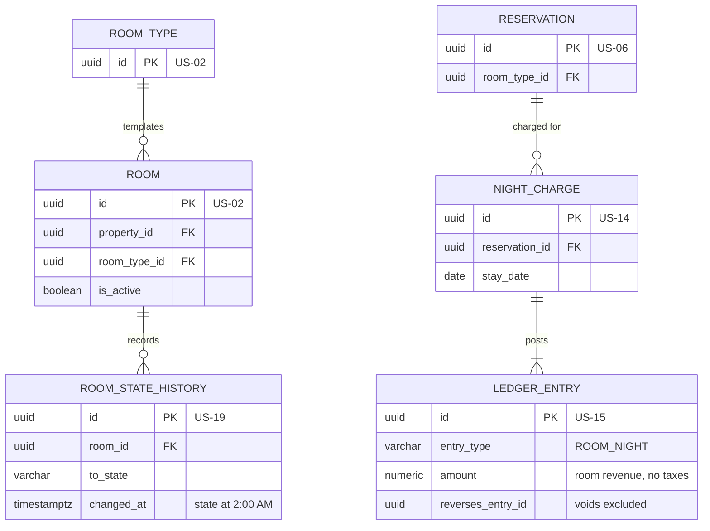
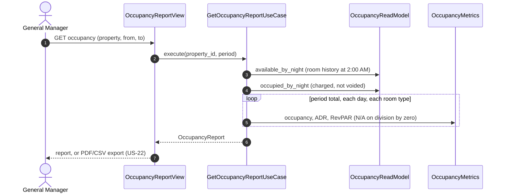

# US-23 — Occupancy Reporting: Diagrams

> Source: `US-23-occupancy-reporting.md`. Related: US-14 (nights charged), US-15 (voids), US-19 (room state history), US-22 (header and export).

## Business rules reflected

| Rule (US-23) | Where it appears |
|---|---|
| Occupancy % = occupied ÷ available room-nights × 100, 1 decimal | `OccupancyMetrics.occupancy()` |
| Available room-nights per night: active rooms minus rooms Unavailable or Maintenance at the 2:00 AM Night Audit (from room history) | `AvailableRoomNightsQuery` on `ROOM_STATE_HISTORY` |
| Occupied room-nights: nights charged by the Night Audit, excluding voids; No-Show and Canceled not counted | `NIGHT_CHARGE` + non-voided `ROOM_NIGHT` entries |
| ADR = room revenue ÷ occupied room-nights | `OccupancyMetrics.adr()` |
| RevPAR = room revenue ÷ available room-nights | `OccupancyMetrics.revpar()` |
| Revenue excludes taxes; CAD; rounded to the cent, halves up | `ROOM_NIGHT` entries only; `Money.round_half_up()` |
| "N/A" when there is nothing to divide by | `Optional` result → "N/A" |
| Any date range; totals, daily breakdown and by room type | `OccupancyReport` DTO |
| No dynamic pricing | Read-only report |
| GM only, one property at a time, same header and PDF/CSV export as US-22 | `FINANCIAL_REPORTS`, `ReportHeader`, `ExportReportUseCase` |

---

## 1. Class Diagram (Clean Architecture)

### Design notes
- **Available room-nights** for night *N*: rooms that are active, minus rooms whose state at the moment of that night's Night Audit (2:00 AM local on *N* + 1, from `ROOM_STATE_HISTORY`) was `UNAVAILABLE` or `MAINTENANCE`.
- **Occupied room-nights** for night *N*: `NIGHT_CHARGE` rows with `stay_date = N` whose `ROOM_NIGHT` entry has not been voided. No-Show and Canceled reservations are never charged by the audit, so they are naturally excluded.
- **Room revenue:** sum of non-voided `ROOM_NIGHT` amounts (no taxes).
- **Verified example (Scenario 2):** 20 active rooms, 2 in Maintenance → 18 available; 9 occupied; $900.00 → occupancy 50.0%, ADR $100.00, RevPAR $50.00.
- **Division by zero:** if available or occupied room-nights are 0, the corresponding value is "N/A".
- **By room type:** the same counts grouped by the room type of the room (available) and of the reservation (occupied).

---

## 2. ER Diagram (sources of the read model)

---

## 3. Event Flow

### 3.1 Generating the report — Scenarios 1 to 4

### 3.2 Domain events

None. The report is read-only.
