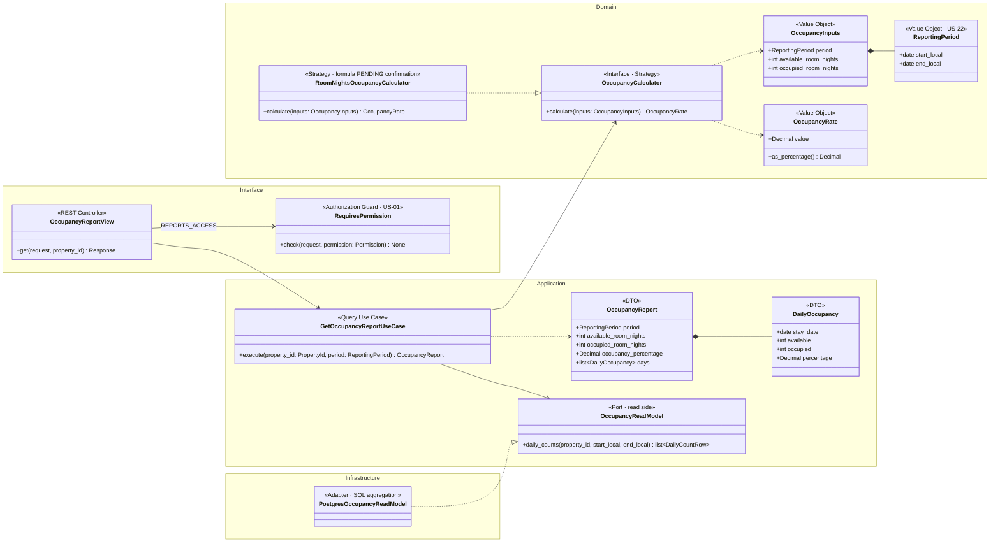
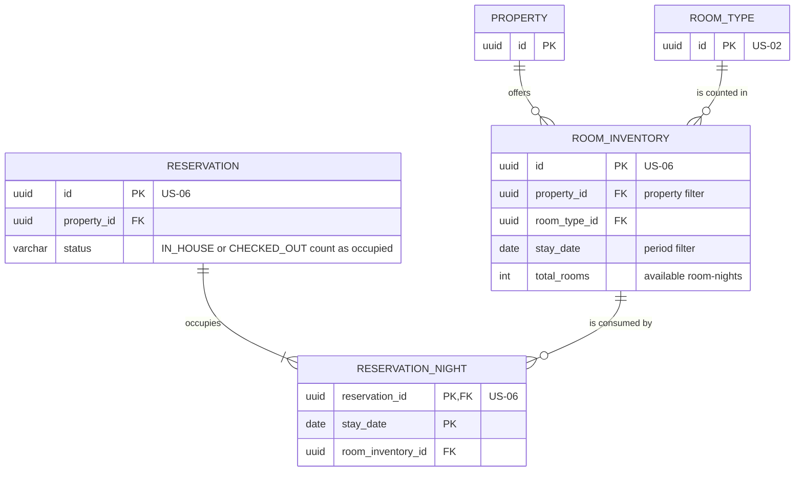
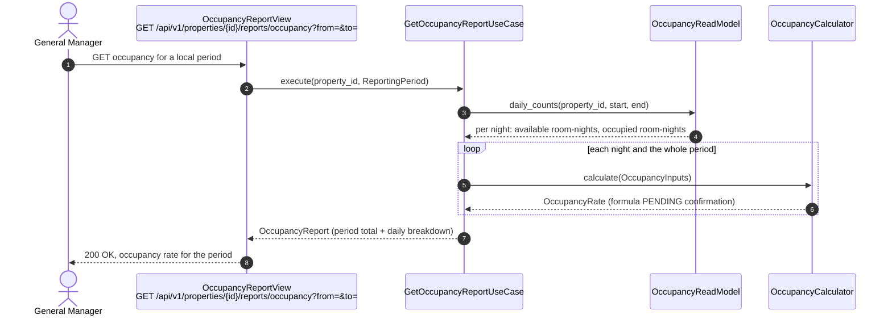

# US-23 — Occupancy Reporting: Diagrams

> Sources: `US-23-occupancy-reporting.md`, `US-06-reservation-creation-with-secure-card-tokenization.md`, `docs/Business Modeling/Business Modeling.md` (Personas: "yield management, occupancy rates"), `CLAUDE.md`.
> Elements tagged **PENDING** depend on business rules not defined yet. They are placeholders in the design, not decisions.
> Reports are generated per **Property** (Business Modeling, Section 5). Whether a consolidated view is needed is PENDING.

---

## 1. Class Diagram (Clean Architecture)

### Design notes
- **The formula is PENDING, so it sits behind the `OccupancyCalculator` strategy (Open/Closed principle).**
  - `RoomNightsOccupancyCalculator` uses the industry-standard *occupied room-nights ÷ available room-nights*, and is a placeholder until the business confirms the formula.
  - Other indicators, such as ADR or RevPAR, if requested, become new strategies or report fields without changing the use case.
- **Inputs per night:**
  - **available room-nights:** `ROOM_INVENTORY.total_rooms` per room type and night (US-06);
  - **occupied room-nights:** `RESERVATION_NIGHT` rows of reservations that were actually stayed (`IN_HOUSE` or `CHECKED_OUT`);
  - whether Out-of-Order rooms reduce the available count depends on US-19 states that are still PENDING.
- **Precision:** the rate is `Decimal`, and the period is in the property's local dates (stay nights are local calendar dates).
- **Permission:** `REPORTS_ACCESS` (General Manager, US-01).
- **PENDING:**
  - the occupancy formula and other yield indicators (ADR, RevPAR);
  - whether yield management includes dynamic pricing or only reporting;
  - a consolidated view across properties.

---

## 2. ER Diagram (sources of the read model)

### Design notes
- **No new table.** One aggregation query groups `ROOM_INVENTORY` and the matching `RESERVATION_NIGHT` rows by `stay_date` for the property and period.
- **Index:** `ROOM_INVENTORY (property_id, stay_date)` supports the period filter.

---

## 3. Event Flow

### 3.1 Generating the occupancy report — Scenario 1

### 3.2 Domain events

No domain event is emitted; this story is read-only. It reads the inventory and reservation nights maintained by US-06 and the lifecycle states set by US-11, US-13 and US-17.
