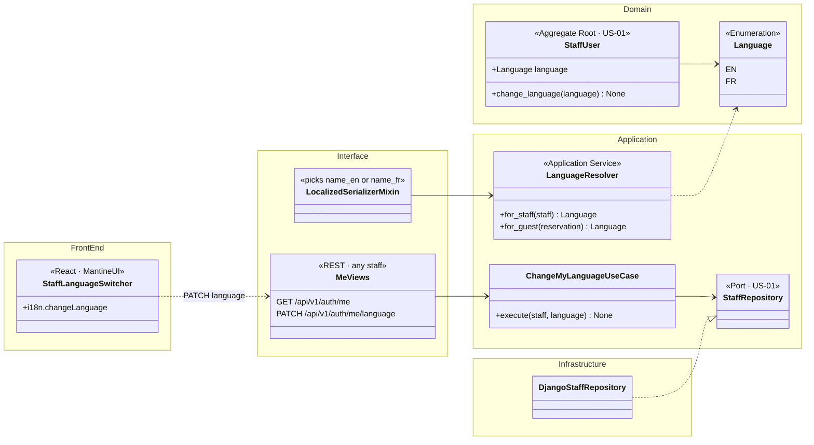
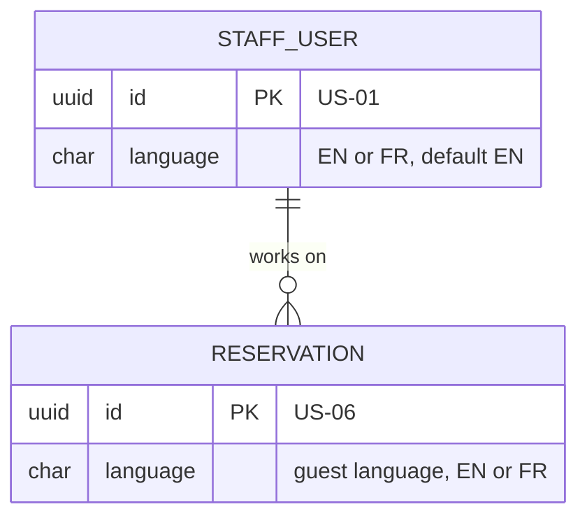
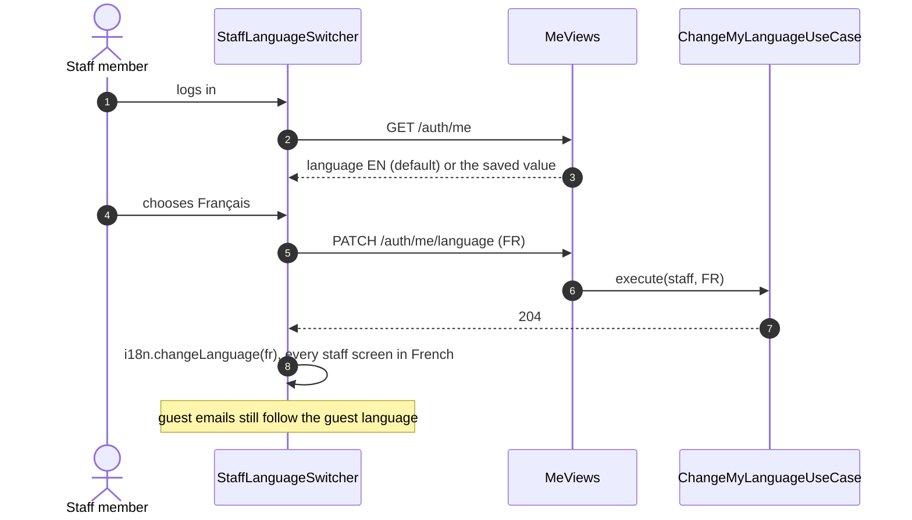

# US-24 — Staff Interface Language: Diagrams

> Source: `US-24-staff-interface-language.md`. Related: US-01 (staff accounts, password reset email), US-14 (developer email in English), US-22 and US-23 (report exports). Technical setup: `docs/Tech Spec/Techinal Specs.md`, section 4.

## Business rules reflected

| Rule (US-24) | Where it appears |
|---|---|
| Only EN and FR | `Language` enum |
| Saved on each staff account; default EN | `STAFF_USER.language` default `EN` |
| Staff member changes their own; GM sets it when creating or editing an account | `ChangeMyLanguageUseCase`, `CreateStaffAccountUseCase` / `UpdateStaffAccountUseCase` (US-01) |
| Applies to all staff screens, system messages and staff emails | `GET /auth/me` returns `language`; front end calls `i18n.changeLanguage()`; `Notifier` uses the staff language |
| Report exports use the exporting staff member's language | `ExportReportUseCase(language)` (US-22) |
| Bilingual content entered by the GM is shown in the staff language | Serializers pick `*_en` or `*_fr` from the request user's language |
| Guest-facing content always follows the guest's language | Guest notifications and invoices use `RESERVATION.language` |
| Developer warning email always in English | `DeveloperAlert` (US-14) has no language parameter |

---

## 1. Class Diagram (Clean Architecture)

### Design notes
- **One source of truth:** the language lives on the staff account, so it follows the user to any device (Scenario 2). The front end reads it from `GET /api/v1/auth/me` at login and switches i18next immediately after `PATCH`.
- **Two resolvers, never mixed:** `LanguageResolver.for_staff()` drives staff screens, staff emails and report exports; `for_guest()` drives guest emails, the booking widget and invoices (Scenario 4).
- **Bilingual data** (room type names, descriptions, fine names) is returned in the staff member's language by the serializers; settings forms still show both fields for editing.

---

## 2. ER Diagram

---

## 3. Event Flow

### 3.1 Changing the language — Scenarios 1 to 4

### 3.2 Domain events

| Event | Raised when | Consumers |
|---|---|---|
| `StaffLanguageChanged` | Staff member or GM changes the language | — |
